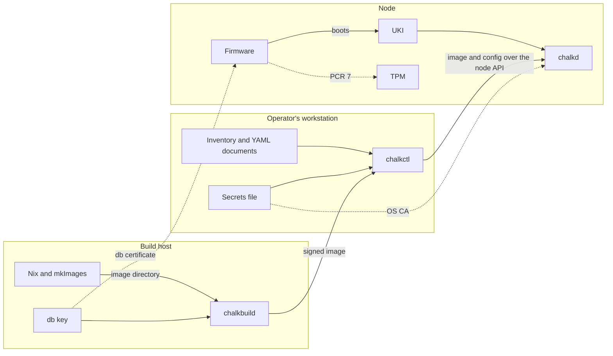
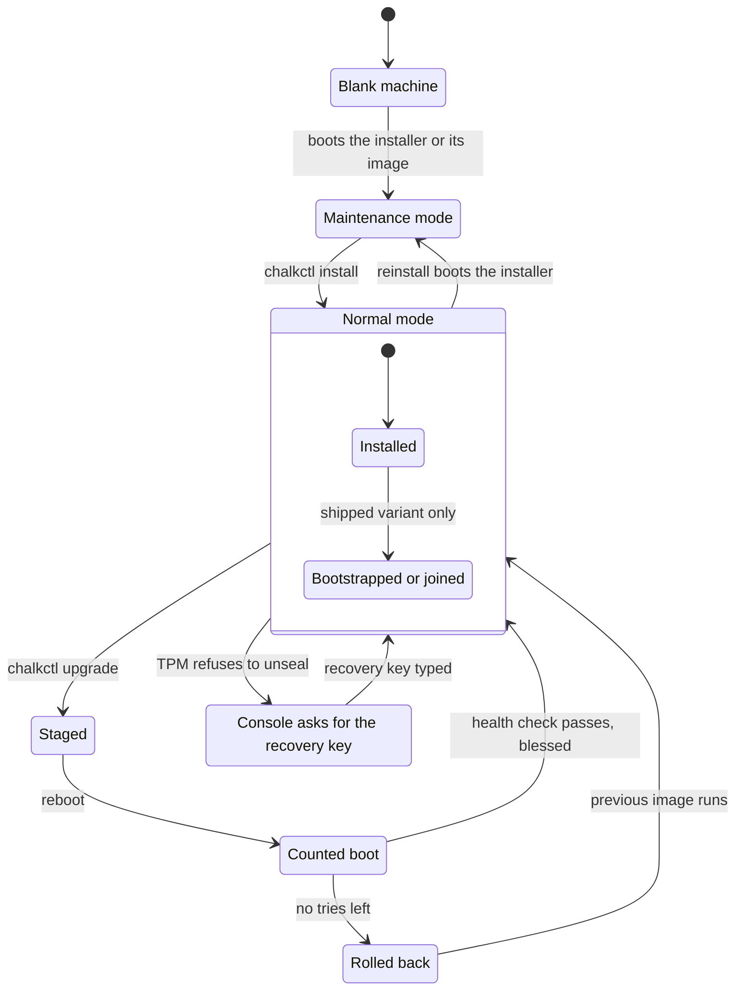

# How a node works

chalkos is an operating system for servers, which Nix builds as read-only images.
Each node boots a signed image, takes its settings from YAML documents and is reached only
through its agent, chalkd. An upgrade replaces the whole image, and a node that does not come up
healthy on the new image falls back to the old one.

## Three machines take part

The build host builds and signs the images, the operator's workstation drives the nodes, and the
node runs an image. The build host and the workstation can be one machine. In the diagram, a solid
edge carries data and a dashed edge carries trust.

The three trust edges are the anchors of a node:

- The firmware boots only binaries that a certificate in its db signed. The operator enrols the db
  certificate before the first boot.
- chalkd accepts only clients whose certificate chains to the OS CA. The image can carry the OS
  CA, and the install puts it on the node's disk.
- The TPM seals the disk keys to PCR 7, the measurement of the Secure Boot state. The keys unseal
  only while the firmware boots under the same keys.

chalkctl reads only the inventory, the YAML documents, the secrets file and the image
directories, so a machine without Nix, an airgapped one included, can drive the nodes.
[Architecture](architecture.md) names the parts of a node and where each one runs.
[Security model](security.md) explains each trust anchor.

## A node passes through stages

A machine starts blank and becomes a node at its install. From then on it stays in normal mode,
through upgrades and recoveries, until a reinstall. The state diagram shows these stages.

The sections below follow these stages in order. Each one links the page that explains it.

## Nix builds an image and chalkbuild signs it

A flake calls `chalkos.lib.mkImages`, which builds one image directory per variant and
platform. The image directory holds an unsigned raw disk image and the JSON Schemas of the config
the image accepts. chalkbuild then signs a copy of the image directory on the
machine that holds the db key, so the key never enters `/nix/store`. Every file of the store is
covered by the signature, because the signed UKI carries the store's root hash and dm-verity
checks every read against it. [The image](image.md) describes what an image holds.

## An install turns a machine in maintenance mode into a node

A machine reaches maintenance mode when it boots the installer or a node's image written straight
to its disk. [Architecture](architecture.md#maintenance-mode-serves-a-node-that-is-not-installed)
describes both ways and the two modes. `chalkctl install` checks the fingerprint chalkd prints on
the console, as
[A node in maintenance mode is trusted by its fingerprint](security.md#a-node-in-maintenance-mode-is-trusted-by-its-fingerprint)
explains. It sends the node its config, its certificates and its share of the secrets. A machine
that runs the installer also receives the image the inventory names for it. chalkd lays out the
disk, seals STATE to the TPM and marks the node installed. The node then reboots into normal mode.

## The firmware checks the image and the TPM unlocks the disks

At every boot, the firmware checks the signatures of systemd-boot and the UKI against its db and
dbx. The initrd unseals STATE and VAR with the TPM and mounts them. The node's config on STATE is
applied before the network comes up, and chalkd starts in normal mode with the node certificate
from STATE. [Boot, health and rollback](boot-and-rollback.md) follows the boot chain.
[Storage and encryption](storage.md) explains STATE, VAR and the unlock.

!!! note "On the shipped variant, the nodes form a Kubernetes cluster after their first boot"

    `chalkctl bootstrap` starts etcd and the control plane on the first control plane, once per
    cluster. Further control planes and workers join on their own.
    [The control plane](../kubernetes/control-plane.md) describes the bootstrap and the joins.

## YAML documents configure the node without a reboot

Everything that differs between nodes is config: YAML documents of kinds such as `Host`,
`Network` and `SystemDisk`. The inventory says which documents each node gets.
`chalkctl apply-config` delivers them to a running node. chalkd checks them against the schemas
and change rules of the image the node runs, keeps them on STATE and restarts only the services
whose config changed. The node refuses a change that the image's rules forbid, such as a
storage change that would destroy data.
[Config and the inventory](config.md) describes the documents, and
[The config pipeline](config-pipeline.md) follows a delivery through the node.

## chalkd carries out every operation

A node has no login shell. Status, logs, reboots, config, upgrades, etcd membership and rotations
all go through the node API that chalkd serves on port 50000. Every call carries a client
certificate, and its role (reader, operator or admin) decides which methods it may call. chalkctl
signs itself a short-lived admin certificate from the secrets file, or uses a client file that
holds a certificate of one role. [Security model](security.md) explains the roles, and
[Roles and credentials](../../reference/access.md) lists who may call what.

## An upgrade writes the inactive slot and boots it on trial

A disk holds two slots for the store, A and B. `chalkctl upgrade` streams a new image to the node,
or has the node pull it from a registry, and sends the node's config with it. chalkd writes the
image into the inactive slot and checks the config against the new image's schemas. It then
installs the image's UKI with a count of boot tries, 3 by default. The node reboots into the new
image, and a health check decides within 300 seconds by default whether the boot is good. A good
boot blesses the new image, and the node keeps it from then on. [Upgrades](upgrades.md) explains
an upgrade from the image to the bless.

## A node rolls back on its own and recovers at the console

A node that fails its health check reboots and tries again. Once its tries are used up,
systemd-boot boots the previous image, whose slot the upgrade never touched. The node records why
the boot failed, and `chalkctl status` reports it. `chalkctl upgrade` stops at the first node that
rolls back.

A different failure stops the boot before chalkd runs. When PCR 7 changed, for example after a
change of the Secure Boot keys, the TPM releases no key, and the console asks for the node's
recovery key. `chalkctl recovery-key` derives it from the secrets file. A node that nothing
recovers is reinstalled from the installer.
[Boot, health and rollback](boot-and-rollback.md) explains the rollback, and
[Storage and encryption](storage.md) explains the unlock with the recovery key.

## Rotation replaces a CA across the cluster

A certificate stays valid until it expires or its CA is removed, so removing the CA is how
access is revoked. `chalkctl rotate` replaces a CA or key across the cluster in four phases. Each
node confirms a phase before the next one starts, so no node ever presents a certificate that
another node does not trust yet. Renewal needs no rotation: it issues a node a new certificate
from the same CA before the old one expires. [Certificates](certificates.md) explains renewal,
rotation and revocation.

!!! note "On the shipped variant, chalkctl node revoke shuts out one node"

    A revoked node's certificates renew no more, and the API server denies its kubelet every
    write.
    [Revoking a node cuts off its writes and renewals](../kubernetes/certificates.md#revoking-a-node-cuts-off-its-writes-and-renewals)
    lists what revocation leaves open.

## What chalkos does not do

- A node has no SSH server, no passwords and no interactive accounts, as
  [Nobody logs in to a node](security.md#nobody-logs-in-to-a-node) explains. Logs come through the
  node API.
- A node has no Nix and no package manager. Its store is read-only, and new software means a new
  image.
- There is no update server. An install or an upgrade starts only when chalkctl starts it, and a
  node pulls from a registry only when chalkctl tells it to.
- chalkos does not enrol Secure Boot keys, and installing does not check that Secure Boot is on.
  The [Security model's limits](security.md#limits) say who enrols them.
- chalkctl never builds or signs images and never runs Nix.
- Nothing revokes a single client certificate or kubeconfig. One works until it expires or its CA
  is rotated out, as
  [Access is revoked by rotating its CA](certificates.md#access-is-revoked-by-rotating-its-ca)
  explains. On the shipped variant, `chalkctl node revoke` shuts out a node's writes and renewals
  by name.
