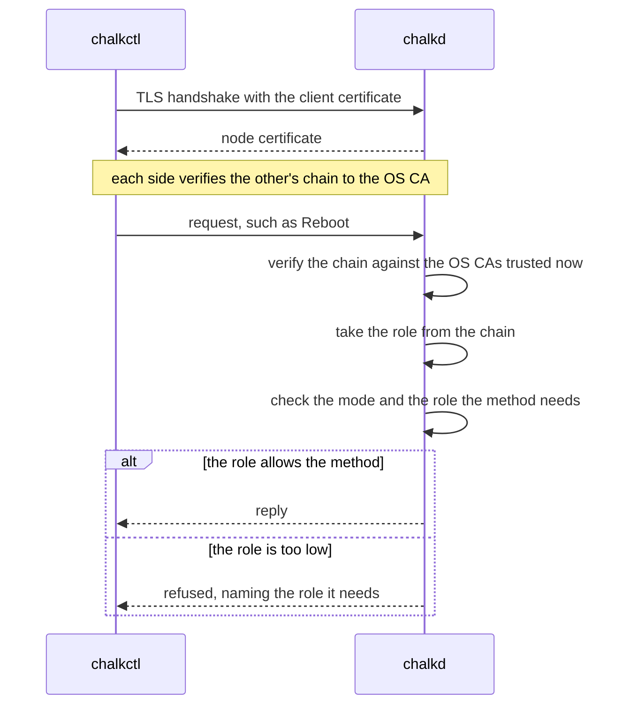

# Security model

A reader client file can read a node's status and logs, and nothing else. When its holder tries
to reboot the node, chalkd refuses the call and names the role it needs:

```text
/chalkos.node.v1.NodeService/Reboot needs the operator role
```

chalkos protects three things: the code a node boots, the secrets a node keeps on its disks, and
the API through which a node is installed and operated. Secure Boot and dm-verity cover the code,
the TPM covers the disks, and mutual TLS with the cluster's own certificate authority covers the
API. [Chain of trust](trust.md) follows the three from the firmware to the API in one picture, and
compares bare metal with virtual machines.

## A node trusts three anchors

A node's trust rests on these anchors:

| Anchor | Where it lives | What it vouches for |
| --- | --- | --- |
| The db signing certificate | The firmware's db | systemd-boot and the UKI, and through the UKI the whole store |
| The OS CA | The secrets file; its certificate is in every image built with `osCA` | Every node certificate and client certificate of the node API |
| The TPM | The machine | That the node booted under the same Secure Boot state it was installed under |

The db key and the OS CA's key never reach a node. Control planes hold the node CA, an
intermediate of the OS CA that may issue only node certificates.
[Certificates](certificates.md) describes what each CA issues.

!!! note "With the Kubernetes layer, the Kubernetes CAs are anchors too"

    The Kubernetes, front-proxy, etcd and kubelet serving CAs live in the secrets file, and a
    control plane holds them in its Kubernetes share. They vouch for the control plane's
    certificates, the kubelets' and admin kubeconfigs. Control planes hold their keys and issue
    their own certificates with them, as [Kubernetes certificates](../kubernetes/certificates.md)
    describes.

## Secure Boot limits a node to images the key holder signed

Secure Boot makes the firmware refuse a boot binary that no certificate in db signed. chalkos signs
two binaries per image, systemd-boot and the UKI. The UKI's signature reaches every file of the
store through the root hash on its kernel command line, as
[dm-verity ties every block of the store to the UKI](image.md#dm-verity-ties-every-block-of-the-store-to-the-uki)
explains. Changing one byte of the store requires a new root hash, a new UKI and the db
key. chalkd checks each UKI against db and dbx before it writes it, as
[The UKI is checked against db and dbx before anything runs it](image.md#the-uki-is-checked-against-db-and-dbx-before-anything-runs-it)
describes, so a node never reboots into an image its firmware would refuse.

Images are built unsigned by Nix and signed afterwards with
[`chalkbuild sign`](../../reference/cli/chalkbuild_sign.md), on the machine that holds the db key.
Keeping the key out of the build keeps it out of `/nix/store`, which any user of the build machine
can read, and out of every binary cache the store is pushed to. Nodes never hold the db key and
never sign anything.

Secure Boot also decides what the operator role can install. A node checks that an image is built
for its platform and that its UKI boots the store it carries, but it cannot tell an image the
cluster's owners built from one somebody else built. Without Secure Boot, anyone with an operator
certificate can install an image of their own and run it as root, with STATE and VAR unlocked,
because their keys are sealed to PCR 7 alone. With Secure Boot enforced, an operator can roll out
only what the key holder signed. An operator's upgrade carries no config, as
[Operator upgrades carry no config](upgrades.md#operator-upgrades-carry-no-config) explains, so an
operator cannot change a node's networks, volumes or `Addon` documents through an upgrade either.

## The TPM ties the disks to the Secure Boot state

STATE, VAR and encrypted volumes are LUKS2 volumes whose key the TPM seals to PCR 7, which measures
the Secure Boot state. The TPM releases the key only under the state the node was installed under,
so a disk taken out of the machine, or booted with other Secure Boot keys, stays locked. The console
then asks for the volume's fallback: the node's recovery key by default, or a password.
[The TPM seals the disk keys to PCR 7](storage.md#the-tpm-seals-the-disk-keys-to-pcr-7) explains
the choice of PCR 7, and
[A changed PCR 7 sends the unlock to the console](storage.md#a-changed-pcr-7-sends-the-unlock-to-the-console)
lists what changes it.

## chalkd checks the role of every request

chalkd serves the [node API](../../reference/api.md) on TCP port 50000 with TLS 1.3. On an installed
node, in normal mode, it serves its node certificate and accepts only clients whose certificate
chains to an OS CA the node trusts. It verifies the client's chain again for every request, against
the OS CAs it trusts at that moment. A client whose certificate expired, or whose OS CA a rotation
removed, loses access on its next call, even on a connection it keeps open.

The diagram shows one call from chalkctl with a client file.



A client's role comes from its certificate. A certificate the OS CA issued directly grants the role
its Organization names: reader, operator or admin. Each allows what the one before it allows, and
more. A certificate whose chain passes through the node CA has the role `node`, whatever its
Organization says, because the node CA is the only intermediate the OS CA issues. `node` allows
renewing the node certificate on a control plane and nothing else, so a control plane, which holds
the node CA, cannot issue itself an admin certificate.
[Roles and credentials](../../reference/access.md) lists the role each method needs.

Two methods need the admin role for what they reveal or carry. Config names a node's networks,
volumes and `Addon` documents, and a control plane applies the objects of `Addon` documents to the
cluster. So an Upgrade that carries config or a fallback secret needs the admin role, as
ApplyConfig does: config an operator may not deliver to the running image it may not deliver with
the next one either. GetConfig returns a node's whole config with its secret values hashed, and
needs the admin role too: whoever holds the hash of a weak Secret value can test guesses of it.

A reader sees config values elsewhere. Status reports why the node's config failed, and the
journal, which the Logs method serves to readers, holds the refusals chalkd logs and what a
renderer, a check or a command fact that failed wrote to standard error. Each of them may quote
the config. No Secret value reaches either: renderers, checks, validators, rules and command facts
read every Secret value hashed. Of a command fact that reads the fallback secret, chalkd logs how
many bytes it wrote to standard error and nothing of what it wrote.

chalkd serves the same API a second time to the console on the machine's screen, through the
socket `/run/chalkd/console.sock` without TLS. The socket and its directory belong to root, and
only root may open them. A call on the socket carries no certificate and no role. Each method
says instead whether the console may call it, and chalkd refuses the others, as in
`the console may not call /chalkos.node.v1.NodeService/Install`.
[The console acts for whoever sits at the machine](#the-console-acts-for-whoever-sits-at-the-machine)
explains what that gives.

## Clients authenticate with the secrets file or a client file

chalkctl authenticates with one of two credentials.

The secrets file holds every CA key of the cluster. A command that reads it issues itself an admin
certificate from the OS CA, valid for one hour and never written to disk, so using the secrets file
leaves no admin certificate behind. The file is `secrets.age`, encrypted with age to the recipients
given to [`chalkctl gen secrets`](../../reference/cli/chalkctl_gen_secrets.md): age keys, SSH keys or
age plugin recipients such as hardware tokens. With `--plaintext` it is `secrets.json`, for a file
protected by other means. chalkctl reads it only where `--secrets` names it. `--secrets -` reads it
from standard input, encrypted or not, for example from a password manager, so a plaintext copy
never touches the disk. `chalkctl gen secrets --out - --public-out secrets.pub.json` writes a new one
to standard output for such a manager, and its public half to `secrets.pub.json`:

```sh
chalkctl gen secrets --recipient=<age-public-key>
```

A client file holds one certificate of one role, its key and the OS CA certificates. It lets
someone operate the cluster without the secrets file, limited to the role.
[`chalkctl client new`](../../reference/cli/chalkctl_client_new.md) issues it, valid for 30 days for
an admin, 90 days for an operator and a year for a reader unless `--ttl` says otherwise, and
writes it to `~/.config/chalkos/config` with mode 0600:

```sh
chalkctl client new --name=grafana --role=reader --ttl=720h --out=grafana.json
```

A client file names no cluster. Its OS CA ties it to one: a node of another cluster serves a
certificate that the file's OS CA does not verify, and refuses the file's certificate. The TLS
handshake fails and chalkctl says `the node does not accept this client file, <path>; is it another
cluster's?`. A client file issued before an OS CA rotation fails the same way later in the
rotation.

Installing nodes, `config apply`, issuing kubeconfigs and rotations need the secrets file, because
they issue certificates or deliver keys. Other commands take either credential, in the order
[Where chalkctl finds its credentials](../../reference/access.md#where-chalkctl-finds-its-credentials)
lists.

## A node's access ends with its certificate

A node's certificate stays valid until it expires or its CA is rotated out, and no node keeps a
list of revoked nodes. On a cluster without Kubernetes, a node renews its certificate only through
`chalkctl node renew`, so not renewing it is how it is revoked. `chalkctl rotate os-ca` cuts it off
at once.

Control planes hold the node CA's key on their disks. A former control plane, or a stolen copy of
its disk, can still issue node certificates until a rotation of `os-ca` retires that node CA.

!!! note "With the Kubernetes layer, chalkctl node revoke shuts out a node by name"

    `chalkctl node revoke` adds the node's name to a list in the cluster's Kubernetes API. Control
    planes then refuse to renew its certificates, and the API server denies its kubelet every
    write.
    [Revoking a node cuts off its writes and renewals](../kubernetes/certificates.md#revoking-a-node-cuts-off-its-writes-and-renewals)
    explains the mechanism and what it leaves open.

## A node in maintenance mode is trusted by its fingerprint

A node that is not installed runs chalkd in maintenance mode. It has no node certificate yet, so it
serves a self-signed one and prints the certificate's SHA-256 fingerprint and the node's addresses
on its serial console:

```text
chalkd: maintenance mode, accepting clients of the OS CA; certificate fingerprint <fingerprint>
chalkd: addresses <addresses>; certificate fingerprint <fingerprint>
```

The header of the console on the machine's screen keeps both on screen.

chalkctl verifies the node in one of two ways:

```sh
chalkctl install <node> --secrets=secrets.age --fingerprint=<fingerprint>
chalkctl install <node> --secrets=secrets.age --insecure
```

With `--fingerprint`, chalkctl compares the certificate with the fingerprint read off the console
before it sends anything. With `--insecure`, it accepts whatever certificate the node presents and
prints its fingerprint, which the operator compares with the console afterwards: trust on first
use. chalkctl then opens a second connection pinned to that fingerprint and sends the secrets over
it. Only the machine whose fingerprint was printed receives the config, the node certificate and
the Kubernetes share. Every command that reaches a node in maintenance mode accepts `--insecure`.

The node in turn decides whom it accepts. The images and the installer of an mkImages call with
[`osCA`](../../reference/mkimages.md#osca) carry that OS CA and accept in maintenance mode only
clients with a certificate from it, so only the holder of the secrets file or a client file can
install them. An image built without one says `accepting any client` on the console, checks no
client certificate and treats every client as an admin until it is installed. On a network other
people can reach, only an image with the OS CA keeps them from installing the node.

## Nobody logs in to a node

Nodes have no SSH server, no passwords and no interactive accounts. The root file system is a tmpfs
assembled at boot, `/etc` is a read-only overlay built from the image, and the store is read-only
and checked by dm-verity, so a node changes only through chalkd. Logs come through
[`chalkctl logs`](../../reference/cli/chalkctl_logs.md).

The image's diagnostics show the node's addresses, routes and firewall through
[`chalkctl node diag`](../../reference/cli/chalkctl_node_diag.md). The image fixes each command,
and a client passes only values that chalkd checks against each parameter's type; no shell reads
them. chalkd runs each command as a transient systemd unit under a user of its own, without new
privileges and with only the capabilities the diagnostic names, in the node's network or in the
network namespace the diagnostic names. The unit sees a read-only file system without STATE,
`/var/lib`, or the config and credentials chalkd and the layers keep below `/run/chalkos`. Each
diagnostic names the least role that runs it, so a reader sees the node's addresses but cannot
ping from it. Only a diagnostic of the admin role may take a capability that reaches past the
sandbox, such as `CAP_DAC_READ_SEARCH`, which reads every file.

A node runs eight Logs streams and four diagnostics of its network's clients at a time, half of
them for one client certificate, and two Logs streams and a diagnostic of the console besides. A
reader's client file, handed to monitoring, cannot take every slot, and the console keeps its own.

The `kvm` platform's images run the QEMU guest agent, which a hypervisor reaches through a
virtio-serial channel. It answers only `guest-sync-delimited`, `guest-sync`, `guest-ping`,
`guest-info`, `guest-get-osinfo`, `guest-get-host-name`, `guest-get-time`, `guest-get-timezone`,
`guest-network-get-interfaces` and `guest-shutdown`. It never runs commands, or reads or writes
files, for the host, so the hypervisor's admin gets no shell on the node through it. It runs
without capabilities: systemd, which it asks to power the node off, does the rest.

!!! note "With the Kubernetes layer, a privileged pod debugs a node"

    A node with Kubernetes is debugged from a privileged pod, started with
    `kubectl debug node/<node>`, which sees the node's file systems.
    [`chalkos.debug.tools`](../../reference/image-options.md#chalkosdebugtools) adds the usual
    command-line tools to an image for that.

## Programs run from the store alone

The store is the only file system a host process runs programs from. Every writable file system
is mounted `nosuid,nodev,noexec`: the root tmpfs with `/tmp`, `/run`, `/dev/shm`, STATE, VAR,
Volumes and the ESP. A file written to any of them does not run as a program, take set-user-ID
effect or open as a device. `/dev` is `noexec` too. The kernel also refuses to open a FIFO or
regular file in a sticky world-writable directory, such as `/tmp`, that another user owns
(`fs.protected_fifos` and `fs.protected_regular` set to 2).

Layers name the few directories that must allow execution as exec paths. With the Kubernetes
layer, these are containerd's and the kubelet's roots, `/var/lib/containerd` and
`/var/lib/kubelet`, where container images and `emptyDir` volumes live, plus `/opt/cni/bin`,
where CNI DaemonSets install their plugins. The router layer has none. A Volume allows execution
only when its `spec.exec` is true.
[Mount options](../../reference/image-layout.md#mount-options) lists every mount.

chalkos's units also get a mount namespace in which only the store allows execution, through
systemd's `NoExecPaths=/` and `ExecPaths=/nix/store`. These are the oneshots that load the
config, apply Links, decide a boot's health and prepare Kubernetes and containerd; the console
and chalkd's serial log; the NixOS firewall, chrony and FRR; the cluster registry; the router's
firewall, Kea, Unbound and dnsmasq; the QEMU guest agent, which also runs systemd's power
commands from a `/sbin` of its own;
and the transient units in which chalkd runs renderers, checks, validators, command facts,
diagnostics and an image's checker. Even an exec path or a Volume with `spec.exec` does not let
them run a program from outside the store.

A unit whose mounts the host must see gets no mount namespace of its own, so these four are bound
by the mount options alone: chalkd, containerd, the kubelet and `chalkos-nat64.service`, which
mounts the NAT64 instances' network namespaces on `/run/netns`. A unit of chalkos's modules that
is neither on that list nor runs from the store alone fails chalkos's own checks.

## Units keep the capabilities they need

Most of chalkos's units run with a capability bounding set of what they need, in a sandbox that
also makes the system read-only and hides devices, home directories and kernel settings. The
sandbox starts from no capabilities and Unix sockets alone, and a unit names what it adds.
FRR's daemons start as root, keep the capabilities each one asks for and run as the `frr` user;
`frr.service`, which fills their config in, keeps `CAP_DAC_OVERRIDE` alone. The NixOS firewall
and the router's firewall keep `CAP_NET_ADMIN`, and the oneshots that write containerd's
registry hosts and settings and the kubelet's registry credentials keep none.

Some units keep every capability, each for a reason that chalkos's checks record: chalkd, the
oneshots that apply the config at boot, decide a boot's health, apply Links, pass DHCP's time
servers to chrony, prepare Kubernetes and its control plane's ports and make NVIDIA's devices;
the kubelet; containerd, less `CAP_SYS_MODULE` and `CAP_MAC_ADMIN`; and systemd's own units. A
unit of chalkos's modules that has no bounding set and is not on that list fails chalkos's own
checks.

## Kernel modules load from the image alone

The kernel loads a module only from the image's store, which dm-verity checks, or from the
initrd, which Secure Boot checked as part of the UKI. It refuses every other module, including
one passed to `init_module` as a buffer, and logs each refusal as an audit record. The rule is an
IPE policy that allows the store by its verity root hash. Each image carries its own policy, and
`chalkbuild sign` signs it with the db key when it signs the UKI. In the initrd,
`chalkos-module-policy.service` loads the policy through securityfs and activates it before the
booted system starts. The kernel checks the signature against the certificates in the firmware's
db.

No container holds `CAP_SYS_MODULE` or `CAP_MAC_ADMIN`, privileged or not: containerd's
capability bounding set leaves both out. A pod that needs a module gets it from the image, loaded
at boot or on demand by the kernel. An image built with
[`chalkos.kubernetes.containerd.allowMacAdmin`](../../reference/image-options.md#chalkoskubernetescontainerdallowmacadmin)
gives privileged containers `CAP_MAC_ADMIN` back, for workloads such as the Security Profiles
Operator.

chalkd reads securityfs, the initrd's record of the load and the boot's audit records, and
reports the policy's state in every mode, on the installer and in maintenance mode too.
`chalkctl status` and the console's header show it as one of these lines:

| Line | Meaning |
| --- | --- |
| `module policy: enforced (version <version>)` | The image's policy is active and enforced, and was during the whole boot. |
| `module policy: not enforced (no Secure Boot): …` | Secure Boot is off and the kernel did not take the policy, so any module loads. |
| `module policy: failed: …` | Secure Boot is on, but the policy did not load, for example because db lacks the key that signed it. |
| `module policy: tampered: …` | The policy loaded, but IPE was switched to permissive or another policy was activated during the boot. |
| `module policy: off (the image leaves it out)` | The image was built with [`chalkos.kernel.modulePolicy.enable`](../../reference/image-options.md#chalkoskernelmodulepolicyenable) set to false. |

A tampered policy stays reported until the node reboots, and the node's journal names the
process that changed it.

## The console acts for whoever sits at the machine

The machine's screen shows the [console](../../operate/console.md) in place of a login prompt.
It offers no shell and needs no credential: whoever reaches the screen and keyboard,
in person, through a BMC or through a hypervisor's display, uses it. Access to the console is
privileged access, as access to a BMC is.

Through chalkd's console socket, the console reads what a reader reads: the node's information,
status, disks and journal, and the status of the image's layer. chalkd also lets it run the
diagnostics of readers, those of operators while its actions are on, and none of admins. The
console runs the ones its tabs show, such as the DHCP leases of a router, which need the operator
role through chalkctl.

Its actions reboot and shut down the node, and roll back its image and its config. Through
chalkctl, the first three need the operator role and the config rollback the admin role. Physical
access gives a reset and a power-off through the machine's buttons already. The rollbacks also
return the node to the image or the config it ran before, which the node still holds. The console
calls no method that installs a node, delivers or reads config, upgrades or issues certificates.

An image built with
[`chalkos.console.actions.enable`](../../reference/image-options.md#chalkosconsoleactionsenable)
set to false offers no actions. chalkd then refuses them on the console's socket with
`the image turns the console's actions off`, refuses the diagnostics of operators, and the
console keeps its reads. An image built with
[`chalkos.console.enable`](../../reference/image-options.md#chalkosconsoleenable) set to false
runs no console, and chalkd serves no console socket.

## What each attacker position reaches

The table lists what an attacker reaches from each position, what stops them going further, and
the section that explains it. The rows on pods and control planes need the Kubernetes layer.

| Position | Reaches | Stopped by | More |
| --- | --- | --- | --- |
| The network, installed node | The node API's TLS handshake on port 50000 and the ports the image opens. No method without a client certificate of the OS CA. | Mutual TLS against the OS CAs the node trusts. | [chalkd checks the role of every request](#chalkd-checks-the-role-of-every-request) |
| The network, maintenance mode, image with `osCA` | A maintenance-mode node's reader methods and its certificate fingerprint. Nothing that installs it. | The image's OS CA, which every maintenance-mode call must chain to. | [A node in maintenance mode is trusted by its fingerprint](#a-node-in-maintenance-mode-is-trusted-by-its-fingerprint) |
| The network, maintenance mode, image without `osCA` | Every method as an admin: installs the node with a config of their own, runs every diagnostic and enrols their Secure Boot keys in firmware in Setup Mode. | Nothing until the node is installed. | [Limits](#limits) |
| A reader client file | Status, information, disks, the journal and the reader diagnostics of every node. The journal may quote config values, never Secret values. | The role in its certificate; its lifetime, a year by default; a rotation of `os-ca`. | [Roles and credentials](../../reference/access.md) |
| An operator client file | A reader's access, and reboots, shutdowns, image rollbacks, operator diagnostics and upgrades without config. With Secure Boot, only to images signed with the db key. | The role; Secure Boot; 90 days by default; a rotation of `os-ca`. | [Secure Boot limits a node to images the key holder signed](#secure-boot-limits-a-node-to-images-the-key-holder-signed) |
| An admin client file | Every method of every node: reads and delivers config, resets volumes, bootstraps and rotates. With the Kubernetes layer, `Addon` documents apply objects to the cluster. No CA key, so it issues no certificate and installs no node. | 30 days by default; a rotation of `os-ca`. | [Clients authenticate with the secrets file or a client file](#clients-authenticate-with-the-secrets-file-or-a-client-file) |
| A node certificate | `RenewNodeCertificate` on a control plane, for its own name. No other method. | The role `node`; `chalkctl node revoke`; a rotation of `os-ca`. | [A node's access ends with its certificate](#a-nodes-access-ends-with-its-certificate) |
| Root on a worker | The node key, the disk keys through the TPM, the kubelet's credentials and the Secrets of the pods bound to the node, and the node's registry credentials. No CA key. | `chalkctl node revoke`, then rotations of `os-ca` and `kubernetes-ca`. | [Revocation leaves reads and the certificates valid](../kubernetes/certificates.md#revocation-leaves-reads-and-the-certificates-valid) |
| Root on a control plane, or its unlocked disk | A worker's reach, and the node CA and every Kubernetes CA key: node certificates and full access to the cluster's Kubernetes. | Rotations of `os-ca` and `kubernetes-ca`. | [Kubernetes certificates](../kubernetes/certificates.md#limits) |
| A stolen disk | Nothing: the disk is sealed to its machine's TPM. | The TPM and PCR 7. | [Chain of trust](trust.md#whoever-controls-the-tpm-controls-the-disk-keys) |
| A stolen machine | Its disks unlock under the same PCR 7: for any image signed with the db key and, after `chalkctl secureboot enroll --microsoft`, for binaries Microsoft's UEFI CA signed. | dbx entries for the old images; enrolling with `--option-roms` in place of `--microsoft`. | [Limits](#limits) |
| An unprivileged pod | What Kubernetes RBAC and Pod Security admission allow it. No module load, as no container holds `CAP_SYS_MODULE`. | Kubernetes; containerd's capability bounding set; the IPE module policy. | [How Kubernetes runs on a node](../kubernetes/overview.md#limits) |
| A privileged pod | Root on its node, through the host's mounts and systemd. No module from outside the image; switching IPE off is reported as tampered. | Pod Security admission, which decides who runs one. | [Kernel modules load from the image alone](#kernel-modules-load-from-the-image-alone) |
| The console or the BMC | What a reader reads, reader and operator diagnostics, reboot, shutdown and rollbacks of the image and the config; the firmware setup. No install, config or shell. | `chalkos.console.actions.enable`; physical security of the machine and the BMC's network. | [The console acts for whoever sits at the machine](#the-console-acts-for-whoever-sits-at-the-machine) |
| The holder of the db key | Images and module policies every node accepts, which unseal the disks on a machine the holder can boot. Installing them takes an operator client file, or the machine. | Revoking the key through dbx, which changes PCR 7. | [The signing keys never reach a node](trust.md#the-signing-keys-never-reach-a-node) |

## Limits

--8<-- "docs/includes/no-os-ca.md"

- chalkos enrols Secure Boot keys only in firmware in Setup Mode, with `chalkctl secureboot
  enroll` before the install; chalkctl signs the updates, so no node holds a key. Other firmware
  gets the operator's db certificate in its setup or through a BMC, as the
  [signing guide](../../build/sign-images.md) shows, and chalklab enrols its own keys in its virtual
  machines. chalkos changes no Secure Boot variable on an installed node. Installing does not check
  that Secure Boot is on.
- A platform key that someone enrolled through an installer without an OS CA, with `--skip-checks` if
  their keys do not start the installer, leaves the firmware trusting only what they sign.
  Clearing the keys in the firmware setup undoes it.
- There is no certificate revocation list. A leaked client file or kubeconfig stays valid until it
  expires or its CA is rotated, as [Certificates](certificates.md#a-client-file-is-revoked-by-rotating-its-ca)
  explains. The default lifetimes keep that time short for the files that grant the most: a day
  for a kubeconfig and 30 days for an admin client file. With the Kubernetes layer, revoking a
  node shuts out that node alone, with the gaps listed under [Revocation leaves reads and the certificates valid](../kubernetes/certificates.md#revocation-leaves-reads-and-the-certificates-valid).
- The console asks nobody for a credential. Anyone at the machine's keyboard, or with its BMC,
  reads what the console shows and uses its actions, unless the image turns the actions off.
- The TPM unseals without a PIN for every boot under the same Secure Boot state, so a machine
  decrypts its own disks whenever it boots. chalkos does not defend against an attacker with the
  machine in hand who attacks it while it runs, for example through its memory.
- PCR 7 does not change after the initrd, so root on a running node can unseal the disk keys
  again, as [Chain of trust](trust.md#a-running-node-can-unseal-its-disk-keys-again) explains.
- PCR 7 records which db entries verified the boot binaries, not which binaries ran. An older
  image signed with the db key, with a known flaw, unseals the keys too, until its signature or
  the key is revoked through dbx. chalkos has no command that seals the keys again to the new
  PCR 7, so a dbx update sends every unlock to the console.
- With `chalkctl secureboot enroll --microsoft`, every boot loader or UEFI application that
  Microsoft's UEFI CA signed can unseal the disks. A normal boot of a machine whose cards carry
  option ROMs already records that CA in PCR 7. An attacker who holds the machine writes the ESP,
  which is not encrypted, and has chalkos's signed systemd-boot start such a binary, for example a
  shim of another distribution. PCR 7 still matches, and the TPM releases the keys of STATE and
  VAR to code that is not chalkos. Enrol the option ROMs' digests with `--option-roms` where the
  cards allow it, as
  [Allow the cards' option ROMs](../../operate/secure-boot.md#allow-the-cards-option-roms)
  describes.
- A refusal of an upgrade's config gives the reason in the reply and in the node's journal, and the
  reason can quote values of the config. That holds for an operator's upgrade too, whose node
  checks the config it carries over.
- A node's clock decides whether certificates are valid. A node whose clock is far off refuses
  valid certificates and accepts expired ones until chrony sets it, as
  [The clock decides whether a certificate is valid](certificates.md#the-clock-decides-whether-a-certificate-is-valid)
  explains.
- noexec stops a file from running as a program, but an interpreter can still read the file as a
  script. Hosts carry no shell.
- The mount options bind the node's processes, not pods. runc mounts a pod's `hostPath` volumes
  with flags of its own, so a pod that may mount host paths may run programs from them inside its
  container; Pod Security admission decides which pods may.
- With the Kubernetes layer, `/var/lib/containerd` allows set-user-ID files, as container images
  need them. A pod's `securityContext` restricts them.
- chalkd, containerd, the kubelet and `chalkos-nat64.service` have no mount namespace of their
  own, as the host must see the mounts they make, so `NoExecPaths` does not apply to them. They
  are bound by the mount options alone. systemd's own units, and those of NixOS modules an
  extension adds, keep the sandboxes they come with.
- A unit that runs as root without capabilities can still ask systemd, over its socket, to start
  any unit. chalkos's units that run so, such as the router's reconcilers, call systemctl for
  what they do.
- With the Kubernetes layer, a `Registry`'s credentials serve the image pulls of every pod on the
  node. chalkd keeps them in a `credentials.json` that only root reads, but the kubelet hands them
  to containerd for any pod whose image names the `Registry`'s host, and containerd sends them to
  that host's mirror endpoints as well, as
  [How Kubernetes runs on a node](../kubernetes/overview.md#pods-pull-private-images-with-node-credentials)
  describes.
- Any process with `CAP_MAC_ADMIN` in the host's user namespace can switch IPE to permissive with
  one write to `/sys/kernel/security/ipe/enforce`, and can activate any policy signed with a key
  in db whose version is not lower. chalkos detects both and reports the policy as tampered, but
  cannot prevent them. A privileged pod that also mounts the host's `/run` can ask systemd to run
  any program as host root. Restrict privileged pods with Pod Security admission.
- The kernel trusts every certificate in db to sign a module policy. On firmware that still holds
  Microsoft's certificates, a policy that Microsoft signed would load too. Enrol chalkos's keys
  without Microsoft's, as `chalkctl secureboot enroll` does.
- A node without Secure Boot loads any module. A node whose firmware ignores db, as it does when
  the EFI variable `MokIgnoreDB` exists, cannot load the policy, which `chalkctl status` reports as
  failed.

## Related pages

- [Chain of trust](trust.md): the stages from the firmware to the API, where each key lives, and
  what a node cannot prove yet.
- [Certificates](certificates.md): the CAs and certificates of the node API, renewal, rotation and
  revocation.
- [Roles and credentials](../../reference/access.md): the role of each method and where chalkctl
  finds its credentials.
- [Storage and encryption](storage.md): the encrypted volumes and their keyslots.
- [The image](image.md): the store, dm-verity and the UKI.
- [Sign images for Secure Boot](../../build/sign-images.md).
- [Manage access and certificates](../../operate/access.md).
- [The console on the machine's screen](../../operate/console.md).
- [Node API](../../reference/api.md), [`chalkctl client new`](../../reference/cli/chalkctl_client_new.md)
  and [`chalkctl gen secrets`](../../reference/cli/chalkctl_gen_secrets.md).
