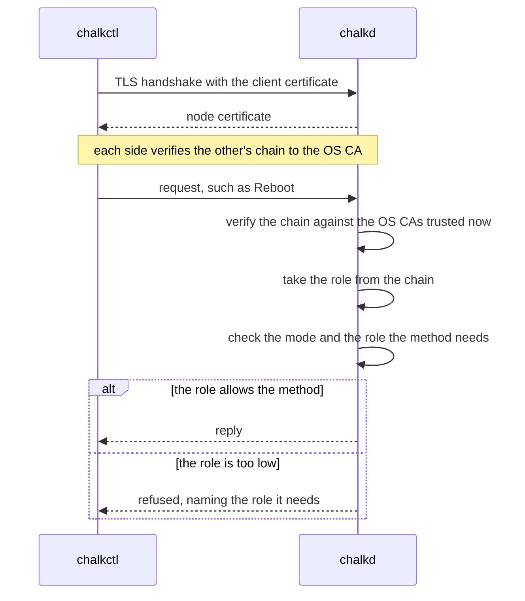

# Security model

A reader client file can read a node's status and logs, and nothing else. When its holder tries
to reboot the node, chalkd refuses the call and names the role it needs:

```text
/chalkos.node.v1.NodeService/Reboot needs the operator role
```

chalkos protects three things: the code a node boots, the secrets a node keeps on its disks, and
the API through which a node is installed and operated. Secure Boot and dm-verity cover the code,
the TPM covers the disks, and mutual TLS with the cluster's own certificate authority covers the
API.

## A node trusts three anchors

A node's trust rests on these anchors:

| Anchor | Where it lives | What it vouches for |
| --- | --- | --- |
| The db signing certificate | The firmware's db | systemd-boot and the UKI, and through the UKI the whole store |
| The OS CA | The secrets file; its certificate is in every image built with `osCA` | Every node certificate and client certificate of the node API |
| The TPM | The machine | That the node booted under the same Secure Boot state it was installed under |

The db key and the OS CA's key never reach a node. Control planes hold the node CA, an
intermediate of the OS CA that may issue only node certificates.
[Certificates](certificates.md) describes what each CA issues.

!!! note "On the shipped variant, the Kubernetes CAs are anchors too"

    The Kubernetes, front-proxy and etcd CAs live in the secrets file, and a control plane holds
    them in its Kubernetes share. They vouch for the control plane's certificates, the kubelets'
    and admin kubeconfigs. Control planes hold their keys and issue their own certificates with
    them, as [Kubernetes certificates](../kubernetes/certificates.md) describes.

## Secure Boot limits a node to images the key holder signed

Secure Boot makes the firmware refuse a boot binary that no certificate in db signed. chalkos signs
two binaries per image, systemd-boot and the UKI. The UKI's signature reaches every file of the
store through the root hash on its kernel command line, as
[dm-verity ties every block of the store to the UKI](image.md#dm-verity-ties-every-block-of-the-store-to-the-uki)
explains. Changing one byte of the store therefore requires a new root hash, a new UKI and the db
key. chalkd checks each UKI against db and dbx before it writes it, as
[The UKI is checked against db and dbx before anything runs it](image.md#the-uki-is-checked-against-db-and-dbx-before-anything-runs-it)
describes, so a node never reboots into an image its firmware would refuse.

Images are built unsigned by Nix and signed afterwards with
[`chalkbuild sign`](../../reference/cli/chalkbuild_sign.md), on the machine that holds the db key.
Keeping the key out of the build keeps it out of `/nix/store`, which any user of the build machine
can read, and out of every binary cache the store is pushed to. Nodes never hold the db key and
never sign anything.

Secure Boot also decides what the operator role can install. A node checks that an image is built
for its platform and that its UKI boots the store it carries, but it cannot tell an image the
cluster's owners built from one somebody else built. Without Secure Boot, anyone with an operator
certificate can install an image of their own and run it as root, with STATE and VAR unlocked,
because their keys are sealed to PCR 7 alone. With Secure Boot enforced, an operator can roll out
only what the key holder signed. An operator's upgrade carries no config, as
[Operator upgrades carry no config](upgrades.md#operator-upgrades-carry-no-config) explains, so an
operator cannot change a node's networks, volumes or `Addon` documents through an upgrade either.

## The TPM ties the disks to the Secure Boot state

STATE, VAR and encrypted volumes are LUKS2 volumes whose key the TPM seals to PCR 7, which measures
the Secure Boot state. The TPM releases the key only under the state the node was installed under,
so a disk taken out of the machine, or booted with other Secure Boot keys, stays locked. The console
then asks for the volume's fallback: the node's recovery key by default, or a password.
[The TPM seals the disk keys to PCR 7](storage.md#the-tpm-seals-the-disk-keys-to-pcr-7) explains
the choice of PCR 7, and
[A changed PCR 7 sends the unlock to the console](storage.md#a-changed-pcr-7-sends-the-unlock-to-the-console)
lists what changes it.

## chalkd checks the role of every request

chalkd serves the [node API](../../reference/api.md) on TCP port 50000 with TLS 1.3. On an installed
node, in normal mode, it serves its node certificate and accepts only clients whose certificate
chains to an OS CA the node trusts. It verifies the client's chain again for every request, against
the OS CAs it trusts at that moment. A client whose certificate expired, or whose OS CA a rotation
removed, therefore loses access on its next call, even on a connection it keeps open.

The diagram shows one call from chalkctl with a client file.



A client's role comes from its certificate. A certificate the OS CA issued directly grants the role
its Organization names: reader, operator or admin. Each allows what the one before it allows, and
more. A certificate whose chain passes through the node CA has the role `node`, whatever its
Organization says, because the node CA is the only intermediate the OS CA issues. `node` allows
renewing the node certificate on a control plane and nothing else, so a control plane, which holds
the node CA, cannot issue itself an admin certificate.
[Roles and credentials](../../reference/access.md) lists the role each method needs.

Two methods need the admin role for what they reveal or carry. Config names a node's networks,
volumes and `Addon` documents, and a control plane applies the objects of `Addon` documents to the
cluster. So an Upgrade that carries config or a fallback secret needs the admin role, as
ApplyConfig does: config an operator may not deliver to the running image it may not deliver with
the next one either. GetConfig returns a node's config with its secret values hashed, and needs the
admin role too, because names, addresses and the shape of the config tell an attacker much about
the node.

## Clients authenticate with the secrets file or a client file

chalkctl authenticates with one of two credentials.

The secrets file holds every CA key of the cluster. A command that reads it issues itself an admin
certificate from the OS CA, valid for one hour and never written to disk, so using the secrets file
leaves no admin certificate behind. The file is `secrets.age`, encrypted with age to the recipients
given to [`chalkctl gen secrets`](../../reference/cli/chalkctl_gen_secrets.md): age keys, SSH keys or
age plugin recipients such as hardware tokens. With `--plaintext` it is `secrets.json`, for a file
protected by other means. chalkctl reads it only where `--secrets` names it. `--secrets -` reads it
from standard input, encrypted or not, for example from a password manager, so a plaintext copy
never touches the disk. `chalkctl gen secrets --out - --public-out secrets.pub.json` writes a new one
to standard output for such a manager, and its public half to `secrets.pub.json`:

```sh
chalkctl gen secrets --recipient=<age-public-key>
```

A client file holds one certificate of one role, its key and the OS CA certificates. It lets
someone operate the cluster without the secrets file, limited to the role.
[`chalkctl config new`](../../reference/cli/chalkctl_config_new.md) issues it, valid for one year
unless `--ttl` says otherwise, and writes it to `~/.config/chalkos/config` with mode 0600:

```sh
chalkctl config new --name=grafana --role=reader --ttl=720h --out=grafana.json
```

A client file names no cluster. Its OS CA ties it to one: a node of another cluster serves a
certificate that the file's OS CA does not verify, and refuses the file's certificate. The TLS
handshake fails and chalkctl says `the node does not accept this client file, <path>; is it another
cluster's?`. A client file issued before an OS CA rotation fails the same way later in the
rotation.

Installing nodes, `apply-config`, issuing kubeconfigs and rotations need the secrets file, because
they issue certificates or deliver keys. Other commands take either credential, in the order
[Where chalkctl finds its credentials](../../reference/access.md#where-chalkctl-finds-its-credentials)
lists.

## Revoking a node cuts off its writes and renewals

On the shipped variant, a revoked node can no longer renew its certificates or change anything in
the cluster. A control plane lists the revoked nodes in its status:

```text
revoked nodes:
  w1  since 2026-10-23T22:42:25Z
```

[`chalkctl node revoke`](../../reference/cli/chalkctl_node_revoke.md) asks a control plane to add
the node's name and the time to the ConfigMap `kube-system/chalkos-revoked-nodes`, and to delete
the node's Node object. The list takes effect in three places:

- A control plane's RenewNodeCertificate refuses a certificate that names a listed node. The
  node's status shows the refusal on its node certificate:
  `renewal failing: the control plane at 192.168.100.11:50000: permission_denied: node w1 is revoked since 2026-10-23T22:42:25Z; chalkctl node unrevoke w1 lets it renew again`.
  The node's certificate has the role `node`, which allows that one method alone, so the node
  can call nothing else.
- chalkd's approver leaves the node's kubelet serving certificate requests pending.
- The ValidatingAdmissionPolicy `chalkos-revoked-nodes` denies every create, update, delete and
  connect by the user `system:node:<name>` of a listed node, on subresources too. The kubelet can
  therefore neither register its Node again nor request a new client certificate:
  `nodes "w1" is forbidden: ValidatingAdmissionPolicy 'chalkos-revoked-nodes' with binding 'chalkos-revoked-nodes' denied request: node w1 is revoked since 2026-10-23T22:42:25Z`.

The policy takes no parameters. chalkd writes the revoked names into the policy's CEL expression
itself, and the policy fails closed. A control plane writes the policy again from the ConfigMap
after each revoke and unrevoke. Every control plane also compares the ConfigMap's resource version
with the one it last applied the policy from, about every 10 seconds, and applies the policy again
when they differ or its last apply failed. So the policy follows a ConfigMap edited by hand, or a
revocation whose apply was cancelled, within about 10 seconds. The API server that chalkctl went
through denies the node's writes within seconds. The other control planes' API servers pick up
the policy shortly after.

`chalkctl node revoke` first asks every other control plane whether it reads the revoked nodes.
A control plane whose chalkd predates node revocation renews the node's certificate regardless,
so the command refuses while one does not answer, cannot read the list, or does not say it read
it. `--force` revokes the node anyway.

chalkctl reads the list as well. `chalkctl rotate` reads it before each phase and skips the listed
nodes, so no rotation hands a revoked node a certificate. `chalkctl node renew` and
`chalkctl apply-config --kubernetes-share` refuse a listed node unless `--force` is given, and
`chalkctl install` refuses to install a node under a listed name unless `--force` is given. All
four refuse to run while no control plane says which nodes are revoked. `chalkctl rotate
--ignore-revoked` rotates without the list, as during an outage of the API server, and every node
of the inventory then takes part. install counts a control plane that does not answer as an
installed node as one not installed yet, so a cluster's first nodes install while the others
wait.

[`chalkctl node unrevoke`](../../reference/cli/chalkctl_node_unrevoke.md) removes the name and
applies the policy again. A node's old certificates chain to the OS CA, which chalkd trusts with
every node CA it signed, and to the Kubernetes CA. So the control plane unrevokes the node only
when every OS CA and Kubernetes CA it trusts was made after the revocation, and refuses otherwise.
`--force` unrevokes it anyway, and the old certificates work again until they expire. The check
compares the revocation time, taken from the control plane's clock, with the time chalkctl made
the CA, taken from the workstation's clock. The two clocks must agree: a workstation clock far
ahead can make a CA from before the revocation pass the check.

### Revocation leaves reads and the certificates valid

A revocation shuts out a node's writes and renewals. It leaves these gaps:

- The node's certificates stay valid until they expire, and the API server's admission sees
  writes alone. The kubelet can still read what every kubelet may: Services, Endpoints and
  EndpointSlices, and a few cluster-scoped kinds such as Nodes and RuntimeClasses. The Secrets and
  ConfigMaps of the pods bound to the node stay readable until the pod garbage collector deletes
  those pods, shortly after their Node is gone.
- A control plane's disk holds the node CA's and the Kubernetes CA's keys. Revoking a control
  plane, or a stolen copy of its disk, does not cut it off. Rotating `os-ca` and `kubernetes-ca`
  does. A former control plane's etcd and front-proxy certificates stay valid until the
  `kubernetes-ca` rotation has finished.
- A cluster without Kubernetes keeps no list. A node there renews its certificate only through
  `chalkctl node renew`, so not renewing it is how it is revoked. `chalkctl rotate os-ca` cuts it
  off at once.
- A renewal already in flight when the revoke lands can still complete, and the node then holds a
  node certificate valid for a year. The policy still denies its kubelet's writes.
- A cluster-admin can edit or delete the ConfigMap and the policy with kubectl. Renewals follow
  the ConfigMap at once, and the policy follows it within about 10 seconds. An edited or deleted
  policy stays so until the ConfigMap changes or chalkd restarts. Deleting the ConfigMap unrevokes
  every node. Editing the ConfigMap by hand skips the checks of chalkctl node revoke and
  chalkctl node unrevoke, so use those commands.
- A control plane renews node certificates only while it can read the list from its API server.
  During a long outage of the API server, renewals stop, the control plane's own included.
  `chalkctl node renew --force` renews a node's certificate without asking the control planes.
- A control plane that still runs a chalkd from before node revocation renews a revoked node's
  node certificate until it is upgraded. The API server denies the node's writes all the same.
  `chalkctl node revoke` refuses while such a control plane runs, unless `--force` is given.
- The list has a size limit. The API server compiles no expression longer than 100,000
  characters, so a control plane refuses a revocation that would make the policy's map longer
  than 90,000: about 2,000 short names, or about 300 names of the longest length Kubernetes
  allows. Unrevoke names once the CAs were rotated, to keep the list short.
- A revoked node left in the inventory is skipped by every rotation, and other commands still
  reach it. Remove it from the inventory.

## A node in maintenance mode is trusted by its fingerprint

A node that is not installed runs chalkd in maintenance mode. It has no node certificate yet, so it
serves a self-signed one and prints the certificate's SHA-256 fingerprint and the node's addresses
on its console. chalkctl verifies the node in one of two ways:

```sh
chalkctl install <node> --secrets=secrets.age --fingerprint=<fingerprint>
chalkctl install <node> --secrets=secrets.age --insecure
```

With `--fingerprint`, chalkctl compares the certificate with the fingerprint read off the console
before it sends anything. With `--insecure`, it accepts whatever certificate the node presents and
prints its fingerprint, which the operator compares with the console afterwards: trust on first
use. chalkctl then opens a second connection pinned to that fingerprint and sends the secrets over
it, so the config, the node certificate and the Kubernetes share go to the machine whose
fingerprint was printed. Every command that reaches a node in maintenance mode accepts
`--insecure`.

The node in turn decides whom it accepts. The images and the installer of an mkImages call with
[`osCA`](../../reference/options.md#osca) carry that OS CA and accept in maintenance mode only
clients with a certificate from it, so only the holder of the secrets file or a client file can
install them. An image built without one accepts any client as an admin until it is installed.
Use images with the OS CA on any network other people can reach.

## Nobody logs in to a node

Nodes have no SSH server, no passwords and no interactive accounts. The root file system is a tmpfs
assembled at boot, `/etc` is a read-only overlay built from the image, and the store is read-only
and checked by dm-verity, so a node changes only through chalkd. Logs come through
[`chalkctl logs`](../../reference/cli/chalkctl_logs.md).

The `kvm` platform's images run the QEMU guest agent, which a hypervisor reaches through a
virtio-serial channel. It answers only `guest-sync-delimited`, `guest-sync`, `guest-ping`,
`guest-info`, `guest-get-osinfo`, `guest-get-host-name`, `guest-get-time`, `guest-get-timezone`,
`guest-network-get-interfaces` and `guest-shutdown`. It never runs commands, or reads or writes
files, for the host, so the hypervisor's admin gets no shell on the node through it.

!!! note "On the shipped variant, a privileged pod debugs a node"

    A node with Kubernetes is debugged from a privileged pod, started with
    `kubectl debug node/<node>`, which sees the node's file systems.
    [`chalkos.debug.tools`](../../reference/options.md#chalkosdebugtools) adds the usual
    command-line tools to an image for that.

## Limits

- chalkos does not enrol Secure Boot keys. The operator enrols the db certificate in each
  machine's firmware, as the [signing guide](../../build/sign-images.md) shows. Only chalklab
  enrols keys, its own, in its virtual machines. Installing does not check that Secure Boot is on.
- There is no certificate revocation list. A leaked client file or kubeconfig stays valid until it
  expires or its CA is rotated, as [Certificates](certificates.md#access-is-revoked-by-rotating-its-ca)
  explains. Revoking a node shuts out that node alone, with the gaps listed under
  [Revocation leaves reads and the certificates valid](#revocation-leaves-reads-and-the-certificates-valid).
- The TPM unseals without a PIN for every boot under the same Secure Boot state, so a machine
  decrypts its own disks whenever it boots. chalkos does not defend against an attacker with the
  machine in hand who attacks it while it runs, for example through its memory.
- PCR 7 does not tell one image signed with the db key from another. An older signed image with a
  known flaw unseals the keys too, until its signature or the key is revoked through dbx.
- A refusal of an upgrade's config gives the reason in the reply and in the node's journal, and the
  reason can quote values of the config. That holds for an operator's upgrade too, whose node
  checks the config it carries over.
- A node's clock decides whether certificates are valid. A node whose clock is far off refuses
  valid certificates and accepts expired ones until chrony sets it, as
  [The clock decides whether a certificate is valid](certificates.md#the-clock-decides-whether-a-certificate-is-valid)
  explains.
- On the shipped variant, a `Registry`'s credentials serve the image pulls of every pod on the node.
  chalkd keeps them in a `credentials.json` that only root reads, but the kubelet hands them to
  containerd for any pod whose image names the `Registry`'s host, and containerd sends them to that
  host's mirror endpoints as well, as
  [How Kubernetes runs on a node](../kubernetes/overview.md#pods-pull-private-images-with-node-credentials)
  describes.

## Related pages

- [Certificates](certificates.md): the CAs and certificates of the node API, renewal, rotation and
  revocation.
- [Roles and credentials](../../reference/access.md): the role of each method and where chalkctl
  finds its credentials.
- [Storage and encryption](storage.md): the encrypted volumes and their keyslots.
- [The image](image.md): the store, dm-verity and the UKI.
- [Sign images for Secure Boot](../../build/sign-images.md).
- [Manage access and certificates](../../operate/access.md).
- [Node API](../../reference/api.md), [`chalkctl config new`](../../reference/cli/chalkctl_config_new.md)
  and [`chalkctl gen secrets`](../../reference/cli/chalkctl_gen_secrets.md).
