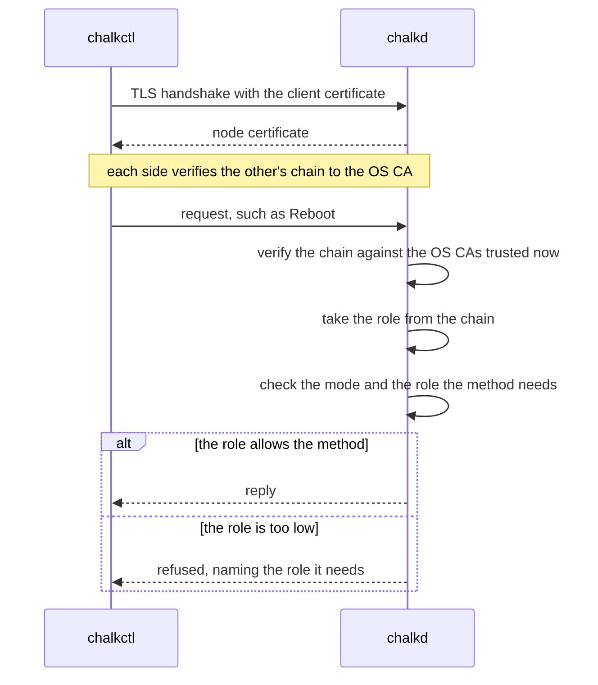

# Security model

A reader client file can read a node's status and logs, and nothing else. When its holder tries
to reboot the node, chalkd refuses the call and names the role it needs:

```text
/chalkos.node.v1.NodeService/Reboot needs the operator role
```

chalkos protects three things: the code a node boots, the secrets a node keeps on its disks, and
the API through which a node is installed and operated. Secure Boot and dm-verity cover the code,
the TPM covers the disks, and mutual TLS with the cluster's own certificate authority covers the
API.

## A node trusts three anchors

A node's trust rests on these anchors:

| Anchor | Where it lives | What it vouches for |
| --- | --- | --- |
| The db signing certificate | The firmware's db | systemd-boot and the UKI, and through the UKI the whole store |
| The OS CA | The secrets file; its certificate is in every image built with `osCA` | Every node certificate and client certificate of the node API |
| The TPM | The machine | That the node booted under the same Secure Boot state it was installed under |

The db key and the OS CA's key never reach a node. Control planes hold the node CA, an
intermediate of the OS CA that may issue only node certificates.
[Certificates](certificates.md) describes what each CA issues.

!!! note "On the shipped variant, the Kubernetes CAs are anchors too"

    The Kubernetes, front-proxy and etcd CAs live in the secrets file, and a control plane holds
    them in its Kubernetes share. They vouch for the control plane's certificates, the kubelets'
    and admin kubeconfigs. Control planes hold their keys and issue their own certificates with
    them, as [Kubernetes certificates](../kubernetes/certificates.md) describes.

## Secure Boot limits a node to images the key holder signed

Secure Boot makes the firmware refuse a boot binary that no certificate in db signed. chalkos signs
two binaries per image, systemd-boot and the UKI. The UKI's signature reaches every file of the
store through the root hash on its kernel command line, as
[dm-verity ties every block of the store to the UKI](image.md#dm-verity-ties-every-block-of-the-store-to-the-uki)
explains. Changing one byte of the store requires a new root hash, a new UKI and the db
key. chalkd checks each UKI against db and dbx before it writes it, as
[The UKI is checked against db and dbx before anything runs it](image.md#the-uki-is-checked-against-db-and-dbx-before-anything-runs-it)
describes, so a node never reboots into an image its firmware would refuse.

Images are built unsigned by Nix and signed afterwards with
[`chalkbuild sign`](../../reference/cli/chalkbuild_sign.md), on the machine that holds the db key.
Keeping the key out of the build keeps it out of `/nix/store`, which any user of the build machine
can read, and out of every binary cache the store is pushed to. Nodes never hold the db key and
never sign anything.

Secure Boot also decides what the operator role can install. A node checks that an image is built
for its platform and that its UKI boots the store it carries, but it cannot tell an image the
cluster's owners built from one somebody else built. Without Secure Boot, anyone with an operator
certificate can install an image of their own and run it as root, with STATE and VAR unlocked,
because their keys are sealed to PCR 7 alone. With Secure Boot enforced, an operator can roll out
only what the key holder signed. An operator's upgrade carries no config, as
[Operator upgrades carry no config](upgrades.md#operator-upgrades-carry-no-config) explains, so an
operator cannot change a node's networks, volumes or `Addon` documents through an upgrade either.

## The TPM ties the disks to the Secure Boot state

STATE, VAR and encrypted volumes are LUKS2 volumes whose key the TPM seals to PCR 7, which measures
the Secure Boot state. The TPM releases the key only under the state the node was installed under,
so a disk taken out of the machine, or booted with other Secure Boot keys, stays locked. The console
then asks for the volume's fallback: the node's recovery key by default, or a password.
[The TPM seals the disk keys to PCR 7](storage.md#the-tpm-seals-the-disk-keys-to-pcr-7) explains
the choice of PCR 7, and
[A changed PCR 7 sends the unlock to the console](storage.md#a-changed-pcr-7-sends-the-unlock-to-the-console)
lists what changes it.

## chalkd checks the role of every request

chalkd serves the [node API](../../reference/api.md) on TCP port 50000 with TLS 1.3. On an installed
node, in normal mode, it serves its node certificate and accepts only clients whose certificate
chains to an OS CA the node trusts. It verifies the client's chain again for every request, against
the OS CAs it trusts at that moment. A client whose certificate expired, or whose OS CA a rotation
removed, loses access on its next call, even on a connection it keeps open.

The diagram shows one call from chalkctl with a client file.



A client's role comes from its certificate. A certificate the OS CA issued directly grants the role
its Organization names: reader, operator or admin. Each allows what the one before it allows, and
more. A certificate whose chain passes through the node CA has the role `node`, whatever its
Organization says, because the node CA is the only intermediate the OS CA issues. `node` allows
renewing the node certificate on a control plane and nothing else, so a control plane, which holds
the node CA, cannot issue itself an admin certificate.
[Roles and credentials](../../reference/access.md) lists the role each method needs.

Two methods need the admin role for what they reveal or carry. Config names a node's networks,
volumes and `Addon` documents, and a control plane applies the objects of `Addon` documents to the
cluster. So an Upgrade that carries config or a fallback secret needs the admin role, as
ApplyConfig does: config an operator may not deliver to the running image it may not deliver with
the next one either. GetConfig returns a node's config with its secret values hashed, and needs the
admin role too, because names, addresses and the shape of the config tell an attacker much about
the node.

## Clients authenticate with the secrets file or a client file

chalkctl authenticates with one of two credentials.

The secrets file holds every CA key of the cluster. A command that reads it issues itself an admin
certificate from the OS CA, valid for one hour and never written to disk, so using the secrets file
leaves no admin certificate behind. The file is `secrets.age`, encrypted with age to the recipients
given to [`chalkctl gen secrets`](../../reference/cli/chalkctl_gen_secrets.md): age keys, SSH keys or
age plugin recipients such as hardware tokens. With `--plaintext` it is `secrets.json`, for a file
protected by other means. chalkctl reads it only where `--secrets` names it. `--secrets -` reads it
from standard input, encrypted or not, for example from a password manager, so a plaintext copy
never touches the disk. `chalkctl gen secrets --out - --public-out secrets.pub.json` writes a new one
to standard output for such a manager, and its public half to `secrets.pub.json`:

```sh
chalkctl gen secrets --recipient=<age-public-key>
```

A client file holds one certificate of one role, its key and the OS CA certificates. It lets
someone operate the cluster without the secrets file, limited to the role.
[`chalkctl config new`](../../reference/cli/chalkctl_config_new.md) issues it, valid for one year
unless `--ttl` says otherwise, and writes it to `~/.config/chalkos/config` with mode 0600:

```sh
chalkctl config new --name=grafana --role=reader --ttl=720h --out=grafana.json
```

A client file names no cluster. Its OS CA ties it to one: a node of another cluster serves a
certificate that the file's OS CA does not verify, and refuses the file's certificate. The TLS
handshake fails and chalkctl says `the node does not accept this client file, <path>; is it another
cluster's?`. A client file issued before an OS CA rotation fails the same way later in the
rotation.

Installing nodes, `apply-config`, issuing kubeconfigs and rotations need the secrets file, because
they issue certificates or deliver keys. Other commands take either credential, in the order
[Where chalkctl finds its credentials](../../reference/access.md#where-chalkctl-finds-its-credentials)
lists.

## A node's access ends with its certificate

A node's certificate stays valid until it expires or its CA is rotated out, and no node keeps a
list of revoked nodes. On a cluster without Kubernetes, a node renews its certificate only through
`chalkctl node renew`, so not renewing it is how it is revoked. `chalkctl rotate os-ca` cuts it off
at once.

Control planes hold the node CA's key on their disks. A former control plane, or a stolen copy of
its disk, can still issue node certificates until a rotation of `os-ca` retires that node CA.

!!! note "On the shipped variant, chalkctl node revoke shuts out a node by name"

    `chalkctl node revoke` adds the node's name to a list in the cluster's Kubernetes API. Control
    planes then refuse to renew its certificates, and the API server denies its kubelet every
    write.
    [Revoking a node cuts off its writes and renewals](../kubernetes/certificates.md#revoking-a-node-cuts-off-its-writes-and-renewals)
    explains the mechanism and what it leaves open.

## A node in maintenance mode is trusted by its fingerprint

A node that is not installed runs chalkd in maintenance mode. It has no node certificate yet, so it
serves a self-signed one and prints the certificate's SHA-256 fingerprint and the node's addresses
on its console:

```text
chalkd: maintenance mode, accepting clients of the OS CA; certificate fingerprint <fingerprint>
chalkd: addresses <addresses>; certificate fingerprint <fingerprint>
```

chalkctl verifies the node in one of two ways:

```sh
chalkctl install <node> --secrets=secrets.age --fingerprint=<fingerprint>
chalkctl install <node> --secrets=secrets.age --insecure
```

With `--fingerprint`, chalkctl compares the certificate with the fingerprint read off the console
before it sends anything. With `--insecure`, it accepts whatever certificate the node presents and
prints its fingerprint, which the operator compares with the console afterwards: trust on first
use. chalkctl then opens a second connection pinned to that fingerprint and sends the secrets over
it. Only the machine whose fingerprint was printed receives the config, the node certificate and
the Kubernetes share. Every command that reaches a node in maintenance mode accepts `--insecure`.

The node in turn decides whom it accepts. The images and the installer of an mkImages call with
[`osCA`](../../reference/mkimages.md#osca) carry that OS CA and accept in maintenance mode only
clients with a certificate from it, so only the holder of the secrets file or a client file can
install them. An image built without one says `accepting any client` on the console, checks no
client certificate and treats every client as an admin until it is installed. On a network other
people can reach, only an image with the OS CA keeps them from installing the node.

## Nobody logs in to a node

Nodes have no SSH server, no passwords and no interactive accounts. The root file system is a tmpfs
assembled at boot, `/etc` is a read-only overlay built from the image, and the store is read-only
and checked by dm-verity, so a node changes only through chalkd. Logs come through
[`chalkctl logs`](../../reference/cli/chalkctl_logs.md).

The image's diagnostics show the node's addresses, routes and firewall through
[`chalkctl node diag`](../../reference/cli/chalkctl_node_diag.md). The image fixes each command,
and a client passes only values that chalkd checks against each parameter's type; no shell reads
them. chalkd runs each command as a transient systemd unit under a user of its own, without new
privileges and with only the capabilities the diagnostic names, in the node's network or in the
network namespace the diagnostic names. The unit sees a read-only file system without STATE,
`/var/lib`, or the config and credentials chalkd writes. Each diagnostic names the least role
that runs it, so a reader sees the node's addresses but cannot ping from it.

The `kvm` platform's images run the QEMU guest agent, which a hypervisor reaches through a
virtio-serial channel. It answers only `guest-sync-delimited`, `guest-sync`, `guest-ping`,
`guest-info`, `guest-get-osinfo`, `guest-get-host-name`, `guest-get-time`, `guest-get-timezone`,
`guest-network-get-interfaces` and `guest-shutdown`. It never runs commands, or reads or writes
files, for the host, so the hypervisor's admin gets no shell on the node through it.

!!! note "On the shipped variant, a privileged pod debugs a node"

    A node with Kubernetes is debugged from a privileged pod, started with
    `kubectl debug node/<node>`, which sees the node's file systems.
    [`chalkos.debug.tools`](../../reference/image-options.md#chalkosdebugtools) adds the usual
    command-line tools to an image for that.

## Limits

- chalkos does not enrol Secure Boot keys. The operator enrols the db certificate in each
  machine's firmware, as the [signing guide](../../build/sign-images.md) shows. Only chalklab
  enrols keys, its own, in its virtual machines. Installing does not check that Secure Boot is on.
- There is no certificate revocation list. A leaked client file or kubeconfig stays valid until it
  expires or its CA is rotated, as [Certificates](certificates.md#access-is-revoked-by-rotating-its-ca)
  explains. On the shipped variant, revoking a node shuts out that node alone, with the gaps listed
  under [Revocation leaves reads and the certificates valid](../kubernetes/certificates.md#revocation-leaves-reads-and-the-certificates-valid).
- The TPM unseals without a PIN for every boot under the same Secure Boot state, so a machine
  decrypts its own disks whenever it boots. chalkos does not defend against an attacker with the
  machine in hand who attacks it while it runs, for example through its memory.
- PCR 7 does not tell one image signed with the db key from another. An older signed image with a
  known flaw unseals the keys too, until its signature or the key is revoked through dbx.
- A refusal of an upgrade's config gives the reason in the reply and in the node's journal, and the
  reason can quote values of the config. That holds for an operator's upgrade too, whose node
  checks the config it carries over.
- A node's clock decides whether certificates are valid. A node whose clock is far off refuses
  valid certificates and accepts expired ones until chrony sets it, as
  [The clock decides whether a certificate is valid](certificates.md#the-clock-decides-whether-a-certificate-is-valid)
  explains.
- On the shipped variant, a `Registry`'s credentials serve the image pulls of every pod on the node.
  chalkd keeps them in a `credentials.json` that only root reads, but the kubelet hands them to
  containerd for any pod whose image names the `Registry`'s host, and containerd sends them to that
  host's mirror endpoints as well, as
  [How Kubernetes runs on a node](../kubernetes/overview.md#pods-pull-private-images-with-node-credentials)
  describes.

## Related pages

- [Certificates](certificates.md): the CAs and certificates of the node API, renewal, rotation and
  revocation.
- [Roles and credentials](../../reference/access.md): the role of each method and where chalkctl
  finds its credentials.
- [Storage and encryption](storage.md): the encrypted volumes and their keyslots.
- [The image](image.md): the store, dm-verity and the UKI.
- [Sign images for Secure Boot](../../build/sign-images.md).
- [Manage access and certificates](../../operate/access.md).
- [Node API](../../reference/api.md), [`chalkctl config new`](../../reference/cli/chalkctl_config_new.md)
  and [`chalkctl gen secrets`](../../reference/cli/chalkctl_gen_secrets.md).
