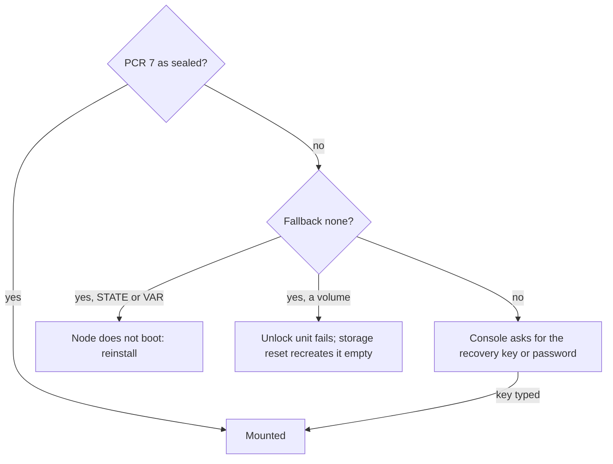

# Storage and encryption

The homelab example gives its worker w1 a VAR of 200 GiB on the NVMe disk it boots from, and a
volume for Longhorn on a SATA SSD of its own:

```yaml
apiVersion: storage.chalkos.dev/v1alpha1
kind: SystemDisk
metadata: {name: system}
spec:
  disk: {path: /dev/disk/by-id/nvme-Samsung_SSD_990_PRO_2TB_S7KHNJ0W100002}
  var: {size: 200G}
---
# A SATA SSD for Longhorn replicas next to the NVMe system disk.
apiVersion: storage.chalkos.dev/v1alpha1
kind: Volume
metadata: {name: longhorn}
spec:
  disk: {model: "Samsung SSD 870*", type: ssd}
  format: xfs
  mountPoint: /var/lib/longhorn
```

A node keeps everything it writes on partitions that are encrypted by default and unlock through
the TPM without a password. The image fixes the partitions that hold the system itself. The
node's config declares the rest in its `SystemDisk` and `Volume` documents: how large VAR is, and
which further volumes exist, on which disks, encrypted or not.

## The system region comes first and VAR fills the rest

The system disk starts with the system region, which every node of an image shares: the ESP, the
two slots A and B, and STATE, as
[An image holds the ESP and one slot](image.md#an-image-holds-the-esp-and-one-slot) describes.
Their sizes are options of the image, such as
[`chalkos.disk.stateSize`](../../reference/options.md#chalkosdiskstatesize), because every node of
the image must agree on them. VAR follows on the system disk and fills the rest of it by default.
Volumes go on the system disk after VAR, or each on a disk of its own.
[Image and partition layout](../../reference/image-layout.md) shows the partition map.

STATE is small and holds what makes the node itself:

- its config;
- its node certificate and key, and the OS CAs it trusts;
- its storage section, with the disks it pinned;
- the marker that the node is installed.

VAR, mounted at `/var`, holds what the node writes while it runs, such as container images and
the journal. The root file system is a tmpfs, so nothing else survives a reboot.

!!! note "On the shipped variant, STATE and VAR also hold Kubernetes data"

    STATE holds the node's Kubernetes share, and on a control plane its etcd markers and pinned
    addresses. VAR holds etcd's data, containerd's images and the kubelet's state.

## Each node's documents declare its storage

Two kinds of config document declare a node's storage:

- One [`SystemDisk`](../../reference/kinds.md#systemdisk), which every node's config holds: the disk
  the node runs from, the encryption of STATE, VAR and volumes, and VAR's size.
- A [`Volume`](../../reference/kinds.md#volume) per further volume, named by its `metadata.name`:
  its disk, size, format, mount point and encryption.

Each node's set holds its own storage documents, usually in the node's own file, since disks
differ between machines. Nothing merges a node's documents with those of other files: a field a
document leaves out takes the kind's default, and a set holds one `SystemDisk`.

A volume is formatted `ext4` by default, or `xfs`, `btrfs` or `swap`. `format: raw` leaves a raw
block device, for software that wants one. A volume without a `disk` goes on the system disk after
VAR, and a volume with a `disk` occupies that disk alone. On each disk at most one partition, VAR
included, may leave its size unset and fill the space left. `chalkctl validate` and chalkd refuse
names, mount points and disk references that break the rules
[Add storage volumes](../../operate/storage-volumes.md) lists. Two references that resolve to one
disk are refused on the node, when it finds the disks.

A `Volume`'s `repart` field passes further systemd-repart keys through, for example `Weight`. The
keys the typed fields set are refused there.

## A disk is found once and then pinned

The system disk is always the disk the node booted from. udev links it as
`/dev/disk/chalk-boot-disk` and its partitions as `/dev/disk/chalk-boot/<label>`. Only that disk
gets the links, so a second disk carrying the same image never stands in for it. A node installed
in place checks that its `SystemDisk`'s `spec.disk` names the disk it booted from. The installer
writes the image to the disk `spec.disk` names.

A disk reference, `spec.disk` of a `SystemDisk` or a `Volume`, is a `path` below `/dev/` or a
selector of `model` (a glob), `serial`, `wwn`, `size` (a comparison such as `>= 1T`) and `type`
(`nvme`, `ssd` or `hdd`). A selector must match exactly one disk, so one that matches two is
refused. A reference is resolved once, the first time the node sees it. The node pins the disk it
found on STATE by its WWN, serial or udev path. Every later boot looks for the pinned disk, so
device names that change between boots, or a new disk that also matches the selector, never move
a volume.

A disk is taken only when it is provably unused: blkid finds nothing on it, or it carries a GPT
whose partitions all have types of this disk's definitions. A disk with other data is refused
with a message naming what it carries, and nothing is written to it.

systemd-repart then creates and grows the partitions, once per disk, from definitions chalkos
renders for the node. The definitions give each partition its own GPT type and a partition UUID
that stays the same across runs, so a new volume never takes over another volume's partition.
[Architecture for developers](../../contribute/architecture.md#storage-partitions-are-matched-deterministically)
explains how.

## The TPM seals the disk keys to PCR 7

With `spec.encryption.mode` of the `SystemDisk` set to `tpm2`, the default, STATE, VAR and volumes
are LUKS2 volumes whose key the TPM seals to PCR 7. VAR (`spec.var.encryption.mode`) and each
volume (its `Volume`'s `spec.encryption.mode`) can override the mode. STATE follows the
`SystemDisk`'s. `none` leaves the partitions unencrypted. `chalkctl validate` warns when STATE,
which holds the node's private keys, would be one of them:

```text
warning: node w1: its SystemDisk's encryption.mode is none, so STATE, which holds the node's keys and secrets, is not encrypted
```

PCR 7 measures the Secure Boot state: whether it is on, the contents of PK, KEK, db and dbx, and
the db certificate that verified the boot binaries. The TPM releases the key only when PCR 7 holds
the value it was sealed under. chalkos seals to PCR 7, and not to the PCRs that measure the kernel
and initrd, because an upgrade changes those with every image. An image signed with the same db
key leaves PCR 7 as it was, so upgrades unlock without anyone typing a key.

Each encrypted volume has a second keyslot, the fallback, for when the TPM does not unseal.
`spec.encryption.fallback` of the `SystemDisk` chooses it:

- `recovery-key`, the default, enrols the node's recovery key. The key is derived from a secret in
  the secrets file and the node's name, so no file stores it and installing a node never changes
  the secrets file. [`chalkctl recovery-key`](../../reference/cli/chalkctl_recovery-key.md) prints
  it.
- `password` enrols a password. chalkctl asks for it on the terminal, or reads it from
  `--password-file`: at install, with each later change that adds an encrypted volume, and when
  `chalkctl storage reset` recreates one.
- `none` enrols no second keyslot. A volume the TPM does not unseal can only be recreated empty.

chalkd enrols the fallback with `systemd-cryptenroll` at install, unlocking each volume with the
TPM. It enrols the fallback on every encrypted volume added later too. Before it enrols a secret
on a new volume, it checks that the secret opens an existing keyslot, so a mistyped password
cannot leave volumes with different fallbacks.

## A changed PCR 7 sends the unlock to the console

PCR 7 changes whenever the Secure Boot state does, and then the TPM releases no key:

- A machine that boots with Secure Boot off, or with a different db, KEK or dbx, measures a
  different PCR 7. A firmware update that adds dbx entries counts too.
- A disk moved to another machine does not unlock there, because the other TPM does not hold the
  sealed key.
- Any boot whose binaries the same db certificate signed measures the same PCR 7, older chalkos
  images included. Those boots unlock as usual.

The diagram shows how the node unlocks each encrypted partition.



The console always asks for STATE, and for VAR and the volumes unless the fallback is `none`.
Typing the recovery key or password boots the node as usual.

With fallback `none`, nothing opens a partition the TPM does not unseal. A volume's unlock unit
fails, and [`chalkctl storage reset`](../../reference/cli/chalkctl_storage_reset.md) recreates the
volume empty. STATE and VAR cannot be recreated that way: a node whose STATE or VAR does not unlock
does not boot, and with fallback `none` it has to be reinstalled. Fallback `none` therefore suits
only nodes whose disks hold nothing that a reinstall would lose.

chalkos has no command that seals the keys again to a new PCR 7 value. After a change to the
Secure Boot keys, each boot asks for the fallback until the node is reinstalled.
[Recover a node](../../operate/recover-node.md#the-console-asks-for-a-passphrase-at-boot) covers
the console prompt.

## The initrd unlocks STATE first, then VAR

The initrd opens storage in two steps, and both print to the console:

1. `chalkos-state.service` unlocks STATE with the TPM, checks its file system with `e2fsck -p` and
   mounts it.
2. `chalkos-storage.service` reads the storage section from STATE and finds and pins the disks.
   It runs systemd-repart on each disk, which creates missing volumes and grows those whose size
   grew. Then it unlocks, checks, mounts and grows VAR.

Once the system runs, a systemd generator writes a unit for every other volume: a cryptsetup
service for an encrypted one, and a mount or swap unit for a formatted one. These units are only
wanted, with `nofail`, so a missing disk fails its own units without holding up the boot. A node
that is not installed has no storage section on STATE, so `/var` stays on tmpfs until it is.

chalkos refuses to mount VAR when it should be encrypted but holds no LUKS header. It mounts an
encrypted volume only from its unlocked device, so data meant to be encrypted never lands
on a plain file system. STATE is exempt from the check, because its encryption mode is recorded on
STATE itself and cannot be known before it is mounted.

## Additive changes apply while the node runs

[`chalkctl apply-config`](../../reference/cli/chalkctl_apply-config.md) delivers changed
`SystemDisk` and `Volume` documents to the running node. The storage kinds'
[change rules](../../build/guard-changes.md) compare them with the section STATE records, volume by
volume. The node translates them into a new storage section and makes its additions. Additive
changes keep every byte of existing data, and the node applies them while it runs:

- a new `Volume`, on the system disk or a new disk;
- a larger size, or a fixed size changed to fill the disk, of a volume or of VAR;
- a new, changed or removed mount point.

Destructive changes need a volume to be wiped:

- a `Volume` removed from the node's config;
- another disk, format or encryption mode;
- a smaller size, or a filling volume given a fixed size;
- a changed disk reference that resolves to another physical disk than the pinned one;
- a changed disk reference that cannot be resolved, because it finds no disk, more than one, or
  names something other than a whole disk.

When the section changes any volume destructively, the node refuses the whole config and applies
none of it, naming each volume and the remedy:

- A volume recreated in place takes a reset, once the disk it lives on is plugged in.
- VAR, a removed volume or a volume that moves to another disk takes a reinstall.
- A disk reference that finds no disk needs fixing, or the disk it names plugged in. One that
  cannot otherwise be resolved needs fixing.

Any change to a volume whose pinned disk is not plugged in, additive ones included, is refused
until the disk is back:

```text
the config is refused: Volume data: its disk data (model "WDC WD40EFRX", size 4T, serial "WD-1234") is not plugged in; plug it in
```

`chalkctl storage reset` wipes one volume and creates it again, empty, as the config defines it.
The new volume is sealed to the TPM again and gets its fallback keyslot, and its data is lost.
Changes to `repart` passthrough keys are not compared, so a config that changes only them is not
applied to the disks. [Add storage volumes](../../operate/storage-volumes.md#apply-the-change)
shows a change and a reset.

## A missing disk stops the boot only when it is the system disk

A missing system disk stops the boot. When the disk the node booted from is not the one VAR was
pinned to, the initrd fails with a message such as `VAR lives on the disk ..., which is missing:
the node booted from ...`.

A missing or unusable other disk does not stop the boot. Its volumes are absent, and the rest of
the node runs. The problem is recorded in `/run/chalkos/storage-status.json`, and
[`chalkctl status`](../../reference/cli/chalkctl_status.md) shows it as a `disk <name>: <error>`
line under the volumes. systemd-repart failures on a disk are recorded the same way.

## Limits

- Volumes on other disks are set up in the initrd at every boot, so a storage controller whose
  driver the initrd does not carry is not supported for them.
- Volumes other than VAR are mounted with `nofail` and not ordered before `local-fs.target`. A
  workload that writes below a volume's mount point needs `RequiresMountsFor=` on that path, or it
  may write into the directory before the volume is mounted.
- VAR cannot be reset while the node runs, and a reset recreates a volume in place: it neither
  removes a volume nor moves it to another disk. A destructive change to VAR, removing a volume or
  moving one to another disk takes a reinstall.
- chalkos has no command that seals the keys again to a new PCR 7 value.

## Related pages

- [The image](image.md) and [Image and partition layout](../../reference/image-layout.md): the
  system region.
- [Boot, health and rollback](boot-and-rollback.md): what the boot does before and after storage.
- [Security model](security.md): Secure Boot and the recovery key.
- [Add storage volumes](../../operate/storage-volumes.md) and
  [Recover a node](../../operate/recover-node.md#the-console-asks-for-a-passphrase-at-boot).
- [`chalkctl storage reset`](../../reference/cli/chalkctl_storage_reset.md) and
  [`chalkctl recovery-key`](../../reference/cli/chalkctl_recovery-key.md).
