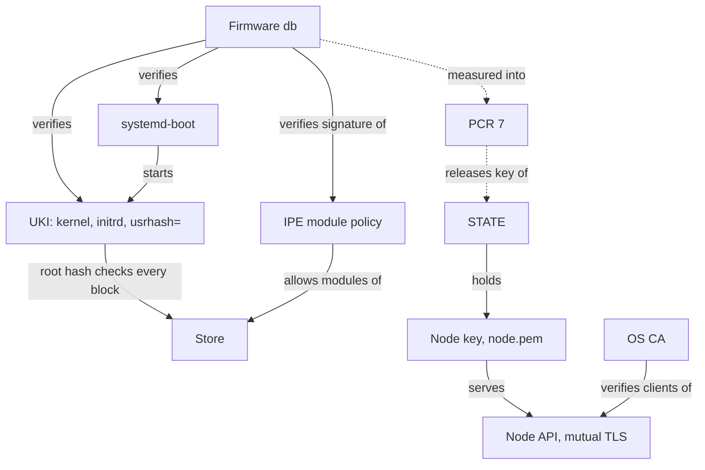
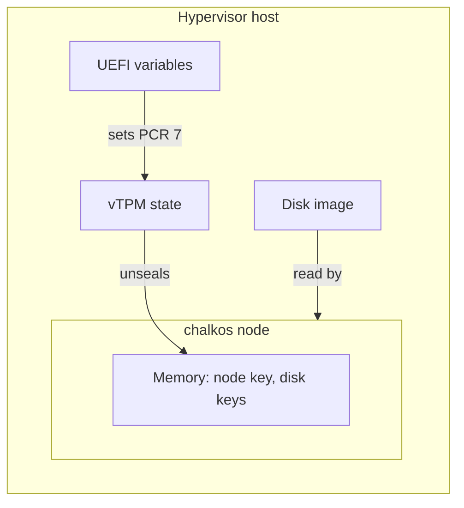

# Chain of trust

Two lines of `chalkctl status` report the two ends of a node's chain of trust:

```text
module policy: enforced (version 0.5.0)
...
trust:
  OS CA    aaaaaaaaaaaaaaaa (issues)
  node CA  cccccccccccccccc, dddddddddddddddd (issues)
```

The first line says that Secure Boot verified the boot and that the kernel loads modules only from
the image the key holder signed. The second names the certificate authorities whose clients the
node accepts on its API. Between the two ends, each stage checks the next one before the next one
runs, and the TPM releases the disk keys only under the Secure Boot state the node was installed
under. This page also covers where each key lives, what the chain proves on bare metal and in a
virtual machine, and what it does not prove yet. [Security model](security.md) covers each
mechanism in more detail.

## Each stage verifies the next before it runs

The firmware's db holds the certificate of the key that signs the images. Everything that runs on
a node derives its trust from that certificate, through the stages in the diagram. The dotted
arrows show what the TPM measures and the key it releases.



The table lists each stage, what checks it and what happens when the check fails:

| Stage | Checked by | Against | When the check fails |
| --- | --- | --- | --- |
| systemd-boot | The firmware, at every boot | db and dbx | The firmware refuses to start it. |
| UKI | The firmware, at every boot; chalkd and the installer before they write it | db and dbx | The firmware refuses to start it; chalkd and the installer refuse the upgrade or the install. |
| Store | dm-verity, on every read | The root hash in the UKI's `usrhash=` | The block fails to read. A store of another image has other partition UUIDs, so the UKI does not boot it. |
| Kernel modules | IPE, on every load | The store's root hash and the initrd, in a policy signed with the db key | The kernel refuses the module and logs an audit record. |
| STATE, VAR and encrypted volumes | The TPM, in the initrd | PCR 7 at install | The console asks for the fallback, the recovery key or a password. With fallback `none`, a volume can only be recreated empty, and a node whose STATE or VAR does not unlock has to be reinstalled. |
| A client of the node API | chalkd, on every request | The OS CAs the node trusts at that moment | The handshake or the call fails. |

[dm-verity ties every block of the store to the UKI](image.md#dm-verity-ties-every-block-of-the-store-to-the-uki),
[The UKI is checked against db and dbx before anything runs it](image.md#the-uki-is-checked-against-db-and-dbx-before-anything-runs-it)
and [Kernel modules load from the image alone](security.md#kernel-modules-load-from-the-image-alone)
describe the checks of the code, and
[chalkd checks the role of every request](security.md#chalkd-checks-the-role-of-every-request) the
check of the API.

## The TPM measures the boot and releases keys to PCR 7

A PCR (platform configuration register) is a register in the TPM that software can extend but never
set: the TPM hashes the old value with a new measurement and stores the result. A PCR's value
summarises every measurement since the machine was reset, in order. The TPM seals a key to one or
more PCR values and releases it only while the registers hold those values.

The firmware and systemd-stub, the EFI stub inside the UKI, measure several stages of a chalkos
boot. chalkos uses two of the registers:

| PCR | Measures | Measured by | chalkos uses it |
| --- | --- | --- | --- |
| 2 | The drivers the firmware loaded from expansion cards, their option ROMs | The firmware | `chalkctl secureboot enroll` reads the event log of PCR 2 so the new db allows those option ROMs, as [Allow the cards' option ROMs](../../operate/secure-boot.md#allow-the-cards-option-roms) shows. |
| 4 | The boot loader and the UKI, as binaries | The firmware | No. |
| 7 | Whether Secure Boot is on, PK, KEK, db and dbx, and the db certificate that verified the boot binaries | The firmware | The keys of STATE, VAR and encrypted volumes are sealed to it. |
| 11 | The UKI's sections: the kernel, the initrd, the kernel command line with `usrhash=` and os-release | systemd-stub | No. |

chalkos seals the disk keys to PCR 7 alone because an upgrade changes PCR 4 and PCR 11 with every
image. A new image signed with the same db key leaves PCR 7 as it was, so the node unlocks its
disks after an upgrade without anyone typing a key.
[The TPM seals the disk keys to PCR 7](storage.md#the-tpm-seals-the-disk-keys-to-pcr-7) explains
the choice, and
[A changed PCR 7 sends the unlock to the console](storage.md#a-changed-pcr-7-sends-the-unlock-to-the-console)
lists what changes the register.

## The signing keys never reach a node

The keys that sign images and the OS CA's key never reach a node. A node holds its own key and,
on a control plane, the keys of the CAs that issue node certificates and Kubernetes certificates.

| Key | Where it lives | Protected by |
| --- | --- | --- |
| db key, which signs systemd-boot, the UKI and the module policy | The machine that runs `chalkbuild sign` | Its owner; chalkos never sees it outside `chalkbuild sign`. |
| OS CA key and the Kubernetes CA keys | The secrets file, `secrets.age` | age encryption to the recipients given to `chalkctl gen secrets`. |
| Node CA key and, with the Kubernetes layer, the Kubernetes CA keys | STATE of each control plane | The LUKS encryption of STATE. |
| Node key | `/state/chalkd/node.pem` on STATE, and the memory of chalkd | The LUKS encryption of STATE, and root's ownership of the file. |
| Client key | The client file on an operator's machine, mode 0600 | The operator's machine. |
| Disk keys of STATE, VAR and encrypted volumes | The LUKS2 header, sealed by the TPM | The TPM and PCR 7. |
| Recovery key | Nowhere; chalkctl derives it from the secrets file and the node's name | The secrets file. |

A node's identity on the API is its node key, a file on an encrypted disk. The TPM
protects that file at rest. Once STATE is unlocked, the key is ordinary memory and an ordinary
file, which root on the node can read.

## Whoever controls the TPM controls the disk keys

The TPM is the anchor of the disk keys, so the disk encryption protects against an attacker only
when that attacker controls neither the TPM nor the running node. On bare metal, the TPM is a
discrete chip or a firmware TPM in the machine's processor, and its keys do not leave it. In a
virtual machine, the hypervisor emulates the TPM, so the encryption protects only against
attackers outside the hypervisor.

A virtual machine's TPM is a vTPM, such as swtpm, which the hypervisor runs and whose state it
keeps in a file beside the VM's UEFI variables. The hypervisor's admin owns both files, the VM's
memory and its disks, as the diagram shows. A copy of the disk image alone does not unlock, because
the copy lacks the vTPM's state. A copy of the disk image, the vTPM's state and the UEFI variables
together is the same machine, and it unlocks.



The table compares what stops each attacker:

| Attacker | Bare metal with a hardware TPM | Virtual machine with a vTPM of the hypervisor |
| --- | --- | --- |
| Takes a disk, or copies the disk image | Stays locked: the disk is sealed to another machine's TPM. | Stays locked without the vTPM's state. |
| Boots the machine with other Secure Boot keys or with Secure Boot off | Stays locked: PCR 7 differs. | Stays locked: PCR 7 differs. |
| Copies the disk, the TPM's state and the UEFI variables | Not possible: the TPM's keys never leave the chip. | Unlocks: the copy is the same machine. |
| Runs as root on the running node | Reads the node key and can unseal the disk keys again. | Reads the node key and can unseal the disk keys again. |
| Reads the running machine's memory | Not defended. | Reads every key, as the hypervisor's admin can at any time. |

On a hypervisor that another party runs, the disk encryption protects the disks from
everyone except that party. [Install a node in a VM](../../operate/install-vm.md) shows how to keep the
vTPM's state and the UEFI variables for the node's life, so a node keeps unlocking itself.

## Limits

The chain keeps a node from booting anything the key holder did not sign, but nobody outside the
node can check what it booted yet. The
[roadmap](../../contribute/roadmap.md#measured-boot-and-attestation) lists the planned work for
each limit.

### A running node can unseal its disk keys again

PCR 7 holds the same value after the initrd as during it, because nothing measures into it once the
firmware has started the UKI. A process that runs as root on the host and opens the TPM device can
ask the TPM to unseal the keys of STATE and VAR, as the initrd did. systemd can extend a register
when the initrd hands over to the system and seal the keys to that boot phase as well. chalkos
does not use that yet.

### PCR 7 accepts every image signed with the db key

PCR 7 records which db certificate verified the boot binaries, and not which binaries. An older
image with a known flaw, signed with the same key, unseals the keys too, until dbx revokes its
UKI or the key. A policy signed with the image's PCR 11 values would bind the keys to images the
key holder signed, including their stores through `usrhash=`.

### The node key can be copied

The node key is a file. Root on the node, or anyone who unlocks STATE, can copy it and act as
the node on the API. On a Kubernetes node, the copy can also renew the certificate before it
expires, so expiry alone does not end it. `chalkctl node revoke` stops the renewals, and the copy
then works until its certificate expires or the OS CA is rotated. A key that the TPM
generates and keeps cannot leave the TPM, and only that TPM could sign the TLS handshakes.

### No one outside the node can verify what it booted

chalkos has no remote attestation. chalkd serves no TPM quote, which is a PCR value signed by a
key of the TPM, and no event log. chalkctl verifies the node's certificate and not the image the
node booted. An operator learns which image a node runs from chalkd's report, so the report is
as trustworthy as the node that sends it.

Some of what an attestation needs exists already. Two builds from the same inputs have the same
store and so the same root hash, as
[The root hash identifies an image](image.md#the-root-hash-identifies-an-image) explains. The UKI
carries the root hash on its command line, which systemd-stub measures into PCR 11. A verifier
could therefore compute the PCR 11 value of every image from its build.

### Confidential virtual machines are not supported

In a virtual machine, the TPM, the memory and the disks belong to the hypervisor, as
[Whoever controls the TPM controls the disk keys](#whoever-controls-the-tpm-controls-the-disk-keys)
describes. AMD SEV-SNP and Intel TDX encrypt a VM's memory against its host, and a vTPM inside
the guest's encrypted memory, such as one that COCONUT-SVSM runs, would take the TPM away from
the host. chalkos is neither built nor tested for such VMs, and nothing checks their attestation
reports.

## Related pages

- [Security model](security.md): Secure Boot, the TPM, the API's roles and their limits in detail.
- [Storage and encryption](storage.md): the encrypted volumes, their keyslots and the fallback.
- [The image](image.md): the store, dm-verity and the UKI.
- [Certificates](certificates.md): the CAs of the node API, renewal and rotation.
- [Enrol Secure Boot keys](../../operate/secure-boot.md) and [Sign images for Secure Boot](../../build/sign-images.md).
- [Roadmap and known limits](../../contribute/roadmap.md#measured-boot-and-attestation).
