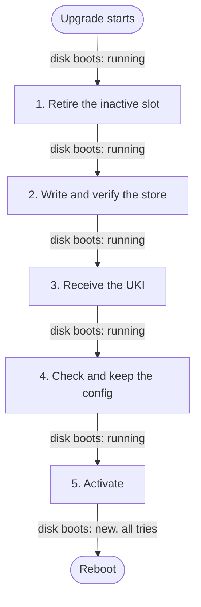

# Upgrades

An upgrade installs a new image on a node. `chalkctl upgrade` prints each node's progress, here
for one node of a run, shortened:

```text
cp1: installing 3fa9c1e2b7d0 (v1.5.0, a1b2c3d4e5f6)
cp1: installed 3fa9c1e2b7d0 (v1.5.0, a1b2c3d4e5f6), which boots next as chalkos_2+3.efi
cp1: 3fa9c1e2b7d0 (v1.5.0, a1b2c3d4e5f6) renders and checks any outputs it declares when it first boots; if one fails, the node falls back to the image it runs
cp1: rebooting into 3fa9c1e2b7d0 (v1.5.0, a1b2c3d4e5f6)
cp1: runs 3fa9c1e2b7d0 (v1.5.0, a1b2c3d4e5f6), found healthy
```

chalkd writes the image into the node's inactive slot and installs its UKI with a fixed number of
tries. The node then boots the new image, and an image that does not become healthy is replaced
by the one before. This page follows one node's upgrade.

!!! note "On the shipped variant, chalkctl rolls the upgrade through the cluster"

    chalkctl upgrades the control planes first, one at a time, while etcd keeps its quorum, and
    drains each node before it reboots. [Kubernetes upgrades](../kubernetes/upgrades.md) describes
    the roll.

## An upgrade replaces the whole image

An upgrade replaces the whole image with another, which its store's root hash identifies. Any
change to an image's modules gives it a new root hash, so a new build needs nothing raised before
it is installed. A node has no packages to update. A new release of any software on it is a new
image, installed like any other.

The node receives three parts of the image, in this order:

- the store's data, the compressed erofs file system that the root hash covers, about 250 MiB for
  an image with Kubernetes;
- the store's dm-verity hash tree, about 2 MiB;
- the UKI, about 44 MiB, signed for Secure Boot.

An upgrade never sends a boot loader, and the node refuses one, so systemd-boot stays as it was
installed. The parts are the ones an install sends, read from the same image, so a node installed
from an image and one upgraded to it run the same bytes.

The node keeps no upgrade state of its own. The slots' partition UUIDs and labels and the UKIs on
the ESP say what is installed. So any step can stop at any point, and running the same command
again continues.

## chalkctl takes each node's image from the inventory

Without `--image`, each node gets the image the inventory names for it. chalkctl asks every node
what it runs, refuses a node that runs another platform than that image, and opens each image
directory once for the nodes that share it. The image in the directory must be the build whose
root hash its `metadata.json` names, which `chalkctl status` compares the nodes with. The root hash
stays on the operator's machine, so a new build changes no node's config, and an upgrade needs no
`chalkctl apply-config` after it.

With `--image`, chalkctl takes a prebuilt image: a raw image with `repart-output.json` beside it,
or an image directory. It installs the image on the nodes that run the image's variant, or on the
nodes `--nodes` names, whatever they run. Nodes on another platform than the image's are skipped
and named. chalkctl prints each node that gets an image of another variant than the one it runs.
The check of the node's config against the image's schemas decides whether such an image suits
it. In both cases chalkctl sends the image as the directory holds it, a copy that
`chalkbuild sign` signed, so the signing key stays on the machine that ran chalkbuild. Without an
inventory, `--address NODE=ADDR` names the nodes, and `--image` is needed.

An image the inventory names in a registry, by `source.oci`, is pulled by each node. chalkctl
resolves the reference to a digest once and reads the manifest, the header and the contract. It
sends each node the reference by that digest, with the header's sizes and SHA-256 sums of the
store, hash tree and UKI. chalkd pulls those layers, through the node's
[`Mirror`](../../reference/kinds.md#mirror) of the registry if it has one, and checks them against
what chalkctl sent. It authenticates to each host with the
[`Registry`](../../reference/kinds.md#registry) of that host, from the config the upgrade delivers
or else the config it runs. It pulls over HTTPS unless that `Registry` sets `insecure`.
[Publish images to a registry](../../build/publish-images.md#upgrade-from-the-registry) covers the
steps.

## chalkctl checks the image before it sends anything

Before it sends anything, chalkctl checks each image against the nodes:

- the UKI boots the store the image holds: its `usrhash=` equals the store's root hash;
- the UKI's os-release sets `IMAGE_VERSION` empty, so systemd-boot orders the node's entries by
  generation, and names a variant and platform;
- the config the inventory gives each node that gets the image suits the `schemas/` and
  `image.json` in the image's directory, as an install checks the config it delivers.

chalkctl checks every node's config before it changes the first node. It needs the inventory for
that, whatever it authenticates with. Without one, the node's own check is all there is. For an
image in a registry, chalkctl checks the config against the artifact's contract and reads no UKI,
so the node alone checks the UKI's `usrhash=` and os-release.

chalkctl checks no signature. Each node checks the UKI against its firmware's db and dbx before it
writes anything, as [The image](image.md#the-uki-is-checked-against-db-and-dbx-before-anything-runs-it)
describes.

## Operator upgrades carry no config

An upgrade with an admin client file or the secrets file carries config. chalkctl sends each node
its config with the image: the set the inventory gives the node, which it checked against the
image. The node checks the set against the image again and keeps it in the new image's
[config slot](config.md#where-does-a-node-keep-its-config), beside the slot of the image it runs.
The new image boots with its own config, and a fallback boots the previous image with the config
it ran. Config that only the new image accepts, such as a document of a kind its extension
declares, therefore goes with the upgrade.

The [Upgrade](../../reference/api.md#method-upgrade) method needs the operator role, and the admin
role when it carries config or a fallback secret, as `apply-config` does. With an operator client
file, chalkctl sends no config. With an inventory it prints one line for the run, in place of a
line per node:

```text
config not delivered: the operator role cannot deliver config; each node carries its own over
```

Without an inventory, chalkctl sends no config either. In both cases the node carries the
documents of the running image's slot over, checked against the new image the same way.

The config meets the new image's [change rules](../../build/guard-changes.md) as `apply-config`'s
config meets the running image's. The rules compare it with the running slot's config and the
storage STATE records. A storage change that takes a reset or a reinstall is refused, and so is a
change of a setting the rules fix. A new volume is created before the image
boots, while the running image runs. chalkctl sends the fallback secret such a volume is enrolled
with: the recovery key from the secrets file, or a password from `--password-file`.
[Config and the inventory](config.md#which-changes-does-a-node-accept) lists what each change
takes.

Before it sends a node the image, chalkctl prints a line of what the config changes against the
running image's, the slot the new one replaces, such as `w1: config 1 added, 0 removed, 1 changed`.
Without an inventory, the line says there is nothing to compare with. `chalkctl upgrade --diff`
prints the whole comparison for every node and changes nothing.

## The node checks the image against itself before it writes

Before it changes anything, chalkd needs normal mode and checks the image's header against the
running image's os-release and the disk:

- The image ID and platform equal the running image's, and the architecture is the machine's.
- The root hash is not the running one. If it is, the node answers that it runs the image already
  and changes nothing.
- The entry the node booted, and any other the upgrade keeps, is named `chalkos_<generation>.efi`
  with a generation from 1 on and no leading zeros. No name on the ESP gives a generation too large
  for one to follow it in 64 bits. chalkd never writes other names. It refuses to upgrade past one
  placed by hand or corrupted until the node is reinstalled or the entry renamed.
- The root hash is not that of the entry that boots next: the highest generation with tries left
  that the node did not boot. If it is, and the inactive slot holds its store, chalkd checks the
  config the upgrade carries against the image, as step 4 below does. It keeps the config for the
  image in place of the config it had, and answers that the image is staged already, without
  writing the image again. When the check refuses, it retires the slot and removes the entry and
  the image's config slot, so the running image boots next.
- The running boot was found healthy, when the upgrade would remove the image the node falls back
  to.
- The store and hash tree fit the inactive slot.

Any other root hash is installed as the next generation: a newer image, an older one, or one whose
earlier entry used up its tries, which the retirement then removes.

The UKI is checked when it arrives, before anything can boot it. Its SHA-256 must match the
header. Its os-release must name the same image ID and platform as the header and set
`IMAGE_VERSION` empty. Its `usrhash=` must equal the header's root hash, and its boot tries must be
a positive number. With Secure Boot enforced, chalkd checks its signature against the firmware's
db and dbx.

## chalkd writes the inactive slot in five steps

chalkd installs in five steps. At every point between them the disk boots the running image, or,
after the last step, the new one with all its tries.



1. Retire the inactive slot. chalkd removes every UKI of the image on the ESP except those that
   boot the running store. This includes a UKI that a stopped upgrade left under its temporary
   name, and a file whose name gives a generation of the image but that is no UKI. A UKI whose
   os-release names no `IMAGE_ID`, such as another system's, stays. A UKI the ESP fails to read
   stops the upgrade. Then chalkd gives the slot's partitions random UUIDs and the label `_empty`,
   so nothing can boot them.
2. Write and verify. chalkd writes the store and hash tree into the slot, checks their SHA-256
   sums and verifies the store read back from the disk against the root hash. A slot that already
   holds this store is not written again.
3. Receive the UKI. chalkd writes it to the ESP as `/EFI/Linux/.upgrade-<root-hash>.efi`, a name
   systemd-boot ignores, and checks it.
4. Check and keep the config. chalkd opens the written store read-only through dm-verity with the
   image's root hash. It reads the schemas and `image.json` of the system the UKI boots, and checks
   the config the upgrade carries against them, or without one the running slot's documents. The
   check is an install's: the set rules, each document's schema and, on an image with Kubernetes,
   the cluster it gives. chalkd evaluates the image's change rules against the running slot's
   config, the storage STATE records and the node's facts. It refuses a change they refuse, makes
   the storage changes they accept, such as a new volume, and writes the image's config slot
   `/state/config/<root-hash>`. An image that would not accept the config would fail its boot in
   `chalkos-config`, and boot counting would fall back. When the check refuses, chalkd answers
   with the reason, removes the UKI and leaves the slot retired. The running image stays the next
   boot, and the next upgrade reuses or overwrites the slot. A node whose running slot holds no
   documents and that gets none refuses the upgrade.
5. Activate. chalkd gives the slot the partition UUIDs derived from the root hash and the labels
   `store_<hash16>` and `store-verity_<hash16>`, from the root hash's first 16 hex characters. It
   renames the UKI to `chalkos_<generation>+<tries>.efi`, one generation above the highest any
   name on the ESP gave, whatever its UKI holds. The rename is the last change: before it, nothing
   boots the slot. After it, chalkd records the image's revision and tag in
   `/state/chalkd/images.json`. It forgets the images that no UKI on the ESP boots any more, with
   their config slots. A refused upgrade forgets the images it retired the same way.

The running slot and its UKI are never written. When the client stops sending, chalkd stops
between steps, never in the middle of a partition table change.

## The node boots the new image on trial

After the install, chalkctl reboots the node and waits until it runs the new image's root hash
and its boot was found healthy. systemd-boot counts the new entry's tries, and the health check
blesses the entry once the boot is good. [Boot, health and rollback](boot-and-rollback.md)
explains the counted tries, the health check, the blessed boot and the fallback.

chalkctl upgrades nodes without Kubernetes in batches of `--max-unavailable`, 1 by default. With
`--no-reboot`, it installs on every node without rebooting it, and each node boots the new image at
its next reboot. A node that has the image staged already, after an upgrade with `--no-reboot`,
gets the image again only when the config kept for it is not the inventory's. The node then
replaces that config without writing the image again.

## A rolled-back node stops the run

A run stops at the first node that fails and leaves the rest as they are. The most important case
is a rollback: a node that fell back from the new image. The error names the node and the image it
runs again, and the journal lines its failed boot recorded follow it:

```text
chalkctl: w2: upgrade to 3fa9c1e2b7d0 (v1.5.0, a1b2c3d4e5f6) failed: rolled back to 81bd02c4a9e1 (v1.4.0, 0f1e2d3c4b5a); it stays cordoned; its boots logged:
```

A run also stops when a node does not come back healthy within `--timeout`, 30 minutes by
default.

## Running the command again continues

Running the same command again continues where the last run stopped:

- A node that runs the new image with a blessed boot is skipped.
- A node that booted the new image and is still being counted is waited for.
- A node that has the image installed already is rebooted without the image being sent again.

A node that fell back from the image stops every later run too, so a known-bad image never boots
again by itself. `--retry-failed` installs it once more on such nodes, as the next generation, for
a failure that lay outside the image. Each node is upgraded once per run, so a second fallback
stops the run again. Usually the fix is a new build, which has a new root hash and is installed
like any other image.

## A downgrade is an upgrade to another root hash

chalkd has no notion of older or newer. A downgrade is an upgrade to another root hash, installed
as the next generation, so systemd-boot boots it first like any upgrade. When its tries are used
up, the node falls back to the image it ran. When the inactive slot still holds the older image,
as after one upgrade, its store is not written again. Neither chalkctl nor chalkd warns of a
downgrade. Whether the older image still suits the node's data is for the operator to know.

## Secure Boot decides which images a node trusts

chalkd checks that an image is of its platform, that the node's config suits it, and that it boots
the store it carries. It cannot tell an image to trust from another, and Secure Boot does that.
With Secure Boot enforced, the node refuses a UKI that the firmware's db does not accept, so only
images signed by a trusted signer run. Without Secure Boot, an operator can upgrade a node to any
image. That image then runs as root with STATE and VAR unsealed, because their keys are sealed to
PCR 7 alone. [Security model](security.md) explains the consequences.

An image a node pulls from a registry passes the same checks as a streamed one, against the
digests and root hash chalkctl read. The registry therefore needs no more trust than a directory
an image is streamed from.

After a rotation of the OS CA, images rebuilt from the new `secrets.pub.json` and rolled out with
`chalkctl upgrade` bring the trust of maintenance mode up to date, for nodes that are installed
again later.

## Limits

- Every node receives the whole compressed store, about 300 MiB with the hash tree and UKI. There
  are no delta updates, and nodes do not share a download.
- An image reaches a node only when chalkctl starts an install or an upgrade: streamed from a
  directory, or pulled from a registry.
- An upgrade never updates systemd-boot.
- The health check does not cover workloads. An image that breaks only workloads is blessed, and
  the run continues.

## Related pages

- [Boot, health and rollback](boot-and-rollback.md) for boot counting and the health check.
- [The image](image.md) for what an image holds and how its root hash identifies it.
- [Kubernetes upgrades](../kubernetes/upgrades.md) for the roll through a cluster.
- [Upgrade nodes](../../operate/upgrade.md) for the task, step by step.
- [`chalkctl upgrade`](../../reference/cli/chalkctl_upgrade.md) and the
  [Upgrade](../../reference/api.md#method-upgrade) method for the details.
