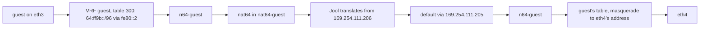

# NAT64 and DNS64 on a router

A router image translates IPv6 connections to IPv4 with Jool, a stateful NAT64 in the kernel. It
resolves names with Unbound, whose DNS64 module synthesises AAAA records in a NAT64 prefix. The
output `jool` renders an instance of Jool per `NAT64` document, and each instance runs in a
network namespace of its own, joined to its VRF by a link. The output `unbound` renders Unbound's
whole config of each `Resolver` document, one resolver per VRF. The documents name their prefixes
independently: a NAT64 names the prefix it translates, a resolver the prefix it synthesises in,
and `BGP.spec.networks` the prefix BGP announces.

## The output jool renders an instance and a link per NAT64

`chalkos-render jool` writes two files per `NAT64`, named after it. The edge of
[Translate to IPv4 and resolve names](../../router/nat64-and-dns.md) renders `edge.json`, in
Jool's own format:

```json
{
  "instance": "edge",
  "framework": "netfilter",
  "global": {
    "pool6": "64:ff9b::/96"
  },
  "pool4": [
    {
      "protocol": "TCP",
      "prefix": "192.0.2.252/30",
      "port range": "61001-65535"
    },
    {
      "protocol": "UDP",
      "prefix": "192.0.2.252/30",
      "port range": "61001-65535"
    },
    {
      "protocol": "ICMP",
      "prefix": "192.0.2.252/30",
      "port range": "61001-65535"
    }
  ]
}
```

It also renders `edge.veth`, the link that joins the instance's namespace to its VRF:

```json
{
  "vrf": null,
  "table": 254,
  "outer": "169.254.96.241/30",
  "inner": "169.254.96.242/30",
  "routes": [
    "192.0.2.252/30"
  ]
}
```

- `vrf` is the NAT64's VRF, or null for the default VRF, and `table` that VRF's routing table:
  254, the main table, for the default VRF.
- `outer` is the address of the link's end in the VRF, and `inner` the address of its end in the
  namespace.
- `routes` are the prefixes of an explicit pool, which the VRF's table routes to the inner end.

An entry of `pool4` becomes an entry per protocol. An empty `pool4` renders the inner address as
the pool, with the ports 61001 to 65535. The VRF example's `guest` renders this `pool4` in
`guest.json`, an entry per protocol of `169.254.111.206/32`, and no routes in `guest.veth`:

```json
{
  "protocol": "TCP",
  "prefix": "169.254.111.206/32",
  "port range": "61001-65535"
}
```

The link's addresses are a /30 of `169.254.64.0/18`, whose 4096 /30s the NAT64s share. The
renderer takes the FNV-1a hash of the NAT64's name modulo 4096, so the /30 depends on the name
alone: `edge` takes `169.254.96.240/30` and `guest` `169.254.111.204/30`. The outer end takes the
/30's first host and the inner end its second. A NAT64 keeps its addresses while other NAT64s come
and go, and nothing moves another NAT64's link. Two names whose hashes pick one /30 are refused,
the later name in the message. While the node has a NAT64, the rules and the renderer also
refuse a static address of a `Network` document in `169.254.64.0/18`.

`jool file check`, the output's check, reads a file's syntax and bounds alone. The renderer parses
every value and refuses what Jool's kernel module or the link would refuse once the instance
loads:

- a name of more than 11 characters, as the link `n64-<name>` is an interface name of 15;
- a prefix of another length than RFC 6052's, or one whose bits 64 to 71 are set;
- two NAT64s of one VRF whose prefixes overlap;
- ports of the kernel's ephemeral range, 32768 to 60999, which Jool refuses for any address;
- a pool entry of link-local addresses, which the NAT64s' links take;
- a pool entry that holds an address a `Network` document gives a link;
- two entries of one pool that share an address, a protocol and a port, and two NAT64s whose
  pools share an address;
- a VRF that no `VRF` document declares.

The rules refuse each of these too, so `chalkctl validate` reports them; two names of one /30
are the renderer's alone. The rules read a link's static addresses from `Address=` in the
`[Network]` and `[Address]` sections and `ServerAddress=` in `[DHCPServer]`, as the renderer
does. Naming the `Network` of each address would cost the rules a loop more than chalkd allows,
so their messages leave it out, while the renderer's name it. The rules also refuse a `VRF` whose
name starts with `n64-`, which the NAT64s' links take.

The output's inputs are `NAT64`, `VRF` and `Network`, so a change of a VRF's table changes
`.veth` too.

## Each instance runs in a namespace of its own

Jool in netfilter mode takes packets at its namespace's prerouting hook, on every link of the
namespace, members of VRFs included. It then routes what it translated in the main table. An
instance in the router's own namespace would therefore translate the packets of every VRF into
the default VRF. Each instance, the default VRF's too, runs in a network namespace of its own,
`nat64-<name>`, and sees the packets that its VRF routes to it alone.

A veth pair joins the namespace to the VRF: `n64-<name>` in the VRF, or in the default VRF, and
`nat64` in the namespace. Both ends have an MTU of 65535, so the router's real links decide the
path MTU. The outer end holds the `outer` address and `fe80::1/64`, the inner end the `inner`
address and `fe80::2/64`, without duplicate address detection. The VRF's table routes the prefix
via `fe80::2` and an explicit pool's prefixes via the inner address, with the protocol 64, which
`chalkctl node routes` names `nat64`. The namespace has default routes back via the outer address
and `fe80::1`, and forwards nothing of either family itself. Jool sends what it translated. A
packet it leaves alone would return to the router, which would route it into the namespace again
until its hop limit ran out.

The guest of the VRF example reaches the IPv4 internet like this:



The router's own connections to the prefix take the same path, so they reach the NAT64 too.

networkd leaves the NAT64s' links alone. On a router image the output `networkd` renders
`00-n64-<name>.network`, which matches `n64-<name>` and sets `[Link] Unmanaged=yes`. It refuses a
networkd document of that name, a `NetDev` that creates a device of the link's name and a
`Network` that networkd would apply to the link first.

## chalkos-nat64 brings the instances to the rendered files

`chalkos-nat64.service` runs the instances. It is a oneshot unit that starts at boot after
`chalkos-config.service`, `chalkos-firewall.service` and `systemd-networkd.service`, and before
`frr.service`. Each delivery that changes the output reloads it. A start and a reload do the same:

1. It reads every file first, Jool's with `jool file check` and the link's against the form that
   chalkos-render writes. A file it refuses fails the unit, and no instance changes. It then
   reads the router's IPv4 addresses, those from DHCP included, which the rules cannot see. An
   explicit pool that holds one fails the unit too, before any instance changes:
   `chalkos-nat64: NAT64 edge: the pool entry 192.0.2.252/30 holds 192.0.2.253, an address of the link eth0, …`.
2. Per instance, it creates the namespace, turns forwarding off inside it, and creates the veth
   pair. A link whose other end is not in the namespace is made anew. A device of the link's name
   and another kind, such as a dummy, stays, and the instance fails.
3. It puts the outer end into its VRF, or out of every VRF for the default VRF. networkd creates
   a VRF without waiting, at boot and when a delivery changed its table, so the unit waits up to
   30 seconds for the VRF's device with the rendered table. A VRF that does not have it by then
   fails the instance with `chalkos-nat64: VRF guest has no table 300 after 30 s`. The unit
   waits once per VRF, and the other instances of that VRF fail at once.
4. It sets the addresses of both ends and the namespace's default routes.
5. `jool file handle`, run in the namespace through `nsenter`, creates the instance or replaces it
   in one step. A replaced instance keeps its sessions, so a delivery that changes a pool ends no
   connection. Jool keeps an instance's prefix, so an instance whose `NAT64` changed its prefix
   is removed first, and its sessions end.
6. It routes the prefix and an explicit pool's prefixes to the link in the VRF's table.

It then removes, in this order, Jool's instances of the router's own namespace, such as one an
older image ran, routes of protocol 64 that no file names, `n64-` links that no file names, and
`nat64-` namespaces that no file names. Removing a namespace removes its instance and its veth
pair. A route never goes with its link before its own removal.

A step that fails leaves the others to run, and the unit then fails with each failed step. An
instance that failed keeps the routes its file names. Stopping the unit removes every instance,
namespace, link and route. In maintenance mode the node renders no output, so it runs no
instance. The image loads Jool's kernel module at boot.

`ip netns add` mounts each namespace below `/run/netns`, where the host and chalkd must see it.
The unit therefore has no mount namespace of its own: it runs without `ProtectSystem`,
`PrivateTmp`, `PrivateDevices`, `ProtectHome`, `ProtectKernelLogs`, `ProtectKernelModules`,
`ProtectControlGroups` and `ProtectKernelTunables`, each of which would give it one. It keeps
`CAP_NET_ADMIN` and `CAP_SYS_ADMIN`, which mounting and entering the namespaces take, netlink and
Unix sockets alone, and `RestrictNamespaces=net`.

## The firewall around the NAT64 links

A namespaced instance's packets pass the router's firewall twice: the clients' IPv6 packets on
their way into the link, and the translated IPv4 packets on their way out of it. The output
`router-nftables` reads the `NAT64` documents and renders lines of their own, each with the
comment `NAT64 <name>`.

The forward chain, once it drops, accepts what Jool translated, after the protected rules and
before the policies. Out of the link come IPv6 from the prefix and IPv4 from the pool, or from the
inner address for an empty pool. Into the link go IPv6 to the prefix and IPv4 to an explicit
pool. The forward hook sees a packet from a VRF's link with the VRF's device as `iifname`, so a
VRF's NAT64 is matched by `meta sdifname`. The edge renders:

```text
iifname "n64-edge" ip6 saddr 64:ff9b::/96 accept comment "NAT64 edge"
iifname "n64-edge" ip saddr { 192.0.2.252/30 } accept comment "NAT64 edge"
oifname "n64-edge" ip6 daddr 64:ff9b::/96 accept comment "NAT64 edge"
oifname "n64-edge" ip daddr { 192.0.2.252/30 } accept comment "NAT64 edge"
```

and `guest`, of the VRF `guest` with an empty pool:

```text
meta sdifname "n64-guest" ip6 saddr 64:ff9b::/96 accept comment "NAT64 guest"
meta sdifname "n64-guest" ip saddr 169.254.111.206 accept comment "NAT64 guest"
oifname "n64-guest" ip6 daddr 64:ff9b::/96 accept comment "NAT64 guest"
```

An empty pool's replies come back as part of the masqueraded connections, which the chain
accepts as established. Anything else on a NAT64's link goes on to the zones' policies, and is
dropped: the renderer refuses a `FirewallZone` whose `interfaces` name or glob a NAT64's link, so
no zone holds one. It also refuses a NAT rule whose interface matches nothing but NAT64 links,
which the NAT chains leave alone.

The NAT rules leave the NAT64s' traffic alone. The `srcnat` chain, when it exists, starts with
the NAT64s' lines, and an empty pool adds the chain by itself. The edge's lines exempt connections
into its link, from its prefix and from its pool:

```text
oifname "n64-edge" accept comment "NAT64 edge"
ip6 saddr 64:ff9b::/96 accept comment "NAT64 edge"
ip saddr { 192.0.2.252/30 } accept comment "NAT64 edge"
```

An empty pool masquerades the inner address to the address of the link a connection leaves
through, within the ports Jool takes of it:

```text
oifname "n64-guest" accept comment "NAT64 guest"
ip6 saddr 64:ff9b::/96 accept comment "NAT64 guest"
ip saddr 169.254.111.206 meta l4proto { tcp, udp } masquerade to :61001-65535 comment "NAT64 guest"
ip saddr 169.254.111.206 masquerade comment "NAT64 guest"
```

When the config has `dnat` rules, the `dstnat` chain starts with exemptions for connections out
of each NAT64's link and to its prefix and explicit pool. The output refuses a `dnat` rule whose
`match.destination` lies in a prefix or pool, and a `dnat` or `snat` rule whose `to.address` lies
in a pool, as a pool's addresses belong to its NAT64 alone.

A VRF with a conntrack zone takes its NAT64's link into the zone, in the `ct-prerouting` and
`ct-output` chains, so a connection and its translation share the zone:

```text
iifname { "eth3", "eth4", "n64-guest" } ct zone set 1 comment "VRF guest"
```

The prerouting chain's reverse-path filter passes the NAT64s' packets as it passes others: the
routes of the prefix, the pool and the link's /30 lead back to the link they come from.

## The output unbound renders Unbound's whole config

`chalkos-render unbound` writes `unbound.conf` from the default VRF's `Resolver`. The edge's
`Resolver` renders:

```text
# Unbound's config, rendered by chalkos-render unbound from the node's Resolver.
# unbound-control reload_keep_cache applies it.
server:
  username: ""
  chroot: ""
  pidfile: ""
  directory: "/"
  do-daemonize: no
  use-syslog: no
  ip-freebind: yes
  port: 53
  interface: 2001:db8:ffff::1
  access-control: 0.0.0.0/0 refuse
  access-control: ::/0 refuse
  access-control: 2001:db8::/32 allow
  module-config: "dns64 validator iterator"
  trust-anchor-file: "/nix/store/…-dns-root-data-…/root.key"
  dns64-prefix: 64:ff9b::/96
  domain-insecure: "ipv4only.arpa."
auth-zone:
  name: "ipv4only.arpa."
  zonefile: "/nix/store/…-ipv4only.arpa.zone"
  for-downstream: no
  for-upstream: yes
  fallback-enabled: no
remote-control:
  control-enable: yes
  control-interface: /run/unbound/unbound.ctl
```

- `ip-freebind` lets Unbound bind an address before networkd has assigned it.
- The config refuses every client of both families, and then allows the ranges of `allow`. Of
  two lines of one range the later decides, so an `allow` of `::/0` opens the family.
- With `dnssec`, the validator takes the root's trust anchor of the image. An image update
  brings a new anchor, so the resolver keeps no anchor of its own in `/var`.
- Unbound does not answer `ipv4only.arpa` by itself. The auth zone, from a file of the image,
  holds RFC 8880's `192.0.0.170` and `192.0.0.171`. The iterator reads them in place of asking
  another server, and the DNS64 module synthesises the AAAA records from them. The zone is
  unsigned, and `domain-insecure` has the validator skip it.
- A local zone becomes a `local-zone` line and a `local-data` line per record. Unbound answers
  them before DNS64, which synthesises nothing from them.
- Forwarders become a `forward-zone` of the root.

A VRF's `Resolver` renders `unbound-<vrf>.conf` of the same form, which names the VRF in its
first line and has a control socket of its own. The resolver of `guest` ends with:

```text
remote-control:
  control-enable: yes
  control-interface: /run/unbound-guest/unbound.ctl
```

The renderer parses every value of the document before it writes it: addresses and ranges as
addresses, names against a pattern of lower-case labels and record data by type. A record stands
between single quotes and a TXT record's text between double quotes, so a value that holds a
quote, a backslash or anything but printable ASCII is refused. It also refuses two resolvers of
one VRF, a VRF that no `VRF` document declares, and a `listen` address that `Network` documents
give only to links of other VRFs, whose queries the resolver would never receive. An address from
DHCP passes. The output reads `Resolver`, `VRF` and `Network`, and its check runs
`unbound-checkconf` on each rendered file in the output's sandbox, so a value that Unbound refuses
refuses the delivery before it changes anything.

The rules refuse local zones that Unbound would load and answer wrongly: a duplicate record,
which Unbound keeps one copy of, a CNAME beside another record of its name, a `redirect` zone's
record below its own name, and a zone over `ipv4only.arpa` with DNS64. The rules compare the
records in pairs, so the zones hold 150 records at most, which keeps the comparison within
chalkd's cost limit for rules.

## A delivery reloads Unbound and keeps its cache

`/etc/unbound/unbound.conf` links to the rendered file of the default VRF, and NixOS's
`unbound.service` runs it. The unit starts only when the node has that file, after
`chalkos-config.service`, `chalkos-firewall.service` and `chalkos-nat64.service`. In maintenance
mode the node has none and runs no resolver. Two effects act on the unit:

- `unbound` reloads it when the config changes, with `unbound-control reload_keep_cache`. That
  reads the new config, binds new addresses and keeps the cache.
- `unbound-start` restarts it when a delivery adds or removes the default VRF's `Resolver`, and
  starts it if it is stopped. A reload skips a unit that does not run. Once the document is gone,
  the unit's condition no longer holds and the restart leaves it stopped. Resolvers of other VRFs
  do not count.

A VRF's resolver runs as `unbound@<vrf>.service`, a template unit with the default VRF's
hardening and `CAP_NET_BIND_SERVICE` alone. It reads `unbound-<vrf>.conf` and keeps its control
socket in `/run/unbound-<vrf>`. `BindNetworkInterface=<vrf>` has systemd bind every socket of the
unit to the VRF's device, as `ip vrf exec` would, so Unbound answers on the VRF's links and sends
its queries through the VRF's table. systemd binds the sockets to the device's index, which it
looks up when the unit starts. The unit writes that index to `/run/unbound-<vrf>/ifindex` before
Unbound starts, and fails if the VRF has no device, since systemd would otherwise start Unbound
with its sockets in the default VRF. The unit requires the VRF's device unit, so a start waits for
the device to appear, but the device going away does not stop the resolver.

`chalkos-resolvers.service` runs these units. It is a oneshot unit that starts at boot after
`chalkos-vrf.service` and networkd, which create the VRFs. It starts the resolver of each rendered
`unbound-<vrf>.conf` that does not run, once the VRF's device exists, and reloads those that run.
When a delivery changes a VRF's table, `chalkos-vrf.service` deletes the VRF and networkd creates
it again with a new index. A running resolver whose recorded index differs from the device's, or
whose VRF has no device yet, is restarted once the device exists, so its sockets bind to the new
device. The unit stops the resolvers that have no config. It waits 30 seconds at most for the
VRFs' devices and 30 more for the resolvers it started, and then fails, naming each that does not
run. The effect `resolvers` reloads it when the output `unbound` or `networkd` changes. The unit
reads the indexes as a member of the group `unbound`, without capabilities.

chalkd reloads the units of one delivery in one `systemctl reload`, which follows their order:
`chalkos-firewall`, then `chalkos-nat64`, then `frr`, `unbound` and `chalkos-resolvers`, which
also waits for `chalkos-vrf` and networkd. So a resolver's port is open before it answers on a
new address, and a new prefix's route exists before FRR announces it.

The node's own name lookups go through systemd-resolved as on every node, not through Unbound.

## The firewall accepts DNS from the resolver's clients

The input chain of `inet chalkos` accepts DNS, UDP and TCP port 53, from the ranges of `allow` to
the addresses of `listen`, with a line per family that both hold. The edge renders:

```text
ip6 saddr { 2001:db8::/32 } ip6 daddr { 2001:db8:ffff::1/128 } udp dport { 53 } accept comment "Resolver resolver"
ip6 saddr { 2001:db8::/32 } ip6 daddr { 2001:db8:ffff::1/128 } tcp dport { 53 } accept comment "Resolver resolver"
```

A VRF's resolver gets the same lines with the VRF's device as `iifname`, which the input hook
gives a packet from the VRF's links. The resolver of `guest` renders:

```text
iifname "guest" ip6 saddr { 2001:db8:3::/64 } ip6 daddr { 2001:db8:3::1/128 } udp dport { 53 } accept comment "Resolver guest"
iifname "guest" ip6 saddr { 2001:db8:3::/64 } ip6 daddr { 2001:db8:3::1/128 } tcp dport { 53 } accept comment "Resolver guest"
```

These rules come after chalkd's port and the peers' ports and before the policies to `local`,
which cannot close them. [The router's firewall](firewall.md#the-input-chain) describes the
chain.

## chalkd reads the state of Jool and Unbound

`chalkctl status` shows a router's NAT64 instances and its resolvers. chalkd asks FRR, Jool and
Unbound side by side, and the questions to each have 5 seconds together.

- NAT64: chalkd lists Jool's instances with `jool instance display`, which lists those of every
  namespace, and keeps those that the output `jool` rendered a file of. For each, it enters the
  namespace with `nsenter --net=/run/netns/nat64-<name>`, reads the counters of sessions and
  bindings from `jool stats display` and sums the ports of each protocol's pool from
  `jool pool4 display`. An instance or namespace removed meanwhile is left out.
- The default VRF's resolver: when `/etc/unbound/unbound.conf` leads to a rendered file, chalkd
  asks `unbound-control status`. The resolver runs when it answers.
- The VRFs' resolvers: for each rendered `unbound-<vrf>.conf`, chalkd asks
  `systemctl is-active unbound@<vrf>.service`. A unit that is not active is reported with its
  state, such as `unbound@guest.service is failed`.

When a question fails, the status gives its error, and the status's other parts stand.

The diagnostic `nat64-sessions` lists an instance's sessions with `jool session display`, for TCP,
UDP and ICMP. It declares `networkNamespace = "nat64-{instance}"`, so chalkd runs it with
`NetworkNamespacePath=/run/netns/nat64-<instance>`, in the instance's namespace. Jool shows the
sessions to `CAP_NET_ADMIN` alone, which the diagnostic's unit gets. It needs an operator, as the
sessions show who connects where.

## Limits

- The firewall's policies do not limit who uses a NAT64. Routing to the prefix and the
  reverse-path filter do.
- A pool entry holds no address of the router's links, which the router answers itself. The
  rules cannot see an address from DHCP, so `chalkos-nat64.service` refuses it when it runs.
- An empty pool's connections are masqueraded, so conntrack lets in only the replies of
  connections that clients opened. Jool's own pools let a binding's remote hosts in.
- Each translated connection takes two conntrack entries in the router's namespace, one per side.
- A NAT64's name has 11 characters at most.
- Two NAT64 names that hash to one /30 are refused, about 1% of the time among 10 NAT64s and 4.5%
  among 20.
- networkd's IPv4 link-local addressing may pick an address in `169.254.64.0/18`, which the
  renderer cannot see.
- DNS64 synthesises no AAAA record from a local zone's records.
- A pool's ports stay out of the kernel's ephemeral range, 32768 to 60999, also for addresses the
  router does not hold.
- A NAT64 whose prefix changes, or which is renamed, loses its sessions.
- The rules do not compare a resolver's DNS64 prefix with the NAT64s' prefixes.
- The local zones hold 150 records at most.
- `chalkos-nat64.service` and `chalkos-resolvers.service` are units of the boot. When one fails
  on an upgrade's first boot, the health check fails and the node falls back to its previous
  image.
- Jool is an out-of-tree module, and the kernel marks itself tainted when it loads it. Under
  Secure Boot the module loads, as the kernel checks no module signatures. dm-verity guards the
  store that holds it.

## Related pages

- [Translate to IPv4 and resolve names](../../router/nat64-and-dns.md) configures both.
- [VRFs on a router](vrfs.md): the VRFs the NAT64s and resolvers join.
- [The router's firewall](firewall.md): the chains the NAT64s' lines sit in.
- [BGP on a router](bgp.md): announcing the prefix.
- [How a router works](overview.md): the layer's outputs and the boot order.
- [Built-ins](../../reference/builtins.md#outputs-router-images) for the outputs, their effects,
  the rules and the diagnostics.
