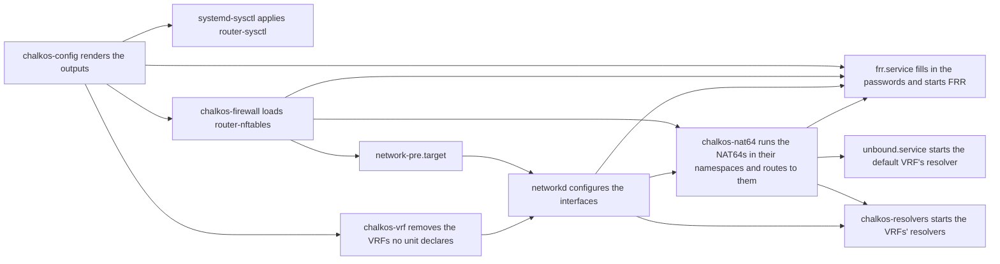

# How a router works

The router layer is what a variant adds with
[`router = true`](../../reference/mkimages.md#variantsrouter). A node of such an image forwards
IPv4 and IPv6 packets between its interfaces and accepts the kinds of
[`router.chalkos.dev`](../../reference/kinds.md#router-chalkos-dev). Its interfaces, addresses and
static routes stay networkd's `Network` and `NetDev` documents, as on every node.

## The router layer adds kinds, outputs and a firewall

A router image carries the base of every image and the router layer on top of it. An image
carries one layer at most, so a router image runs no Kubernetes. The router layer adds these
parts:

| Part | What it is |
| --- | --- |
| Kinds | `Router`, `FirewallZone`, `FirewallPolicy`, `AddressSet`, `NATRule`, `BGP`, `BGPPeer`, `PrefixList`, `CommunityList`, `RoutingPolicy`, `NAT64`, `Resolver`, `VRF` and `PolicyRoute`, which only router images accept. |
| Outputs | `router-sysctl`, the kernel settings of the `Router` document; `router-nftables`, the firewall of the firewall kinds, the chain `policy-routing` of the `PolicyRoute` documents, the ports of the `BGPPeer` and `Resolver` documents and the lines around the NAT64s' links; `frr`, FRR's config of the BGP kinds; `jool`, an instance of Jool and its link per `NAT64`; `networkd`, which renders the `VRF` documents, the kernel's rules and next hops' routes of the `PolicyRoute` documents and a unit per NAT64's link beside networkd's own; and `unbound`, Unbound's config of each `Resolver`. |
| Effects | `router-sysctl` restarts `systemd-sysctl.service`, `router-nftables` reloads `chalkos-firewall.service`, `frr` reloads `frr.service`, `vrf` reloads `chalkos-vrf.service`, which removes the VRFs networkd keeps, `jool` reloads `chalkos-nat64.service`, `unbound` reloads `unbound.service` and `resolvers` reloads `chalkos-resolvers.service`, which runs the VRFs' resolvers, when `unbound` or `networkd` changes. `unbound-start` restarts `unbound.service` when the default VRF's `Resolver` is added or removed. |
| Firewall | The nftables table `inet chalkos` in place of NixOS's firewall. |
| FRR | zebra, bgpd, bfdd and staticd, and vtysh, which chalkd asks for the router's BGP sessions and paths. |
| Jool | The kernel module of the NAT64 instances, which run in network namespaces of their own, and `jool`, with which `chalkos-nat64.service` loads them and chalkd, through `nsenter`, reads their sessions and pools. |
| Unbound | The resolvers: `unbound.service` for the default VRF and `unbound@<vrf>.service` for each other VRF, and `unbound-control`, which reloads them and tells chalkd whether the default VRF's runs. |
| Diagnostics | `traceroute`, the routers on the path to an address; `bgp-summary`, `bgp-neighbor`, `bgp-route` and `bfd-peers`, FRR's views of BGP and BFD; and `nat64-sessions`, a NAT64 instance's sessions, read in its network namespace. |

[The router's firewall](firewall.md) describes the table, [BGP on a router](bgp.md) FRR's config,
[VRFs on a router](vrfs.md) the VRFs, [Policy routing on a router](policy-routing.md) the marks
and the kernel's rules, and [NAT64 and DNS64 on a router](nat64-and-dns.md) Jool's instances
and Unbound's config.
[Built-ins](../../reference/builtins.md#outputs-router-images) lists the outputs, effects, rules
and diagnostics.

## The Router document sets the kernel's forwarding

A node has one `Router` document at most. A node without one takes the kind's defaults: it
forwards both families, filters reverse paths loosely, spreads flows over equal-cost routes by
their addresses, protocol and ports, and answers the node API on every interface. A LAN router's
`Router`:

```yaml
apiVersion: router.chalkos.dev/v1alpha1
kind: Router
metadata: {name: router}
spec:
  rpFilter: strict
  ecmpHash: l3
  conntrackMax: 262144
  management: {interfaces: [lan0]}
```

The output `router-sysctl` renders the kernel's part of it into
`/run/sysctl.d/90-chalkos-router.conf`:

```text
# The kernel settings of the node's Router, rendered by chalkos-render router-sysctl.
net.ipv4.ip_forward = 1
net.ipv6.conf.all.forwarding = 1
net.ipv4.fib_multipath_hash_policy = 0
net.ipv6.fib_multipath_hash_policy = 0
net.ipv4.conf.all.rp_filter = 0
net.ipv4.conf.default.rp_filter = 0
net.ipv4.conf.*.rp_filter = 0
net.ipv4.tcp_l3mdev_accept = 0
net.ipv4.udp_l3mdev_accept = 0
net.ipv4.raw_l3mdev_accept = 0
net.netfilter.nf_conntrack_max = 262144
```

systemd-sysctl reads the file after the image's `/etc/sysctl.d/60-nixos.conf`, so these values
win over the image's own. The kernel's IPv4 reverse-path filter stays off, because the firewall
filters reverse paths in both families as `rpFilter` says. The glob `*` covers the interfaces
that exist when systemd-sysctl runs, and systemd's udev rules apply the file to each interface
that appears later. The image loads `nf_conntrack` at boot, so `nf_conntrack_max` exists when
systemd-sysctl runs. `rpFilter` and `management` go to the firewall.

The three l3mdev settings keep the default VRF's sockets, such as chalkd's, from answering on a
VRF's link; [VRFs on a router](vrfs.md#management-stays-in-the-default-vrf) explains why.

## A router boots with its firewall in place

`chalkos-config.service` renders every output at boot, before the network starts. The flowchart
shows what follows:



`chalkos-nat64` runs after networkd, because a NAT64's link joins a VRF that networkd creates.
It waits up to 30 seconds for each such VRF's device.

`chalkos-firewall.service` loads the rendered ruleset. When the node has none, it loads a fallback
ruleset that the image carries. That happens in maintenance mode, before the first install, and
when the node's config did not render at boot. The fallback accepts chalkd's port on every
interface and the traffic chalkos protects, and forwards nothing.

When nft refuses the rendered ruleset at boot, the unit loads the fallback and then fails. The
router stays reachable through chalkd and forwards nothing. The next delivery that changes the
ruleset restarts the failed unit, which loads the new ruleset.

## A delivery reloads the firewall in one transaction

A delivery renders and checks the outputs before it changes anything. The check of
`router-nftables` runs `nft --check` on the rendered ruleset in a user and network namespace of
its own, so the kernel refuses a ruleset it would not load before the node stores the config.
Once the config is stored, chalkd reloads `chalkos-firewall.service` and then restarts
`systemd-sysctl.service`, so forwarding never changes before the policies of the same delivery.
The reload loads the ruleset in one nftables transaction. The transaction replaces the table
`inet chalkos` and leaves every other table alone. A ruleset that nft refuses at that point
leaves the loaded one in place and fails the delivery. chalkd still restarts
`systemd-sysctl.service`, so the delivery's kernel settings apply with the old table.
A delivery that changes FRR's config reloads `frr.service` in the same call as the firewall, and
after it. [BGP on a router](bgp.md#a-delivery-reloads-frr) describes that reload. The same call
reloads `chalkos-nat64.service` after the firewall and networkd and before FRR, so a NAT64
prefix's route exists before FRR announces it. `unbound.service` and `chalkos-resolvers.service`
reload after `chalkos-nat64.service`.
[NAT64 and DNS64 on a router](nat64-and-dns.md#a-delivery-reloads-unbound-and-keeps-its-cache)
describes both.

## The management guard keeps the node API reachable

`Router.spec.management.interfaces` names the interfaces on which the firewall accepts chalkd's
port. A change rule guards them against a delivery that locks the operator out. A delivery that
keeps `spec.management.interfaces` must keep a `Network` document for each management interface
that a running `Network` matches. A delivery that removes the last `Network` of `lan0`, while
`lan0` is a management interface, is refused:

```text
the config is refused: Router "router" spec.management.interfaces: the config leaves the management interfaces lan0 without a Network document that matches them, so the router would no longer configure them; keep a Network that matches each, or change spec.management.interfaces in the same delivery
```

The rule reads the `Name=` of each `[Match]` section and splits it into names at spaces and tabs. It
compares names and globs, a prefix followed by `*`, by their prefixes:

- A name matches the same name, and a glob matches the names and globs its prefix starts.
- A `Network` glob such as `lan*`, or `lan0*`, covers the management interface `lan0`.
- The management interface `*` needs one `Network` with a `Name=` to remain.

A delivery that renames the `Network` and keeps its `[Match]` passes. So does one that moves the
match into another document, or changes `spec.management.interfaces` too. A router whose node API
answers on every interface, the default, has nothing to guard. The rule reads the running config,
so `chalkctl apply-config` and the node run it, and `chalkctl validate` does not.

The guard cannot tell which interface chalkctl reaches the router through. A delivery with
`apply-config --try` covers that case: the router rolls the config back at the trial's deadline
unless chalkctl confirms it over a new connection, which the new ruleset must accept.

## Limits

- An image carries the router layer or the Kubernetes layer, not both.
- The management guard compares the names and prefixes of `Name=` with the management
  interfaces. It does not ask networkd which interfaces a `Network` matches, so it catches a
  removed `Network` and proves nothing more. A `Network` glob that covers a name passes it whether
  or not networkd configures that interface with it, and a `[Match]` on anything but `Name=`
  counts for none.
- No policy filters the router's own outgoing traffic.

## Related pages

- [The router's firewall](firewall.md): the table, its chains and what each default does.
- [BGP on a router](bgp.md): FRR's config, the passwords and the state chalkd reads.
- [VRFs on a router](vrfs.md): the VRFs' units, chalkos-vrf and FRR's instances.
- [Policy routing on a router](policy-routing.md): the marks, the chain and networkd's rules.
- [NAT64 and DNS64 on a router](nat64-and-dns.md): Jool's instances and Unbound's config.
- [Run a router](../../router/index.md): set up a router and its firewall.
- [Config kinds](../../reference/kinds.md#router-chalkos-dev) for every field of the router kinds.
- [Ports and firewall](../../reference/ports-and-firewall.md#router-images).
