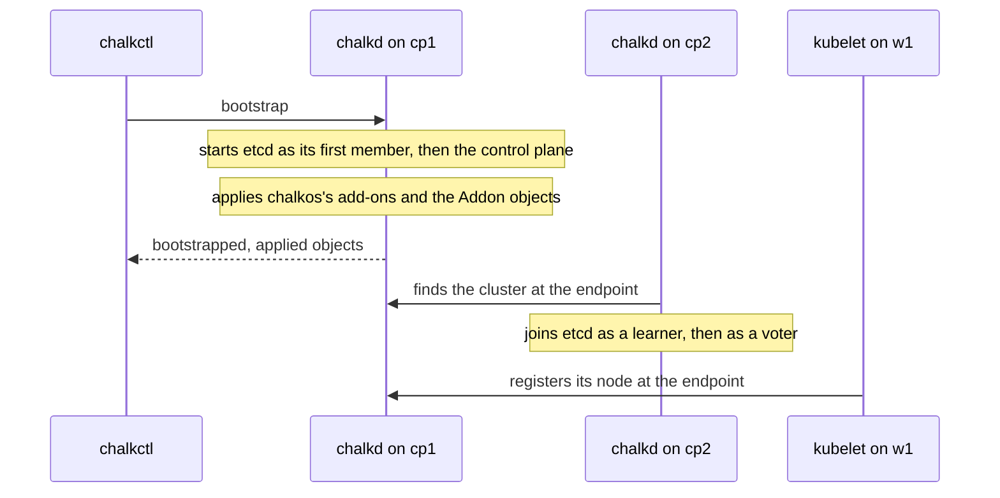

# Bootstrap and get a kubeconfig

This page is for an operator whose nodes are installed and waiting for their cluster. One command
starts the cluster on the first control plane, and every other node joins it on its own. At the
end every node is `Ready` in Kubernetes, and you hold a kubeconfig for the API server. The page
uses the homelab's `cp1` and `w1`.

```console
$ chalkctl bootstrap cp1 --secrets=secrets.age
bootstrapping cp1; the control plane pulls its images and starts
cp1 is bootstrapped; applied 19 objects
$ chalkctl kubeconfig --secrets=secrets.age
wrote kubeconfig; its certificate is valid for 8760h0m0s
```

## Before you begin

- Every node is installed and back up in normal mode, as [Install a node](../operate/install.md)
  describes.
- The cluster's `Cluster` document names the endpoint you chose in [Plan a cluster](plan.md).
- You hold the secrets file `secrets.age`. `chalkctl bootstrap` also works with an admin client
  file; `chalkctl kubeconfig` needs the secrets file.
- kubectl is on your workstation, for the check at the end.

## One bootstrap starts the cluster, and the other nodes join

A cluster starts once, on one control plane. After that, nothing runs a join command: each node
finds the cluster at the endpoint by itself.



The diagram shows a cluster with a second control plane, cp2. The homelab has one control plane, so
only w1 joins. [Kubernetes on chalkos](../how-it-works/kubernetes/kubernetes.md#how-does-a-cluster-start)
explains each step.

## Every control plane waits for the bootstrap

An installed control plane cannot tell whether it should start the cluster or join one, so it waits.
[`chalkctl status`](../reference/cli/chalkctl_status.md) shows it in the Kubernetes line:

```text
kubernetes controlplane: waiting for bootstrap or for the cluster at https://10.0.0.11:6443
```

The URL is the cluster endpoint, here cp1's own address. A worker reads `joined` once it has
prepared its Kubernetes files, since it has no etcd member to add. Its `node ready` reads `unknown`,
followed by the error, until its kubelet has registered its node with the API server.

## Bootstrap the first control plane

Run [`chalkctl bootstrap`](../reference/cli/chalkctl_bootstrap.md) on one control plane:

```console
$ chalkctl bootstrap cp1 --secrets=secrets.age
bootstrapping cp1; the control plane pulls its images and starts
cp1 is bootstrapped; applied 19 objects
```

chalkd on cp1 records the bootstrap on STATE, starts etcd as the cluster's first member and starts
the API server, the controller-manager and the scheduler. It then applies chalkos's add-ons: RBAC,
kube-proxy, flannel and CoreDNS. Last come the objects of the `Addon` documents. `applied 19 objects`
counts all of them; the homelab has no `Addon` documents, so all 19 are chalkos's.

chalkctl waits until the objects are applied, up to `--timeout`, 20 minutes by default. Most of
that time goes into pulling the control plane's images. A run that times out leaves the bootstrap
in place and ends with `etcd is initialised and the control plane starts, but chalkos's add-ons
and the objects of the Addon documents were not applied yet; chalkctl status shows its
progress`. chalkd keeps applying, so wait and check the status. Do not bootstrap again.

Bootstrap one control plane only. A second bootstrap would start a second etcd cluster, so chalkd
refuses it on a node that is bootstrapped already, with `the node is bootstrapped already`, and on
a node whose cluster answers at the endpoint, with `the cluster's API server answers at
https://10.0.0.11:6443; this node joins it on its own`. chalkctl refuses a worker before it sends
anything: `w1 is not a control-plane node; bootstrap one of the cluster's control-plane nodes`.

## The other nodes join on their own

Each other control plane finds the cluster at the endpoint, joins etcd and starts its control
plane. etcd accepts one learner at a time, so control planes join one after another. While a node
joins, its status names the step after `joining the cluster at <endpoint>:`. In a cluster whose
endpoint is the VIP 10.0.0.10, it reads:

```text
kubernetes controlplane: joining the cluster at https://10.0.0.10:6443: checking etcd's members
kubernetes controlplane: joining the cluster at https://10.0.0.10:6443: etcd member <id> catches up
```

`<id>` is the new member's etcd ID in hexadecimal. A joined control plane reads `bootstrapped`, the
same as the first one:

```text
kubernetes controlplane: bootstrapped, node ready: True, vip standby, control plane current
```

`vip standby` appears when the cluster has a VIP and another control plane holds it; the holder
reads `vip holder`. [Run a highly available control plane](ha-control-plane.md) covers the joins of
three control planes and what stops one.

A worker's kubelet registers its node at the endpoint with the certificate the worker received at
install. Once flannel runs on the node, the node is ready:

```text
kubernetes worker: joined, node ready: True
```

## Get a kubeconfig

[`chalkctl kubeconfig`](../reference/cli/chalkctl_kubeconfig.md) writes a kubeconfig for the cluster
endpoint, with a client certificate it issues from the secrets file:

```console
$ chalkctl kubeconfig --secrets=secrets.age
wrote kubeconfig; its certificate is valid for 8760h0m0s
```

The defaults write `./kubeconfig`, valid for a year, for the user `admin`. The file holds the
certificate's private key and is written with mode 0600. chalkctl refuses to replace an existing
file unless `--force` is given. Other flags change what it writes:

| Flag | Default | Sets |
| --- | --- | --- |
| `--out` | `kubeconfig` | The file to write; `-` writes to standard output. |
| `--ttl` | `8760h` | How long the certificate is valid. |
| `--name` | `admin` | The user name in the certificate, which the API server's audit log records. |
| `--context` | the inventory's `metadata.name` | The name of the kubeconfig's cluster, user and context. |
| `--server` | the cluster endpoint | Another URL to reach the API server at, such as a forwarded port. The certificate is still verified for the endpoint. |

`--context` keeps the names apart when you merge the file into a kubeconfig that holds other
clusters.

## Give someone access to the Kubernetes API

Issue each person a kubeconfig of their own, with their name and the shortest validity your routine
tolerates:

```console
$ chalkctl kubeconfig --name=alice --ttl=2160h --out=alice.kubeconfig --secrets=secrets.age
wrote alice.kubeconfig; its certificate is valid for 2160h0m0s
```

Every kubeconfig chalkctl issues puts its holder in the group `chalkos:cluster-admins`, which is
bound to `cluster-admin`, so each one grants full access to the cluster.

Nothing revokes a single kubeconfig. It works until its certificate expires or the Kubernetes CA is
rotated. [Rotate the Kubernetes CAs and keys](rotate-kubernetes-cas.md#revoke-kubernetes-access)
takes access away from everyone at once, so a short `--ttl` lets a kubeconfig lapse without a
rotation.

Narrower access uses Kubernetes RBAC. The API server accepts only client certificates and
service-account tokens, as [Configure Kubernetes](configure.md#the-api-server-authenticates-with-certificates-and-tokens)
explains. A cluster admin can issue a client certificate for a user and group of their choice
through the Kubernetes
[certificate signing request API](https://kubernetes.io/docs/reference/access-authn-authz/certificate-signing-requests/#normal-user),
and bind that user or group to a narrower role.

## Check that it worked

List the nodes with the kubeconfig:

```console
$ kubectl --kubeconfig kubeconfig get nodes
NAME   STATUS   ROLES    AGE   VERSION
cp1    Ready    <none>   21s   v1.37.1
w1     Ready    <none>   12s   v1.37.1
```

The output is from the lab of the [quick start](../get-started/quick-start.md), whose nodes have the
homelab's names. Every node of the inventory appears, with the Kubernetes release of its image.
`ROLES` is empty because chalkos sets no `node-role` label. A node may show `NotReady` for the first
minute, until flannel runs on it.

`chalkctl status` shows each node's Kubernetes line, as in the sections above.

## If something goes wrong

| Symptom | Cause | Fix |
| --- | --- | --- |
| A control plane stays at `waiting for bootstrap or for the cluster at ...` after the bootstrap | It cannot reach the API server at the endpoint. | Check that the endpoint reaches a bootstrapped control plane on port 6443. |
| A worker's `node ready` stays `unknown` | Its kubelet cannot register at the endpoint. | Check `chalkctl logs w1 --unit=kubelet.service`. |
| The bootstrap times out | The control plane is still pulling its images. | Wait, and watch `chalkctl status cp1`. |
| `chalkctl kubeconfig` fails with `no Cluster document of the cluster ... names an endpoint` | The inventory's files give no node a `Cluster` document. | Add the `Cluster` document to the files every node gets. |

[Troubleshoot Kubernetes](troubleshooting.md) covers further symptoms.

## What next

- [Configure Kubernetes](configure.md): labels, taints, extra flags and add-ons.
- [Run a highly available control plane](ha-control-plane.md).
- [Status, logs and the console](../operate/status-and-logs.md) for the rest of `chalkctl status`.
