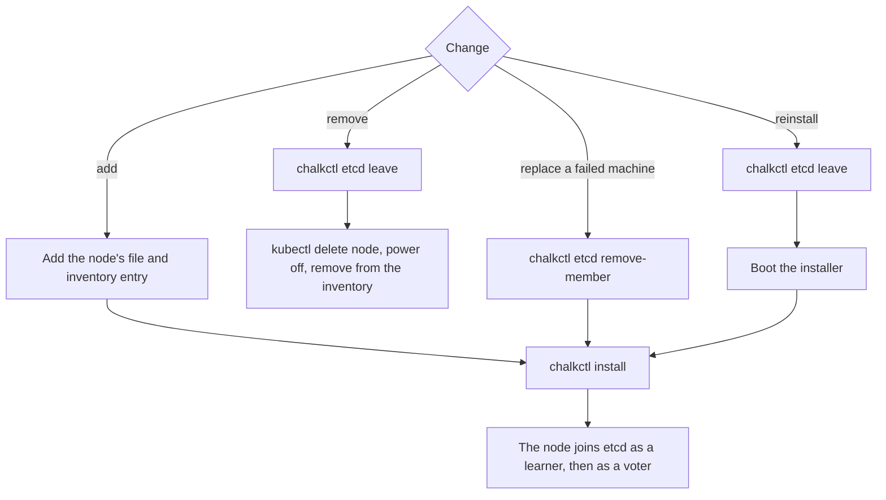

# Run a highly available control plane

This page is for an operator who runs a cluster with three control planes behind a VIP. Three
control planes keep the Kubernetes API and etcd available while one of them reboots or fails. At
the end three control planes are healthy etcd voters, and you know how to add, remove and replace
one without losing etcd's quorum.

A healthy control plane is three voters, each healthy:

```console
$ chalkctl etcd members
NAME  ID                PEER URLS                    MEMBER  HEALTH
cp1   d9fb26556fe7b4a5  https://192.168.123.11:2380  voter   healthy
cp2   7cd467b152867819  https://192.168.123.12:2380  voter   healthy
cp3   af880a99b80b32b3  https://192.168.123.13:2380  voter   healthy
```

The output on this page comes from a lab cluster whose control planes `cp1`, `cp2` and `cp3` sit at
192.168.123.11 to 192.168.123.13, behind the VIP 192.168.123.10.

## Before you begin

- You have the workstation that [Set up your workstation](../operate/workstation.md) describes,
  with the inventory, the secrets file `secrets.age` and the signed image directories.
- You made the decisions of [Plan a cluster](plan.md): three control planes and a VIP as the
  cluster endpoint.
- The three machines share one layer-2 segment. Each has a static address, and one free address on
  the segment is left for the VIP.
- Each machine is booted into the installer, as [Install a node](../operate/install.md) describes.

## Define three control planes and the VIP

Every node gets the `Cluster` document, which puts the VIP in `spec.vip.addresses` and makes it the
cluster endpoint:

```yaml title="cluster/cluster.yaml"
apiVersion: kubernetes.chalkos.dev/v1alpha1
kind: Cluster
metadata: {name: default}
spec:
  endpoint: https://192.168.123.10:6443
  vip: {addresses: [192.168.123.10]}
```

Each control plane has a file of its own with `type: controlplane`, its system disk and its static
address:

```yaml title="nodes/cp1.yaml"
apiVersion: kubernetes.chalkos.dev/v1alpha1
kind: Node
metadata: {name: default}
spec:
  type: controlplane
---
apiVersion: storage.chalkos.dev/v1alpha1
kind: SystemDisk
metadata: {name: system}
spec:
  disk: {path: /dev/disk/by-id/nvme-Samsung_SSD_990_PRO_2TB_S7KHNJ0W100001}
---
apiVersion: networkd.chalkos.dev/v1alpha1
kind: Network
metadata: {name: 10-uplink}
spec:
  match: {name: enp1s0}
  network: {address: [192.168.123.11/24], gateway: 192.168.123.1}
```

`nodes/cp2.yaml` and `nodes/cp3.yaml` differ only in their disk and address. The inventory names
the three nodes at the same addresses:

```yaml title="chalkos.yaml"
apiVersion: chalkctl.chalkos.dev/v1alpha1
kind: Inventory
metadata: {name: prod}
spec:
  images:
    node-metal: {source: {directory: images/node-metal-signed}}
  all: {imageName: node-metal, files: [cluster/*.yaml]}
  nodes:
    cp1: {address: 192.168.123.11, files: [nodes/cp1.yaml]}
    cp2: {address: 192.168.123.12, files: [nodes/cp2.yaml]}
    cp3: {address: 192.168.123.13, files: [nodes/cp3.yaml]}
```

chalkd adds the VIP to the interface that holds the node's address of the VIP's family. A `Node`
document can name another interface in `spec.vip.interface`. A cluster takes at most one VIP per
family, and an endpoint that is an IP address must be one of the VIPs. Check the files with
`chalkctl validate`.

## Install the three, then bootstrap one

Install each control plane at the address and with the fingerprint its console shows:

```sh
chalkctl install cp1 --secrets=secrets.age --address=<address> --fingerprint=<fingerprint>
chalkctl install cp2 --secrets=secrets.age --address=<address> --fingerprint=<fingerprint>
chalkctl install cp3 --secrets=secrets.age --address=<address> --fingerprint=<fingerprint>
```

Each node reboots into its image and waits, because it cannot tell whether it should start the
cluster or join one. [`chalkctl status`](../reference/cli/chalkctl_status.md) shows it:

```text
kubernetes controlplane: waiting for bootstrap or for the cluster at https://192.168.123.10:6443
```

Bootstrap exactly one of them:

```console
$ chalkctl bootstrap cp1 --secrets=secrets.age
bootstrapping cp1; the control plane pulls its images and starts
cp1 is bootstrapped; applied 19 objects
```

[Bootstrap and get a kubeconfig](bootstrap.md#bootstrap-the-first-control-plane) covers the
bootstrap, the kubeconfig and why a second bootstrap is refused. Once cp1's API server is ready,
cp1 holds the VIP.

## The other control planes join etcd one at a time

cp2 and cp3 find the cluster at the endpoint and join on their own. etcd accepts one learner at a
time, so they join one after the other. A joining node adds itself as a learner, a member that
receives etcd's data but has no vote. It waits until its member has caught up with the leader,
has it promoted to a voter and then starts the rest of its control plane. Its status names the
step:

```text
kubernetes controlplane: joining the cluster at https://192.168.123.10:6443: checking etcd's members
kubernetes controlplane: joining the cluster at https://192.168.123.10:6443: etcd member af880a99b80b32b3 catches up
```

Before the node adds itself as a learner, it pins its addresses on STATE. From then on, every boot
waits for exactly these addresses before it starts etcd. A joined control plane reports:

```text
kubernetes controlplane: bootstrapped, node ready: True, vip standby, control plane current
```

`vip standby` means another control plane holds the VIP, and the holder shows `vip holder`. A
standby node takes part in the VIP's election only while its API server answers ready.
`control plane current` means the node's API server and etcd serve the certificates the node
holds, and its API server answers ready. Right after the join, the line can read
`control plane the API server is not ready` for a few seconds while the API server starts.

## The VIP moves to another control plane within seconds

When the holder's API server stops answering, or the holder fails, another healthy control plane
takes the VIP through an election in etcd. The holder's lease lasts 10 seconds. The HA end-to-end
test requires the VIP to move within 30 seconds of its holder's network link going down. When the
old holder comes back, the VIP stays with its new holder.
[Networking](../how-it-works/node/networking.md#how-does-the-vip-move-between-control-planes)
explains the election. Clients with an open connection to the old holder notice only when the
connection times out. A cluster without etcd quorum has no holder, because no node can win the
election.

## Every change to the control planes goes through etcd

etcd's membership decides which control planes count towards the quorum. Every change therefore
updates etcd before or after the machine changes:



The diagram shows the four changes this page covers. Each etcd command refuses a change that would
leave fewer healthy voters than etcd's quorum, the majority of voters that etcd needs to accept a
write.

## Add a control plane

Write the new node's file with `type: controlplane`, add the node to the inventory with its address
and file, and install it. It joins as cp2 and cp3 did, with no further command.

Grow to five control planes, not four. Four voters need three for a quorum, so they tolerate one
failure, the same as three.

## Remove a control plane

Take the node out of etcd before you switch it off.
[`chalkctl etcd leave`](../reference/cli/chalkctl_etcd_leave.md) makes the node release the VIP,
remove its own member, stop its control plane, delete its etcd data and unpin its addresses:

```console
$ chalkctl etcd leave cp2
cp2 left etcd; reinstall it to join the cluster again
```

The node's status now reports:

```text
kubernetes controlplane: left etcd; reinstall the node to join the cluster again
```

It does not join again on its own, also after a reboot. Delete its Node with
`kubectl delete node cp2`, power it off, and remove it from the inventory and its file from the
repository.

The leave is refused when the voters left would have fewer healthy members than their quorum,
because etcd would then stop accepting writes. With cp3 down, the leave of cp2 is refused, and the
message names the counts:

```text
chalkctl: cp2: failed_precondition: without cp2 etcd has 2 voters, 1 healthy, fewer than the 2 a quorum needs
```

Bring the unhealthy member back first. `chalkctl etcd members` shows which one it is:

```console
$ chalkctl etcd members
NAME  ID                PEER URLS                    MEMBER  HEALTH
cp1   d9fb26556fe7b4a5  https://192.168.123.11:2380  voter   healthy
cp2   7cd467b152867819  https://192.168.123.12:2380  voter   healthy
cp3   af880a99b80b32b3  https://192.168.123.13:2380  voter   unhealthy: context deadline exceeded
```

## Replace a failed machine

A control plane whose machine is gone cannot leave by itself. Remove its member through the other
control planes with
[`chalkctl etcd remove-member`](../reference/cli/chalkctl_etcd_remove-member.md), which takes the
node's name or the member's ID:

```console
$ chalkctl etcd remove-member cp3
removed the etcd member cp3 (af880a99b80b32b3)
```

The same quorum guard applies. `--force` skips it, and etcd then accepts no writes until enough of
the remaining members are healthy again.

Then install the replacement machine under the same name. Give it the addresses of the node's
`Network` document, so the inventory's address stays right. Change its `SystemDisk` if the new disk
has another serial number or path. Boot it into the installer and install it, with `--wipe-disk`
when its disk holds data:

```sh
chalkctl install cp3 --secrets=secrets.age --address=<address> --fingerprint=<fingerprint> \
  --wipe-disk
```

The node joins etcd as a new member.

## Reinstall a control plane

A control plane that keeps its machine but starts over, for a new disk layout or a lost STATE,
leaves etcd first and is reinstalled after:

```sh
chalkctl etcd leave cp3
chalkctl install cp3 --secrets=secrets.age --address=<address> --fingerprint=<fingerprint> \
  --wipe-disk
```

Between the two commands, boot the machine into the installer through its BMC or boot menu. An
installed node runs no maintenance mode, so `chalkctl install` cannot reach it before.

## etcd has no backup and restore yet

chalkos has no command that snapshots etcd or restores it. Three control planes survive the loss of
one machine, but they do not bring back an object someone deleted. A cluster that loses two of its
three control planes at once loses etcd's quorum, and chalkos has no command that rebuilds etcd
from the one member left. Back up what the workloads keep with a tool that works at the Kubernetes
level.
[Back up what you cannot rebuild](../operate/workstation.md#back-up-what-you-cannot-rebuild) lists
the files to keep, and the [roadmap](../contribute/roadmap.md#smaller-items) lists etcd backup and
restore.

## Check that it worked

Run `chalkctl etcd members`, which lists etcd's members as one control plane's member sees them.
It needs a reader client file or the secrets file. Expect three voters, each `healthy`, as at the
top of this page. A member that joins shows `learner`, and an unhealthy one shows
`unhealthy:` and the reason. `--via=<node>` asks a particular control plane, which helps when two of
them disagree. Then check that the API server answers through the VIP:

```console
$ kubectl get nodes
NAME   STATUS   ROLES    AGE   VERSION
cp1    Ready    <none>   41s   v1.37.1
cp2    Ready    <none>   39s   v1.37.1
cp3    Ready    <none>   38s   v1.37.1
w1     Ready    <none>   37s   v1.37.1
```

## If something goes wrong

These failures are specific to control planes.

### A control plane cannot rejoin etcd

A control plane's Kubernetes line in `chalkctl status` names what holds it back, and the fix:

| Status | Cause | Fix |
| --- | --- | --- |
| `preparation failed: pinned address ... is not present` | The node booted without one of the addresses it was pinned to when it became an etcd member. | Restore the address and reboot. Or remove its member with `chalkctl etcd remove-member <node>`, as the status suggests, or with `chalkctl etcd leave <node> --force`, which also cleans up the node; then reinstall it. |
| `joining the cluster at ...: etcd has a member <node> already; remove it with chalkctl etcd remove-member <node>` | The node was reinstalled without leaving etcd, and its old member is still there. | Run the command the status names. The node tries again every 10 seconds and joins. |
| `left etcd; reinstall the node to join the cluster again` | The node left etcd with `chalkctl etcd leave`. | Reinstall it. |
| `etcd data missing: restore etcd or reinstall the node` | The node is an etcd member, but VAR lost its etcd data. | chalkos cannot restore etcd. Run `chalkctl etcd remove-member <node>`, then reinstall it. |
| `joining the cluster at ...: the node's etcd member was removed while joining; run chalkctl etcd leave and reinstall the node` | An operator removed the member while the node was joining. | Run `chalkctl etcd leave <node>`, then reinstall it. |

### A reinstalled node finds its old member

A control plane reinstalled without `chalkctl etcd leave` finds a member of its own name in etcd
and stops. Joining would hand it the old member's identity without its data:

```text
kubernetes controlplane: joining the cluster at https://192.168.123.10:6443: etcd has a member cp3 already; remove it with chalkctl etcd remove-member cp3
```

Run the command the status names. The node joins on its next attempt.

### A control plane lost its pinned address

A pinned control plane that boots without one of its addresses, after a cabling or switch change
for example, waits for `spec.nodeIP.timeout` seconds of the `Cluster` document. Then it runs
neither etcd nor the kubelet:

```text
kubernetes controlplane: preparation failed: pinned address 192.168.123.13 is not present, 5m0s after chalkos-node-addresses.target; restore it, or remove the node's etcd member with chalkctl etcd remove-member cp3 and reinstall the node
```

The other two keep the cluster running. Restore the address and reboot the node, or take it out.
Its own etcd member does not answer, so `chalkctl etcd leave cp3` refuses without `--force`. With
`--force` it removes the member through the others and cleans up the node. Then reinstall it.

[Recover a node](../operate/recover-node.md) covers nodes that do not unlock or boot.
[Troubleshoot Kubernetes](troubleshooting.md) starts from symptoms.

## What next

- [Upgrade Kubernetes](upgrade-kubernetes.md) rolls a new image through the control planes one at
  a time.
- [Add and remove nodes](../operate/add-remove-nodes.md) covers workers and nodes without
  Kubernetes.
- [The control plane](../how-it-works/kubernetes/control-plane.md) explains bootstrap, join and
  the static pods.
- [`chalkctl etcd`](../reference/cli/chalkctl_etcd.md) lists the etcd commands and their flags.
