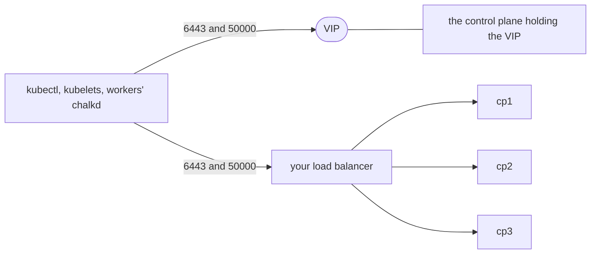

# Plan a cluster

This page is for an operator who is about to install the nodes of a new Kubernetes cluster. It
takes the decisions that shape the `Cluster` document every node gets and the `Node` document of
each control plane. A few of them are fixed once the cluster runs, so they are made here, before
the first install. At the end you have a `Cluster` document and a list of control planes with
their addresses.

The decisions lead to a document such as this one, for three control planes behind a VIP:

```yaml title="cluster/cluster.yaml"
apiVersion: kubernetes.chalkos.dev/v1alpha1
kind: Cluster
metadata: {name: default}
spec:
  # The VIP the control planes hold, so the endpoint outlives any one of them.
  endpoint: https://10.0.0.10:6443
  vip: {addresses: [10.0.0.10]}
  # Fixed once the cluster exists.
  ipFamilies: [ipv4]
  podCIDRs: {ipv4: 10.244.0.0/16}
  serviceCIDRs: {ipv4: 10.96.0.0/12}
```

## Before you begin

You need the workstation that [Set up your workstation](../operate/workstation.md) describes: the
repository with the inventory, the secrets file and the image directories. The nodes' files are
laid out as [Write a node's config](../operate/node-config.md) describes. Who may use the nodes and
the Kubernetes API is on [Manage access and certificates](../operate/access.md).

Know the machines: how many there are, which network segments they sit on and which addresses
they can keep.

## Three control planes survive the loss of one

A control plane runs etcd, the API server, the controller-manager and the scheduler. Every
control plane is an etcd member, and etcd needs a majority of its voters to accept a write. The
number of control planes therefore decides how many machines the cluster can lose:

| Control planes | Survives the loss of | Upgrades and reboots |
| --- | --- | --- |
| 1 | none | The API server is down while the node reboots, so `chalkctl upgrade` needs `--allow-downtime`. |
| 3 | one | One at a time, with no API downtime. |
| 5 | two | One at a time. Each member adds etcd write latency. |

Use three. One control plane suits a lab, or a cluster whose API may go away while the node
reboots. An even number adds no tolerance: two control planes need both for a majority, and four
tolerate the loss of one, like three. Two are less available than one, because etcd stops when
either of two machines fails.

A node is a control plane when its `Node` document has `type: controlplane`, and a worker with
`type: worker`. The type is fixed once the node holds a Kubernetes share; a node of the other type
is a reinstall. [Run a highly available control plane](ha-control-plane.md) installs three.

## The cluster endpoint reaches the API server and chalkd

The cluster endpoint, `spec.endpoint` of the `Cluster` document, is the URL that kubelets,
kubeconfigs and joining control planes use to reach the API server on port 6443. Workers also
renew their node certificates through it: chalkd on a worker connects to the endpoint's host on
port 50000, where a control plane's chalkd answers. Whatever the endpoint points at must
reach both ports of a healthy control plane.

The diagram shows the two ways to keep the endpoint reachable when a control plane fails.



Choose one:

- A VIP, `spec.vip.addresses`, which chalkd holds on one healthy control plane at a time. The
  holder announces it with gratuitous ARP and unsolicited neighbour advertisements, so the control
  planes must share one layer-2 segment. Use it for machines in one rack or VLAN. The endpoint is
  the VIP or a name that resolves to it; `chalkctl validate` refuses an endpoint address that is
  none of the VIPs, with `vip: the endpoint https://10.0.0.11:6443 is none of the virtual
  addresses`.
- A load balancer you run, for control planes in different segments. It forwards TCP ports 6443
  and 50000 to the control planes and passes TLS through, because clients authenticate with
  certificates. A balancer that forwards only 6443 leaves workers unable to renew their node
  certificates. Leave `spec.vip.addresses` empty, and make the endpoint the balancer's address or
  name.

When the holder crashes or loses its network, another control plane takes the VIP once the
holder's etcd lease of 10 seconds expires.
[Kubernetes networking](../how-it-works/kubernetes/networking.md#one-healthy-control-plane-holds-the-vip)
describes the election.

A single control plane can take the endpoint of its own address, as the homelab does. Every
kubeconfig names the endpoint, so moving to a VIP later means issuing every kubeconfig again. A VIP
from the start, even on one control plane, keeps the endpoint when control planes join.

## Control planes keep their addresses

Give every control plane a static address in a `Network` document of its own file, and the same
address as its `address` in the inventory. A control plane's addresses are pinned on STATE when it
becomes an etcd member, and every later boot waits for exactly those addresses before it starts
etcd. Changing a control plane's address means taking it out of etcd and reinstalling
it.

Workers may take their address from DHCP. `spec.nodeIP.validSubnets` of the `Cluster` document
then picks it from the subnets you list. The inventory names such a worker by an address or name
that stays.

## IP families and ranges are fixed at creation

`spec.ipFamilies` lists the cluster's address families, the primary one first: `[ipv4]` by
default, or `[ipv4, ipv6]` for dual stack. Each family has a pod range, `podCIDRs`, and a service
range, `serviceCIDRs`. The families, the ranges and the cluster DNS addresses of `dnsIPs` are fixed
once the cluster exists, because the certificates, etcd and the ranges the control plane allocated
were made for them. A node that holds a Kubernetes share refuses a config that changes them, with a
message such as:

```text
the config changes the cluster's podCIDRs from ipv4 10.244.0.0/16 to ipv4 10.245.0.0/16; they are fixed once the cluster exists, so keep them, or reinstall the node into a new cluster
```

A different choice later means a new cluster. Pick ranges that overlap none of your networks,
including the networks pods must reach. A dual-stack cluster names both families and a range of
each:

```yaml
apiVersion: kubernetes.chalkos.dev/v1alpha1
kind: Cluster
metadata: {name: default}
spec:
  endpoint: https://10.0.0.10:6443
  vip: {addresses: [10.0.0.10]}
  ipFamilies: [ipv4, ipv6]
  podCIDRs:
    ipv4: 10.244.0.0/16
    ipv6: fd00:10:244::/56
  serviceCIDRs:
    ipv4: 10.96.0.0/12
    ipv6: fd00:10:96::/112
```

[Kubernetes networking](../how-it-works/kubernetes/networking.md#each-node-picks-one-address-per-family-before-the-kubelet-starts)
explains how nodes pick an address of each family.

## Workloads stay off control planes by default

Each control plane registers with a `NoSchedule` taint, so only pods that tolerate it run there. A
cluster of one to three machines without workers leaves the taint off. Decide before the control
planes register, because the setting reaches only control planes that register later.
[Run workloads on control planes](configure.md#run-workloads-on-control-planes) shows the setting.

## Check that it worked

Put the `Cluster` document into the files every node gets. Give each control plane a `Node`
document with `type: controlplane`, and each worker one with `type: worker`; `type` has no
default. Then check every node's config against its image. `chalkctl validate` reaches no node and
needs no secrets file:

```console
$ chalkctl validate
cp1: valid for the image node-metal (node on metal, root hash d871203debfe), config 675850c48eaffe4a755dca41652dbf65a5b7959f1e70a3cdd2a94799136fd200
w1: valid for the image node-metal (node on metal, root hash d871203debfe), config 82ec5bbabd10ec79bf76ad892a0bcd7627c9db2ed4c9e252ad0657313359254c
```

The output is the homelab's. Each node of your inventory gets a line. A refused config names the
node and the field, as in the VIP message above.

## What next

- [Install a node](../operate/install.md) on each machine.
- [Bootstrap and get a kubeconfig](bootstrap.md) once the nodes are installed.
- [Configure Kubernetes](configure.md) for labels, taints, extra flags and add-ons.
- [Run a highly available control plane](ha-control-plane.md) for three control planes behind a
  VIP.
- [Add and remove nodes](../operate/add-remove-nodes.md) to add workers to a running cluster.
