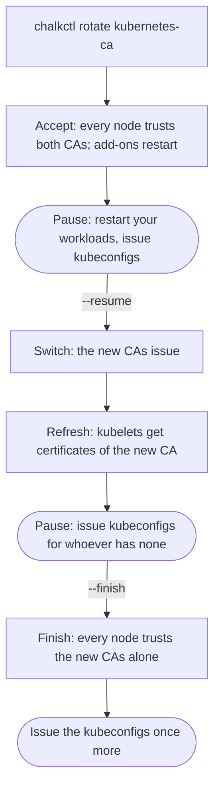

# Rotate the Kubernetes CAs and keys

This page is for an operator who replaces what the API server and etcd trust: after a key may have
leaked, to take away Kubernetes access, or before a CA expires. At the end every node trusts the
new value alone, and every kubeconfig in use chains to the new CAs.
[`chalkctl rotate`](../reference/cli/chalkctl_rotate.md) rotates three Kubernetes kinds:

```console
$ chalkctl rotate kubernetes-ca --secrets secrets.age
secrets.age records the rotation of the Kubernetes CAs; the previous version is secrets.age.prev; secrets.pub.json holds the new public half
kubernetes-ca: the accept phase
  cp1 runs on its new files
  cp2 runs on its new files
  cp3 runs on its new files
  w1 trusts the Kubernetes CAs
  restarted kube-system/DaemonSet/kube-proxy, kube-flannel/DaemonSet/kube-flannel-ds, kube-system/Deployment/coredns
kubernetes-ca: every node applied the accept phase
Every node trusts the old and the new Kubernetes CAs, and chalkos's addons and the workloads of the Addon documents, StatefulSets included, restarted. Restart your other workloads that talk to the API server, so they trust both CAs too; pods started from now on do. Issue new kubeconfigs now with chalkctl kubeconfig: they carry both CAs and work throughout the rotation and after it; kubeconfigs from before the rotation stop verifying the API server at the switch. Then continue with chalkctl rotate kubernetes-ca --resume, which makes the new CAs issue.
```

The output on this page comes from a lab cluster of three control planes, `cp1` to `cp3`, and one
worker, `w1`. The lab's secrets file and kubeconfig had other names; the output shows them as
`secrets.age` and `admin.kubeconfig`, the names the commands here use.

## Before you begin

- You hold the secrets file and know how a rotation runs, as
  [A rotation runs in four phases with pauses](../operate/access.md#a-rotation-runs-in-four-phases-with-pauses)
  describes.
- Every node of the inventory runs and is reachable. Each phase waits until every node confirms
  it.
- No other rotation runs. One rotation runs at a time.
- kubectl and a kubeconfig, for the steps between the phases.

## Each kind replaces something else

| Kind | What it replaces | What stops working after the finish |
| --- | --- | --- |
| `kubernetes-ca` | The Kubernetes CA, the front-proxy CA and the etcd CA, and every certificate they issued | Kubeconfigs issued before the rotation |
| `service-account-key` | The key that signs service-account tokens | Tokens signed with the old key |
| `encryption-key` | The key that encrypts Secrets in etcd | Nothing; etcd holds every object under the new key |

Each rotation runs the phases accept, switch, refresh and finish. Every node confirms a phase
before the next one starts. Control planes take each phase one at a time, so etcd keeps its
quorum: each restarts its static pods on the new files, and the next starts only once etcd has
every member healthy again.

## The Kubernetes CAs pause twice for new kubeconfigs

The rotation of the Kubernetes CAs stops after accept and after refresh, because kubeconfigs and
workloads that talk to the API server need the new CA before the old one goes:



The diagram shows the phases in order and, drawn round, the points where you act. The
service-account key and the encryption key run accept, switch and refresh in one command and pause
once, before the finish.

## Rotate the Kubernetes CAs

`kubernetes-ca` replaces the cluster's three Kubernetes CAs together. Start it with
`chalkctl rotate kubernetes-ca --secrets secrets.age`, as at the top of this page. The accept
phase gives control planes and workers both CAs and restarts chalkos's add-ons and the workloads of
the [`Addon`](../reference/kinds.md#addon) documents.

At the first pause:

1. Restart your own workloads that talk to the API server, so they trust both CAs. Pods started
   from now on do.
2. Issue a new kubeconfig for everyone who keeps access. Kubeconfigs issued now carry both CAs and
   keep working through the rotation:

    ```console
    $ chalkctl kubeconfig --secrets secrets.age --out admin.kubeconfig
    wrote admin.kubeconfig; its certificate is valid for 8760h0m0s
    ```

Then resume. The switch makes the new CAs issue on each control plane in turn. The refresh gives
each worker a kubelet client certificate of the new CA and has every kubelet request a new serving
certificate. Control planes issued their kubelet client certificates themselves at the switch:

```console
$ chalkctl rotate kubernetes-ca --resume --secrets secrets.age
kubernetes-ca: the switch phase
  cp1 runs on its new files
  cp2 runs on its new files
  cp3 runs on its new files
kubernetes-ca: every node applied the switch phase
kubernetes-ca: the refresh phase
  cp1's kubelet serves a certificate of the new CA
  cp2's kubelet serves a certificate of the new CA
  cp3's kubelet serves a certificate of the new CA
  w1's kubelet serves a certificate of the new CA
kubernetes-ca: every node applied the refresh phase
The new Kubernetes CAs issue every certificate of the cluster, and the kubelets requested new serving certificates. Kubeconfigs from before the rotation cannot verify the API server any more and are refused after the finish: issue them again with chalkctl kubeconfig. Then remove the old CAs with chalkctl rotate kubernetes-ca --finish.
```

From the switch on, a kubeconfig from before the rotation no longer verifies the API server:

```text
Unable to connect to the server: tls: failed to verify certificate: x509: certificate signed by unknown authority (possibly because of "x509: ECDSA verification failure" while trying to verify candidate authority certificate "chalkos Kubernetes CA")
```

At the second pause, issue kubeconfigs for anyone who did not get one at the first. Then finish:

```console
$ chalkctl rotate kubernetes-ca --finish --secrets secrets.age
kubernetes-ca: the finish phase
  cp1 runs on its new files
  cp2 runs on its new files
  cp3 runs on its new files
  w1 trusts the Kubernetes CAs
kubernetes-ca: every node applied the finish phase
the rotation of the Kubernetes CAs is finished: every node trusts the new value alone; the previous version is secrets.age.prev; secrets.pub.json holds the new public half
Kubeconfigs issued during the rotation still trust the old Kubernetes CA besides the new one when they verify the API server, so whoever holds the old CA's key could pose as the API server to them; issue them again with chalkctl kubeconfig.
```

Issue every kubeconfig once more after the finish. A kubeconfig issued during the rotation still
trusts the old CA when it verifies the API server.

## Rotate the service-account key

The API server signs service-account tokens with this key. The rotation runs accept, switch and
refresh in one command. The refresh restarts chalkos's add-ons and the workloads of the `Addon`
documents, which get tokens of the new key at once:

```console
$ chalkctl rotate service-account-key --secrets secrets.age
secrets.age records the rotation of the service-account key; the previous version is secrets.age.prev; secrets.pub.json holds the new public half
service-account-key: the accept phase
  cp1 runs on its new files
  cp2 runs on its new files
  cp3 runs on its new files
service-account-key: every node applied the accept phase
service-account-key: the switch phase
  cp1 runs on its new files
  cp2 runs on its new files
  cp3 runs on its new files
service-account-key: every node applied the switch phase
service-account-key: the refresh phase
  restarted kube-system/DaemonSet/kube-proxy, kube-flannel/DaemonSet/kube-flannel-ds, kube-system/Deployment/coredns
service-account-key: every node applied the refresh phase
The API server signs tokens with the new service-account key, and chalkos's addons and the workloads of the Addon documents, StatefulSets included, restarted with new tokens. Kubelets renew the tokens of other pods within the hour after every control plane applied the switch; finish from 2026-10-23T20:58:51+02:00 with chalkctl rotate service-account-key --finish.
These Secrets of type kubernetes.io/service-account-token hold tokens of the old key, which nothing signs again and which are refused after the finish; recreate them: default/legacy-token
```

Kubelets renew the tokens of the other pods within the hour after the switch. The pause names the
time from which you can finish. It also names the Secrets of type
`kubernetes.io/service-account-token` that hold tokens of the old key. Nothing signs those again,
so delete and recreate them before you finish.

A finish before that hour is refused, because it would invalidate tokens that pods still use:

```text
chalkctl: tokens signed with the old service-account key are renewed until 2026-10-23T20:58:51+02:00, an hour after every control plane applied the switch; finish then, or pass --force to refuse the tokens not renewed yet
```

Run `chalkctl rotate service-account-key --finish --secrets secrets.age` once the time has
passed. `--finish --force` finishes earlier and refuses the tokens that were not renewed yet.

## Rotate the encryption key

The API server encrypts Secrets in etcd with this key. The refresh has a control plane rewrite
every encrypted object, so etcd stores it under the new key. It then checks that etcd holds none
under the old key:

```console
$ chalkctl rotate encryption-key --secrets secrets.age
...
encryption-key: the refresh phase
  rewrote 1 encrypted object unchanged
  etcd holds 1 of the secrets under chalkos-20261023t180036z
encryption-key: every node applied the refresh phase
etcd holds every encrypted object under the new key; remove the old key with chalkctl rotate encryption-key --finish.
```

`...` stands for the accept and switch phases, whose lines match those of the service-account key.
`chalkos-20261023t180036z` is the name of the new key. Then finish with
`chalkctl rotate encryption-key --finish --secrets secrets.age`.

On a large cluster the rewrite can take longer than `--timeout`, 10 minutes by default. The error
then names a command with a longer timeout. `--resume` repeats the rewrite without harm: it writes
back unchanged the objects it rewrote already. `--finish` is refused while etcd holds objects under
the old key, because removing the key would lose them.

## Revoke Kubernetes access

chalkd and the API server check no revocation list. Access ends when what the certificate or token
chains to is no longer trusted:

- To revoke a kubeconfig, rotate the Kubernetes CAs and issue new kubeconfigs to everyone else. A
  short `--ttl` on `chalkctl kubeconfig` limits how long a kubeconfig works without a rotation.
- To revoke a service-account token, delete its ServiceAccount or Secret in Kubernetes. To
  invalidate every token at once, rotate the service-account key.

## Certificates expire on a fixed schedule

chalkos renews what it can by itself, and `chalkctl status` warns before anything else expires:

| What | Lifetime | Renewed by |
| --- | --- | --- |
| OS CA | 10 years | `chalkctl rotate os-ca`; status warns a year ahead |
| Node CA | 5 years | `chalkctl node-ca rotate`; status warns 18 months ahead |
| Kubernetes, front-proxy and etcd CAs | 10 years | `chalkctl rotate kubernetes-ca`; status warns a year ahead |
| Node certificates | 1 year | chalkd, after two thirds of the lifetime; nodes without Kubernetes need `chalkctl node renew` |
| Control-plane certificates | 1 year | chalkd, after two thirds of the lifetime |
| Kubelet certificates | 1 year | The kubelet |
| Client files and kubeconfigs | `--ttl`, 1 year by default | Issuing new ones |

[Manage access and certificates](../operate/access.md) covers the OS CA, the node CA and node
certificates.

## Check that it worked

`chalkctl status` lists what a node trusts under `trust:`, by the first 16 hex digits of each
fingerprint. `(issues)` marks the value a control plane issues or signs with. During a rotation of
the Kubernetes CAs a control plane trusts two of each:

```console
$ chalkctl status cp1 --secrets secrets.age
...
trust:
  OS CA                 1fb637c2d290057d
  Kubernetes CA         3270541c2d2b460a (issues), b581fa7b6e202356
  front-proxy CA        966815dd53bd5ed8 (issues), a8d3e9f6a3923e87
  etcd CA               ad80f5a0ec48c4fe (issues), ff754e941c6c7965
  service-account keys  8cfdc26cc2babeb1 (issues)
  encryption keys       8714c84f8a9b42ba (issues)
...
```

This is cp1 after the accept phase: the old CAs still issue. A worker lists the Kubernetes CA
alone. After the finish, each line shows one fingerprint again. Then check that a new kubeconfig
reaches the API server:

```sh
kubectl --kubeconfig=admin.kubeconfig get nodes
```

## If something goes wrong

- `the <phase> phase of the rotation of the <kind> stopped: ...; once that is fixed, continue with
  chalkctl rotate <kind> --resume`: a node did not confirm the phase within `--timeout`, or could
  not be reached. Fix the node and run the command it names. A phase applied again redoes nothing
  that is done.
- `tokens signed with the old service-account key are renewed until <time>, ...`: the finish of the
  service-account key came too early. Wait until the time it names.
- `etcd holds <n> objects encrypted with the old key <key>, which removing it would lose; rewrite
  them with chalkctl rotate encryption-key --resume`: the refresh did not rewrite every object.
  Run the command it names.
- A workload that talks to the API server fails with `certificate signed by unknown authority` after
  the switch: it was not restarted at the first pause, so it trusts the old CA alone. Restart it.

## What next

- [Manage access and certificates](../operate/access.md) rotates the OS CA and the node CA.
- [Upgrade Kubernetes](upgrade-kubernetes.md) rolls a new image through the cluster.
- [Certificates](../how-it-works/node/certificates.md) shows every CA and what it issues.
- [`chalkctl rotate`](../reference/cli/chalkctl_rotate.md) lists every flag.
