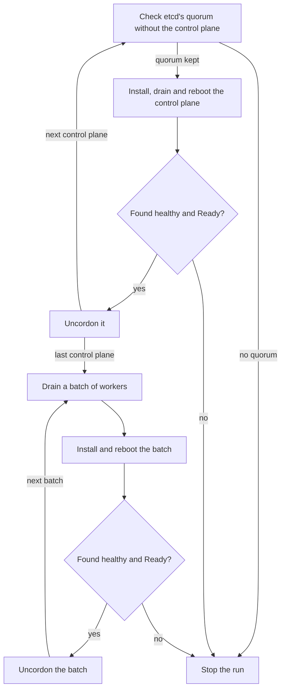

# Upgrade Kubernetes

This page is for an operator who moves a cluster to a new image, such as one with a new Kubernetes
release. It builds on [Upgrade nodes](../operate/upgrade.md), which covers the image, the config
and rollback. On a cluster, [`chalkctl upgrade`](../reference/cli/chalkctl_upgrade.md) also keeps
etcd's quorum, drains each node within its PodDisruptionBudgets and keeps the version skew. At the
end every node runs the new image, and its Node is `Ready` and schedulable again.

A run on three control planes and a worker reads:

```text
upgrading node on kvm to 23112865089f (v2): cp1, cp2, cp3, w1
cp1: installing 23112865089f (v2)
cp1: config unchanged
cp1: installed 23112865089f (v2), which boots next as chalkos_2+3.efi
cp1: 23112865089f (v2) renders and checks any outputs it declares when it first boots; if one fails, the node falls back to the image it runs
cp1: cordoned, evicted 2 pods, kept 6
cp1: rebooting into 23112865089f (v2)
cp1: runs 23112865089f (v2), found healthy
cp1: uncordoned
cp2: installing 23112865089f (v2)
...
cp3: uncordoned
w1: cordoned, evicted 1 pod, kept 2
w1: installing 23112865089f (v2)
w1: config unchanged
w1: installed 23112865089f (v2), which boots next as chalkos_2+3.efi
w1: 23112865089f (v2) renders and checks any outputs it declares when it first boots; if one fails, the node falls back to the image it runs
w1: rebooting into 23112865089f (v2)
w1: runs 23112865089f (v2), found healthy
w1: uncordoned
upgraded 4 nodes to 23112865089f (v2)
```

The output comes from a lab cluster. `...` stands for cp2's and cp3's lines, which repeat cp1's.

## Before you begin

- You have run an upgrade as [Upgrade nodes](../operate/upgrade.md) describes, and hold the
  credentials it lists.
- The image author has built the new image, and it is signed into the directory the inventory
  names.
- The cluster has three control planes, for an upgrade without API downtime. A cluster with one or
  two needs `--allow-downtime`, described below.
- kubectl is on your workstation, for the checks.

## A new Kubernetes release is a new image

The image fixes the Kubernetes release: every node runs the kubelet of its image, and control
planes run the upstream images of the same release. The image author sets it in the image's
modules, as [`chalkos.kubernetes.package`](../reference/image-options.md#chalkoskubernetespackage)
describes, and every variant with Kubernetes gets a new image. The upgrade itself is the same as for
any other image.

Move one minor release at a time, as the
[Kubernetes version skew policy](https://kubernetes.io/releases/version-skew-policy/) requires.
chalkctl compares no versions, so it does not stop a run that skips a minor release. It upgrades
the control planes before the workers, so no kubelet runs a newer release than the API servers.

## Control planes go one at a time, then workers in batches

chalkctl upgrades the control planes first, one at a time, each only while etcd keeps its quorum
without it. The workers follow in batches of `--max-unavailable`, one node by default:



The diagram shows the order. Within each group the nodes go in the order of their names. A
control plane is drained right before it reboots, after its image is installed. A worker is drained
before its image is sent. After each reboot, chalkctl waits
until the node runs the new image, its boot was found healthy and its Node is `Ready`. Then it
uncordons the node.

## etcd keeps its quorum while a control plane reboots

Before chalkctl touches a control plane, it checks that etcd keeps its quorum without it. The other
voters must be healthy and enough for a quorum, the majority of voters etcd needs to accept a
write. Right after the previous control plane came back, etcd may need a moment, so chalkctl tries
the check again for up to a minute. With cp3 down, an upgrade of cp1 stops there:

```text
upgrading node on kvm to c3a9674a8c68: cp1
chalkctl: without cp1 etcd has 1 healthy voter of 3, fewer than the 2 its quorum needs
```

This output is from another lab run, which upgraded to the image `c3a9674a8c68`.
`chalkctl etcd members` shows which voter is unhealthy. Bring it back, then run the same command
again.

A cluster of one or two control planes loses etcd's quorum while any of them reboots, so etcd and
the API server are down until it is back. chalkctl refuses such a run:

```text
chalkctl: etcd has 2 voters, and without cp1 fewer than the 2 its quorum needs: it and the API server are down while cp1 reboots; pass --allow-downtime to accept that
```

Pass `--allow-downtime` when that downtime is acceptable. With three or more control planes, the
flag changes nothing: chalkctl still waits for the other voters to be healthy.

A control plane that is joining blocks the run too, because its etcd member is a learner. The
message reads `etcd member cp3 is a learner yet; upgrade once it joined`. Run the command again
once the node has joined.

## The drain respects PodDisruptionBudgets

The drain cordons the node and evicts its pods through the eviction API, so each pod's
PodDisruptionBudget applies. An eviction that the budget does not allow yet is tried again until
`--timeout` passes. The drain keeps these pods on the node:

- DaemonSet pods, which run on the node again once it is back;
- static pods, such as the control plane's own;
- finished pods;
- pods without a controller, which nothing starts elsewhere.

chalkctl names the last kind, because those pods are gone for good if the node stays down longer
than their tolerations allow:

```text
w1: keeps pods without a controller: <pods>; nothing starts them elsewhere, and they are deleted for good if the node stays down longer than their tolerations allow
```

`<pods>` stands for the pods' namespaces and names. A pod with an `emptyDir` volume stops the drain
unless `--delete-emptydir-data` allows the eviction, because the eviction deletes the volume's data:

```text
pods <pods> have emptyDir volumes, whose data an eviction deletes; pass --delete-emptydir-data to evict them
```

A node that was cordoned before the run, by `kubectl cordon` for example, stays cordoned after it.
The drain line then reads `was cordoned before and stays so`. chalkctl uncordons only the nodes it
cordoned itself.

## Choose the flags for Kubernetes

These flags of `chalkctl upgrade` change how it treats the cluster. [Upgrade
nodes](../operate/upgrade.md#control-planes-go-first-then-the-other-nodes-in-batches) lists the
others.

| Flag | Default | Effect |
| --- | --- | --- |
| `--allow-downtime` | off | Lets a cluster of one or two control planes upgrade, although etcd and the API server are down while one of them reboots. |
| `--delete-emptydir-data` | off | Also evicts pods with `emptyDir` volumes, whose data is lost. |
| `--timeout=<duration>` | 30 minutes | How long each drain may take, and how long each node may take to come back healthy and `Ready`. |
| `--max-unavailable=<n>` | 1 | How many workers go at once. Control planes always go one at a time. |

Raise `--max-unavailable` only when the other nodes can run the evicted pods. Pods that find no
room stay pending, and their budgets then stop the next drain.

## Run the same command again to continue

A run that stopped continues where it stopped. When a budget allows no eviction within
`--timeout`, the drain fails and the node stays cordoned:

```text
chalkctl: drain w1: cp1: failed_precondition: drain w1: pods default/web-64f96cd96-xzlzx still run: default/web-64f96cd96-xzlzx: Cannot evict pod as it would violate the pod's disruption budget.; it stays cordoned
```

`kubectl get pdb -A` shows the budget that allows no disruption:

```console
$ kubectl get pdb -A
NAMESPACE   NAME   MIN AVAILABLE   MAX UNAVAILABLE   ALLOWED DISRUPTIONS   AGE
default     web    1               N/A               0                     11m
```

Here both pods of `web` ran on w1, the only worker, so no evicted pod could start elsewhere. Make
room for the pods, or change the budget, then run the same command again. It skips the nodes that
run the new image and drains w1 again:

```text
upgrading node on kvm to 23112865089f (v2): cp1, cp2, cp3, w1
cp1: runs 23112865089f (v2), found healthy
cp2: runs 23112865089f (v2), found healthy
cp3: runs 23112865089f (v2), found healthy
w1: cordoned, evicted 1 pod, kept 2
w1: installing 23112865089f (v2)
...
```

## Uncordon a node that rolled back

A node of the cluster whose new image is not found healthy boots its previous image and stays
cordoned, so you can look at it before workloads return. The run stops with
`rolled back to <old>; it stays cordoned`. [A node that fails its health check rolls
back](../operate/upgrade.md#a-node-that-fails-its-health-check-rolls-back) explains how to find the
cause.

The next run that installs an image on the node uncordons it once the node is healthy, with a fixed
image or with `--retry-failed`. To give the node back to the scheduler before that, uncordon it
yourself:

```sh
kubectl uncordon w1
```

## Check that it worked

`kubectl get nodes` shows each node's kubelet release in the `VERSION` column, and no node
`SchedulingDisabled`:

```console
$ kubectl get nodes
NAME   STATUS   ROLES    AGE   VERSION
cp1    Ready    <none>   19m   v1.37.1
cp2    Ready    <none>   19m   v1.37.1
cp3    Ready    <none>   19m   v1.37.1
w1     Ready    <none>   19m   v1.37.1
```

`chalkctl etcd members` shows every control plane as a healthy voter again.

## If something goes wrong

- `without cp1 etcd has 1 healthy voter of 3, fewer than the 2 its quorum needs`: another control
  plane is down or unhealthy. chalkctl does not reboot cp1 until enough of the others are healthy.
  `chalkctl etcd members` shows which one is not.
- `etcd has 2 voters, and without cp1 fewer than the 2 its quorum needs: ...; pass --allow-downtime
  to accept that`: the cluster has one or two control planes, so etcd and the API server are down
  while one reboots. Pass `--allow-downtime` when that is acceptable.
- `pods ... have emptyDir volumes, whose data an eviction deletes; pass --delete-emptydir-data to
  evict them`: the drain refuses to delete those pods' scratch data. Pass the flag when the data
  may be lost.
- `etcd member cp3 is a learner yet; upgrade once it joined`: a control plane is still joining. Run
  the command again once it has joined.
- `drain w1: ... Cannot evict pod as it would violate the pod's disruption budget.; it stays
  cordoned`: a PodDisruptionBudget allowed no eviction within `--timeout`. `kubectl get pdb -A`
  shows it.

## What next

- [Run a highly available control plane](ha-control-plane.md) covers etcd's members and how to
  bring one back.
- [Upgrade nodes](../operate/upgrade.md) covers the image, the config and rollback.
- [Troubleshoot Kubernetes](troubleshooting.md) starts from symptoms.
- [`chalkctl upgrade`](../reference/cli/chalkctl_upgrade.md) lists every flag.
