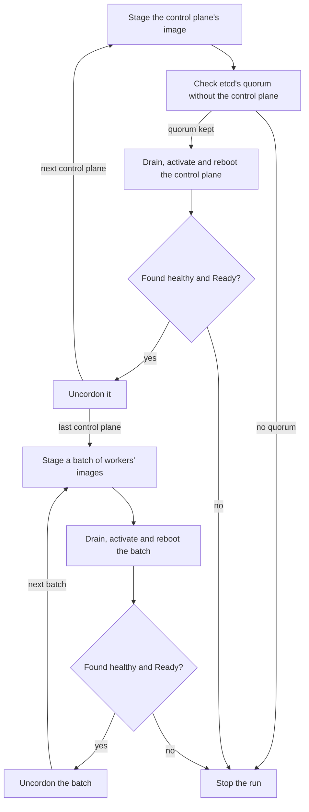

# Upgrade Kubernetes

This page is for an operator who moves a cluster to a new Kubernetes release. The release takes two
steps. First the control plane moves through config:
[`chalkctl apply-config`](../reference/cli/chalkctl_apply-config.md) delivers new image references
to the control planes one at a time, then to the other nodes. Then the kubelets move through new OS
images: [`chalkctl upgrade`](../reference/cli/chalkctl_upgrade.md) installs them, keeps etcd's
quorum and drains each node within its PodDisruptionBudgets. Both commands keep the Kubernetes
version skew policy across the nodes. At the end every node runs the new release, and its Node is
`Ready` and schedulable again.

The second step builds on [Upgrade nodes](../operate/upgrade.md), which covers the image, the
config and rollback. A run of `chalkctl upgrade` on three control planes and a worker reads:

```text
upgrading node on kvm to 23112865089f (v2): cp1, cp2, cp3, w1
cp1: installing 23112865089f (v2)
cp1: config unchanged
cp1: installed 23112865089f (v2), staged as .staged-chalkos_2.efi
cp1: cordoned, evicted 2 pods, kept 6
cp1: activated 23112865089f (v2), which boots next as chalkos_2+3.efi
cp1: rebooting into 23112865089f (v2)
cp1: runs 23112865089f (v2), found healthy
cp1: uncordoned
cp2: installing 23112865089f (v2)
...
cp3: uncordoned
w1: installing 23112865089f (v2)
w1: config unchanged
w1: installed 23112865089f (v2), staged as .staged-chalkos_2.efi
w1: cordoned, evicted 1 pod, kept 2
w1: activated 23112865089f (v2), which boots next as chalkos_2+3.efi
w1: rebooting into 23112865089f (v2)
w1: runs 23112865089f (v2), found healthy
w1: uncordoned
upgraded 4 nodes to 23112865089f (v2)
```

The output comes from a lab cluster. `...` stands for cp2's and cp3's lines, which repeat cp1's.

## Before you begin

- You have run an upgrade as [Upgrade nodes](../operate/upgrade.md) describes, and hold the
  credentials it lists.
- The nodes reach the new release's images, in their registry or through a mirror, as
  [Registries and mirrors](../operate/registries.md) describes.
- The image author has built the new image, and it is signed into the directory the inventory
  names.
- The cluster has three control planes, for an upgrade without API downtime. A cluster with one or
  two needs `--allow-downtime`, described below.
- kubectl is on your workstation, for the checks.

## A new Kubernetes release takes two steps

The image fixes the kubelet's release. The image author sets it in the image's modules, as
[`chalkos.kubernetes.package`](../reference/image-options.md#chalkoskubernetespackage) describes,
and every variant with Kubernetes gets a new image. The control plane, kube-proxy, CoreDNS and the
pod sandbox run the images the `Cluster` document names, as
[Images name every component but the kubelet](configure.md#images-name-every-component-but-the-kubelet)
describes.

A kubelet must not be newer than the API server it talks to, so the control plane moves first:

1. Change the references of `images` in the `Cluster` document to the new release and deliver the
   config to every node with `chalkctl apply-config`, as
   [Roll the control plane out through config](#roll-the-control-plane-out-through-config)
   describes.
2. Upgrade the nodes to the new image with `chalkctl upgrade`, as the sections from
   [Control planes go one at a time, then workers in batches](#control-planes-go-one-at-a-time-then-workers-in-batches)
   on describe.

A patch release of the control plane is the first step alone, and a patch release of the kubelet is
the second step alone. Move one minor release at a time, as the
[Kubernetes version skew policy](https://kubernetes.io/releases/version-skew-policy/) requires.

## Roll the control plane out through config

Change the four versioned references of the `Cluster` document to the new release, and the other
references when the release names new ones. Pin each by its digest, as
[Images name every component but the kubelet](configure.md#images-name-every-component-but-the-kubelet)
describes:

```yaml title="cluster/cluster.yaml"
images:
  apiServer: registry.k8s.io/kube-apiserver:v1.37.2@sha256:<digest>
  controllerManager: registry.k8s.io/kube-controller-manager:v1.37.2@sha256:<digest>
  scheduler: registry.k8s.io/kube-scheduler:v1.37.2@sha256:<digest>
  proxy: registry.k8s.io/kube-proxy:v1.37.2@sha256:<digest>
  # etcd, coredns, pause and flannel as before
```

Then deliver the config to every node of the cluster in one command:

```sh
chalkctl apply-config cp1 cp2 cp3 w1 --secrets secrets.age
```

The config changes the API server's version, so chalkctl orders the run. It checks the versions
every node runs first, as
[chalkctl checks the versions every node runs](#chalkctl-checks-the-versions-every-node-runs)
describes. Then the control planes get the config one at a time, in the order of their names,
whatever order the command names them in:

1. chalkctl checks that etcd keeps its quorum without the control plane, as before a reboot.
2. It delivers the config on trial, for `--try` or else 10 minutes. The kubelet restarts and
   replaces the static pods of the API server, the controller-manager and the scheduler.
3. It waits until the node's Node is `Ready` and its three static pods run the images the config
   names and are `Ready`.
4. It confirms the trial once the node is healthy, as any trial.

The other nodes get the config after the last control plane, without a trial unless `--try` asks
for one. No node reboots and no node drains. A run on three control planes and a worker reads:

```text
cp1: config 0 added, 0 removed, 1 changed
cp1: delivering config <version> on trial until <deadline>
restarted chalkos-kubernetes.service
restarted kubelet.service
cp1 runs config <version> on trial; it rolls back to config <previous-version> by itself unless confirmed within 10m0s
cp1: waiting for its layers to serve with the config
cp1: waiting for a new connection and the node's health to confirm config <version>
cp1 keeps config <version>: the trial is confirmed
cp2: config 0 added, 0 removed, 1 changed
...
cp3 keeps config <version>: the trial is confirmed
w1: config 0 added, 0 removed, 1 changed
restarted chalkos-kubernetes.service
restarted kubelet.service
w1 runs config <version>
```

`<version>` stands for each node's new config version, and `...` for cp2's and cp3's lines, which
repeat cp1's. Each control plane takes a few minutes: its kubelet pulls the new images and starts
the static pods again. The first control plane that gets the config applies the add-ons too, so
kube-proxy's DaemonSet moves to the new image while the other control planes still run the old API
server. Within a patch release the skew policy allows that. In a minor upgrade, kube-proxy runs one
minor ahead of the API servers not yet rolled until the run finishes, so run it to the end without
a pause.

A command that names one node takes the same path when the config changes its API server: the
version check over every node, etcd's quorum check, the trial and the wait. Without such a change,
`chalkctl apply-config` delivers node by node, as for any other config.

### A failure stops the run and rolls that node back

The first node that fails stops the run. A control plane whose static pods do not run the new
images by the trial's deadline is rolled back at once, and the nodes after it get nothing. chalkctl
prints which nodes run which API server:

```text
cp2 runs config <previous-version> again: config <version> was rolled back
API server v1.37.1: cp2, cp3, w1
API server v1.37.2: cp1
chalkctl: cp2: config <version> was not confirmed within its trial: cp2: its control plane: kube-apiserver is not Ready
```

Nodes that run the new version keep it, which the skew policy allows. The error names what the
node's static pods lacked. A reference the registry does not serve, or a pull the mirror refuses,
shows as a pod that is not `Ready`, as `kube-apiserver has no mirror pod yet`, or as
`its static pods are unknown` while the node's API server is down.
`chalkctl logs cp2 --unit kubelet.service` names the image the kubelet could not pull, and
`chalkctl status` prints each node's versions in its `kubernetes versions` line. Fix the reference
or the registry, then run the same command again. It skips the nodes that run the config already,
checks that each such control plane still serves with it, and continues with the first that does
not:

```text
cp1 runs config <version> already
cp1: waiting for its layers to serve with the config
cp2: config 0 added, 0 removed, 1 changed
...
```

### Walk the control planes by hand

`--until deliver` delivers the config on trial to the first node that does not run it yet, and
leaves the trial open. `--confirm` confirms it once its static pods run the new images, and the
same `--until deliver` command then goes on with the next control plane:

```sh
chalkctl apply-config cp1 cp2 cp3 w1 --secrets secrets.age --until deliver
kubectl get pods -n kube-system -o wide
chalkctl apply-config cp1 --secrets secrets.age --confirm
chalkctl apply-config cp1 cp2 cp3 w1 --secrets secrets.age --until deliver
```

While a trial is open, the run refuses to go on, and `chalkctl apply-config --rollback cp1` rolls
the open trial back. Once every control plane runs the config, the last command delivers it to the
other nodes and finishes.

## chalkctl checks the versions every node runs

Each node reports, in its status, the Kubernetes version of the API server its config names and the
release of its image's kubelet. chalkctl reads them from every node of the inventory and holds them
to the [Kubernetes version skew policy](https://kubernetes.io/releases/version-skew-policy/), minor
versions compared:

| Rule | Checked by |
| --- | --- |
| The API servers of a cluster are at most one minor apart. | `apply-config` |
| A kubelet is no newer than the API server. | the image's checker, `apply-config`, `upgrade` |
| A kubelet is at most three minors older than the API server. | the image's checker, `apply-config` |
| The controller-manager and the scheduler are no newer than the API server and at most one minor older. | the image's checker |
| kube-proxy is no newer than the API server and at most three minors older. | the image's checker |

The image's checker compares the config with the image's own kubelet, as
[The image's checker holds the versions to the skew policy](configure.md#the-images-checker-holds-the-versions-to-the-skew-policy)
describes. `chalkctl apply-config` compares the config's API server with every node's API server
and kubelet before it delivers anything to a node, and `chalkctl upgrade` compares each new image's
kubelet with the oldest API server the control planes run before it sends any image. A refusal
names the node:

```text
chalkctl: images.apiServer: v1.39.0 is 2 minors newer than the API server 1.37 that cp1 runs; a cluster's API servers may be at most one minor apart, so upgrade one minor at a time
chalkctl: w1: the image's kubelet 1.38.0 would be newer than the API server 1.37.2 that cp2 runs, the oldest of the cluster; upgrade the control plane first: name the new release's images in the Cluster document and deliver it with chalkctl apply-config
```

`apply-config` also refuses a config that names two API servers for the nodes of one run, and a
worker's new API server while a control plane outside the run does not run it yet. A config older
than a minor the control planes run is a downgrade, which `--allow-downgrade` allows by one minor.

The checks need the versions of every node. A node that does not answer stops an `apply-config`
that changes the API server, and a control plane that does not answer stops an `upgrade`, with
`the versions <node> runs are unknown: <error>`. A node whose inventory entry holds no Kubernetes
`Node` document does not count.

## Control planes go one at a time, then workers in batches

chalkctl upgrades the control planes first, one at a time, each only while etcd keeps its quorum
without it. The workers follow in batches of `--max-unavailable`, one node by default:



The diagram shows the order. Within each group the nodes go in the order of their names. A node is
drained once its image is staged, and the image is activated right after the drain, before the
node reboots. A quorum check or a drain that fails stops the run with the image staged and not
active, so the node keeps booting its current image. An activation that fails stops the run too,
and chalkctl uncordons the node, which does not reboot. After each reboot, chalkctl waits until the
node runs the new image, its boot was found healthy and its Node is `Ready`. Then it uncordons the
node. `chalkctl node reboot` runs the same quorum check, drain, reboot, wait and uncordon for one
node.

## etcd keeps its quorum while a control plane reboots

Before chalkctl touches a control plane, it checks that etcd keeps its quorum without it. The other
voters must be healthy and enough for a quorum, the majority of voters etcd needs to accept a
write. Right after the previous control plane came back, etcd may need a moment, so chalkctl tries
the check again for up to a minute. With cp3 down, an upgrade of cp1 stops there:

```text
upgrading node on kvm to c3a9674a8c68: cp1
chalkctl: without cp1 etcd has 1 healthy voter of 3, fewer than the 2 its quorum needs
```

This output is from another lab run, which upgraded to the image `c3a9674a8c68`.
`chalkctl etcd members` shows which voter is unhealthy. Bring it back, then run the same command
again.

A cluster of one or two control planes loses etcd's quorum while any of them reboots, so etcd and
the API server are down until it is back. chalkctl refuses such a run:

```text
chalkctl: etcd has 2 voters, and without cp1 fewer than the 2 its quorum needs: it and the API server are down while cp1 reboots; pass --allow-downtime to accept that
```

Pass `--allow-downtime` when that downtime is acceptable. With three or more control planes, the
flag changes nothing: chalkctl still waits for the other voters to be healthy.

`chalkctl apply-config` runs the same check before each control plane gets a new API server, since
the control plane's static pods restart. Its message ends `it and the API server are down while cp1
restarts its control plane; pass --allow-downtime to accept that`, and its `--allow-downtime`
accepts it the same way.

A control plane that is joining blocks the run too, because its etcd member is a learner. The
message reads `etcd member cp3 is a learner yet; upgrade once it joined`. Run the command again
once the node has joined.

## The drain respects PodDisruptionBudgets

The drain cordons the node and evicts its pods through the eviction API, so each pod's
PodDisruptionBudget applies. An eviction that the budget does not allow yet is tried again until
`--timeout` passes. The drain keeps these pods on the node:

- DaemonSet pods, which run on the node again once it is back;
- static pods, such as the control plane's own;
- finished pods;
- pods without a controller, which nothing starts elsewhere.

chalkctl names the last kind, because those pods are gone for good if the node stays down longer
than their tolerations allow:

```text
w1: keeps pods without a controller: <pods>; nothing starts them elsewhere, and they are deleted for good if the node stays down longer than their tolerations allow
```

`<pods>` stands for the pods' namespaces and names. A pod with an `emptyDir` volume stops the drain
unless `--delete-emptydir-data` allows the eviction, because the eviction deletes the volume's data:

```text
pods <pods> have emptyDir volumes, whose data an eviction deletes; pass --delete-emptydir-data to evict them
```

A node that was cordoned before the run, by `kubectl cordon` for example, stays cordoned after it.
The drain line then reads `was cordoned before and stays so`. chalkctl uncordons only the nodes it
cordoned itself.

## Choose the flags for Kubernetes

These flags of `chalkctl upgrade` change how it treats the cluster. [Upgrade
nodes](../operate/upgrade.md#control-planes-go-first-then-the-other-nodes-in-batches) lists the
others.

| Flag | Default | Effect |
| --- | --- | --- |
| `--allow-downtime` | off | Lets a cluster of one or two control planes upgrade, although etcd and the API server are down while one of them reboots. |
| `--delete-emptydir-data` | off | Also evicts pods with `emptyDir` volumes, whose data is lost. |
| `--timeout=<duration>` | 30 minutes | How long each drain may take, and how long each node may take to come back healthy and `Ready`. |
| `--max-unavailable=<n>` | 1 | How many workers go at once. Control planes always go one at a time. |

Raise `--max-unavailable` only when the other nodes can run the evicted pods. Pods that find no
room stay pending, and their budgets then stop the next drain.

These flags of `chalkctl apply-config` change how it rolls the control plane out:

| Flag | Default | Effect |
| --- | --- | --- |
| `--allow-downtime` | off | Lets a cluster of one or two control planes take a new API server, although etcd and the API server are down while the control plane restarts. |
| `--allow-downgrade` | off | Lets the config name an API server one minor older than the newest the control planes run. |
| `--try=<duration>` | 10 minutes for control planes | How long each node's trial lasts. Its static pods must run the new images within it. |
| `--until=deliver` | `confirm` | Leaves the first node's trial open, for `--confirm`. |

## Run the same command again to continue

A run that stopped continues where it stopped. When a budget allows no eviction within
`--timeout`, the drain fails and the node stays cordoned:

```text
chalkctl: drain w1: cp1: failed_precondition: drain w1: pods default/web-64f96cd96-xzlzx still run: default/web-64f96cd96-xzlzx: Cannot evict pod as it would violate the pod's disruption budget.; it stays cordoned
```

`kubectl get pdb -A` shows the budget that allows no disruption:

```console
$ kubectl get pdb -A
NAMESPACE   NAME   MIN AVAILABLE   MAX UNAVAILABLE   ALLOWED DISRUPTIONS   AGE
default     web    1               N/A               0                     11m
```

Here both pods of `web` ran on w1, the only worker, so no evicted pod could start elsewhere. Make
room for the pods, or change the budget, then run the same command again. It skips the nodes that
run the new image and drains w1 again:

```text
upgrading node on kvm to 23112865089f (v2): cp1, cp2, cp3, w1
cp1: runs 23112865089f (v2), found healthy
cp2: runs 23112865089f (v2), found healthy
cp3: runs 23112865089f (v2), found healthy
w1: cordoned, evicted 1 pod, kept 2
w1: installing 23112865089f (v2)
...
```

## Uncordon a node that rolled back

A node of the cluster whose new image is not found healthy boots its previous image and stays
cordoned, so you can look at it before workloads return. The run stops with
`rolled back to <old>; it stays cordoned`. [A node that fails its health check rolls
back](../operate/upgrade.md#a-node-that-fails-its-health-check-rolls-back) explains how to find the
cause.

The next run that installs an image on the node uncordons it once the node is healthy, with a fixed
image or with `--retry-failed`. To give the node back to the scheduler before that, uncordon it
yourself:

```sh
kubectl uncordon w1
```

## Check that it worked

`kubectl get nodes` shows each node's kubelet release in the `VERSION` column, and no node
`SchedulingDisabled`:

```console
$ kubectl get nodes
NAME   STATUS   ROLES    AGE   VERSION
cp1    Ready    <none>   19m   v1.37.1
cp2    Ready    <none>   19m   v1.37.1
cp3    Ready    <none>   19m   v1.37.1
w1     Ready    <none>   19m   v1.37.1
```

`chalkctl etcd members` shows every control plane as a healthy voter again.

`chalkctl status` shows each node's versions after its Kubernetes line. On a control plane the
line ends `control-plane pods current` once its static pods run the config's images:

```text
kubernetes controlplane: bootstrapped, node ready: True, vip holder, control plane current
kubernetes versions: API server 1.37.2, kubelet 1.37.1, control-plane pods current
```

`kubectl get pods -n kube-system -o wide` lists the static pods, kube-proxy and CoreDNS, and
`kubectl describe pod -n kube-system kube-apiserver-cp1` shows the image the API server runs.

## If something goes wrong

- `without cp1 etcd has 1 healthy voter of 3, fewer than the 2 its quorum needs`: another control
  plane is down or unhealthy. chalkctl does not reboot cp1 until enough of the others are healthy.
  `chalkctl etcd members` shows which one is not.
- `etcd has 2 voters, and without cp1 fewer than the 2 its quorum needs: ...; pass --allow-downtime
  to accept that`: the cluster has one or two control planes, so etcd and the API server are down
  while one reboots. Pass `--allow-downtime` when that is acceptable.
- `pods ... have emptyDir volumes, whose data an eviction deletes; pass --delete-emptydir-data to
  evict them`: the drain refuses to delete those pods' scratch data. Pass the flag when the data
  may be lost.
- `etcd member cp3 is a learner yet; upgrade once it joined`: a control plane is still joining. Run
  the command again once it has joined.
- `drain w1: ... Cannot evict pod as it would violate the pod's disruption budget.; it stays
  cordoned`: a PodDisruptionBudget allowed no eviction within `--timeout`. `kubectl get pdb -A`
  shows it.
- `images.apiServer: v1.39.0 is 2 minors newer than the API server 1.37 that cp1 runs; ...`: the
  config skips a minor release. Name the next minor release first, and roll the control plane out
  once per minor.
- `images.apiServer: v1.37.5 is older than the API server 1.38 that cp1 runs; pass
  --allow-downgrade to downgrade the control plane`: the config names an older minor than a control
  plane runs. Pass the flag when the downgrade is meant.
- `images.apiServer: v1.38.0 is 4 minors newer than the kubelet 1.34 that w1 runs; ...`: a node
  runs a kubelet too old for the new API server. Upgrade that node's image first.
- `w1 is no control plane, and the control planes cp2 do not run the API server v1.37.2 yet;
  deliver the config to them first`: the command named a worker before every control plane runs
  the new API server. Name the control planes too, or deliver to them first.
- `cp2: its control plane: kube-apiserver is not Ready`: the control plane's static pods did not
  run the new images within the trial, and chalkctl rolled its config back. Check that the
  registry or the mirror serves the references, then run the same command again.
- `the versions w1 runs are unknown: ...; the version skew check needs every node of the cluster`:
  chalkctl could not read a node's versions. Bring the node back, or remove it from the inventory.
- `w1: the image's kubelet 1.38.0 would be newer than the API server 1.37.2 that cp2 runs, ...`:
  `chalkctl upgrade` refuses an image whose kubelet is ahead of the control plane. Roll the control
  plane out through config first.

## What next

- [Run a highly available control plane](ha-control-plane.md) covers etcd's members and how to
  bring one back.
- [Upgrade nodes](../operate/upgrade.md) covers the image, the config and rollback.
- [Troubleshoot Kubernetes](troubleshooting.md) starts from symptoms.
- [`chalkctl apply-config`](../reference/cli/chalkctl_apply-config.md) and
  [`chalkctl upgrade`](../reference/cli/chalkctl_upgrade.md) list every flag.
- [Kubernetes upgrades](../how-it-works/kubernetes/upgrades.md) explains the order and the checks.
