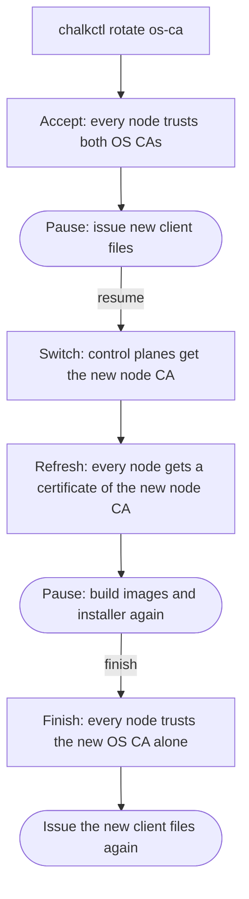

# Manage access and certificates

This page is for an operator who decides who may run chalkctl against the nodes and keeps the
cluster's certificates valid. At the end each person holds a client file of the role they need,
node certificates renew before they expire, and the OS CA and the node CA can be replaced while
the nodes keep running. Every command on this page needs the secrets file, which holds each CA's
key.

## Before you begin

You need the workstation that [Set up your workstation](workstation.md) describes, with the secrets
file `secrets.age` and the inventory. A rotation also needs every node of the inventory running and
reachable, because each phase waits until every node confirms it.

[Certificates](../how-it-works/node/certificates.md) shows the CAs this page changes and what each
one issues.

## A client file gives one person one role

A client file holds a certificate of one role, its key and the OS CA. It lets a person run chalkctl
without the secrets file. Issue one per person with `chalkctl config new`:

```sh
chalkctl config new --name alice --role operator --ttl 2160h --out alice.json --secrets secrets.age
```

`--role` is reader, operator or admin. Give each person the least role their work needs.
[A client file grants one role](workstation.md#a-client-file-grants-one-role) says what each role
may do and where the file goes, and
[Each command needs the secrets file or a client file](workstation.md#each-command-needs-the-secrets-file-or-a-client-file)
lists the role each command needs.

The certificate is valid for a year unless `--ttl` gives another validity. chalkctl warns during a
client file's last 30 days. Hand the file over as you would a private key, because it holds one.

## Access ends when a certificate expires or its CA goes

chalkd checks no revocation list of client files. A client file keeps working until its certificate
expires, or until the nodes no longer trust the OS CA it chains to. To take access away:

- Let the file expire. A short `--ttl` limits how long a file works without a rotation.
- Rotate the OS CA, as [Rotate the OS CA](#rotate-the-os-ca) describes. Every client file issued
  before the rotation stops working. Issue new files at the rotation's first pause to everyone who
  keeps access.

!!! note "On the shipped variant, kubeconfigs are revoked with the Kubernetes CA"

    A kubeconfig chains to the Kubernetes CA, which an OS CA rotation does not touch.
    [Revoke Kubernetes access](../kubernetes/rotate-kubernetes-cas.md#revoke-kubernetes-access)
    covers kubeconfigs and service-account tokens.

## Node certificates renew through a control plane

Each node serves a node certificate, which chalkctl verifies. It is valid for a year, and never
beyond the node CA that issued it.

On the shipped variant, a node renews its own certificate. chalkd checks about every hour. Once two
thirds of the certificate's lifetime have passed, it creates a new key and asks a control plane at
the cluster endpoint for a certificate. A control plane signs its own with the node CA it holds.
A failed attempt keeps the current certificate and retries later. Nothing needs doing until
`chalkctl status` reports a problem on the `node` line under `certificates:`.

A control plane renews a certificate only while it can read the revoked nodes from its API
server, so that it never renews a revoked node's. During a long outage of the API server, no
renewal succeeds, the control plane's own included. `chalkctl node renew --force` renews a node's
certificate without asking the control planes.

A node whose image runs no Kubernetes has no control plane to ask. Renew its certificate with
`chalkctl node renew` once a year, before it expires:

```console
$ chalkctl node renew w1 --secrets secrets.age
w1 serves a new node certificate; it expires <date>
```

`<date>` is a year from the renewal, in RFC 3339 form. Such a node's status shows when renewal is
due, with
`less than a third of its lifetime remains; renew it with chalkctl node renew w1`.

`chalkctl node renew` also renews a node whose certificate has expired, such as a node switched off
for months. To reach it, chalkctl trusts the node's old key, so someone who stole that key and sits
in the node's network path could receive the new certificate. Renewing before expiry avoids that.
[Recover a node](recover-node.md) covers a node that cannot renew.

## Rotate the node CA before it expires

The node CA issues every node certificate, and on the shipped variant the control planes hold it to
renew them. It is valid for five years. No node certificate outlives it, so control planes warn
once less than 18 months remain, with `node CA expires <date>; run chalkctl node-ca rotate`.

`chalkctl node-ca rotate` issues a new node CA from the OS CA and delivers it to every control
plane:

```console
$ chalkctl node-ca rotate --secrets secrets.age
secrets.age holds a new node CA, which expires <date>; the previous version is secrets.age.prev; secrets.pub.json holds the new public half
cp1 renews node certificates with the new node CA
```

`<date>` is five years from the rotation. The rotation runs in one step. Certificates of the old node
CA stay valid until they expire, because both node CAs chain to the same OS CA. Nodes pick up
certificates of the new one at their next renewal. The rotation therefore cuts off no node, not
even a removed one: chalkd trusts every node CA the OS CA signed. A control plane that could not
be reached fails the command, and the error names the command that delivers the new node CA later:
`the new node CA did not reach every control-plane node; deliver it with
chalkctl apply-config <node> --kubernetes-share --secrets secrets.age: ...`.

## Choose what to rotate

`chalkctl rotate` replaces one of four kinds of value across the cluster. Two of them exist only on
the shipped variant's Kubernetes:

| Kind | What it replaces | What it revokes |
| --- | --- | --- |
| `os-ca` | The OS CA and the node CA, and every node certificate | Every client file issued before, and the node certificates of nodes outside the rotation |
| `kubernetes-ca` (Kubernetes) | The Kubernetes, front-proxy and etcd CAs, and every certificate they issued | Every kubeconfig issued before |
| `service-account-key` (Kubernetes) | The key that signs service-account tokens | Tokens signed with the old key |
| `encryption-key` (Kubernetes) | The key that encrypts Secrets in etcd | Nothing; old data is encrypted again |

Rotate when a key may have leaked, when someone who held a client file should lose access, or well
before a CA expires. The OS CA is valid for ten years, and status warns a year ahead.
[Rotate the Kubernetes CAs and keys](../kubernetes/rotate-kubernetes-cas.md) covers the three
Kubernetes kinds.

## Revocation cuts off one node without a rotation

On the shipped variant, `chalkctl node revoke` cuts off one node by name, at once. The cluster
keeps running as it is, and no CA changes. A rotation replaces a CA and with it every certificate
it issued, so it cuts off everyone who holds an old one. Choose by what was lost:

| What was lost | What cuts it off |
| --- | --- |
| A worker that was removed, lost or stolen | `chalkctl node revoke` |
| A control plane, or its disk | `chalkctl etcd leave` or `chalkctl etcd remove-member`, then `chalkctl rotate os-ca` and `chalkctl rotate kubernetes-ca` |
| A node of a cluster without Kubernetes | `chalkctl rotate os-ca` |
| A client file | `chalkctl rotate os-ca` |
| A kubeconfig | `chalkctl rotate kubernetes-ca` |

A control plane needs the rotations because its disk holds the node CA's and the Kubernetes CA's
keys, with which it can issue itself new certificates. A cluster without Kubernetes keeps no list
of revoked nodes. `chalkctl node-ca rotate` cuts off no node, because chalkd trusts every node CA
the OS CA signed.

A revoked name stays blocked until `chalkctl node unrevoke` lets it back in. Reusing the name
takes both rotations first.
[Add and remove nodes](add-remove-nodes.md#revoke-a-removed-node) shows both commands, and
[Security model](../how-it-works/node/security.md#revoking-a-node-cuts-off-its-writes-and-renewals)
lists what a revoked node can still do.

## A rotation runs in four phases with pauses

A rotation moves through four phases: accept, switch, refresh and finish. Every node confirms a
phase before the next one starts, so no node presents a certificate that another node does not
trust yet. The OS CA's rotation pauses twice, after accept and after refresh, for you to act:



The diagram shows the phases in order and the three points, drawn round, where you act:

1. After accept, issue new client files. Files issued then carry both OS CAs, so they keep working
   through the rotation and after it. Files from before the rotation stop verifying the nodes from
   the switch on.
2. After refresh, build the images and the installer again from the new `secrets.pub.json`.
   Images carry the OS CA that maintenance mode accepts, so an install from an older image fails.
3. After the finish, issue the client files once more. Files issued during the rotation still trust
   the old OS CA when they verify the nodes, so whoever holds the old key could pose as a node to
   them.

`chalkctl rotate os-ca --resume` continues after the first pause, and
`chalkctl rotate os-ca --finish` runs the finish after the second.

The secrets file records the rotation's phase. chalkctl rewrites it in place after every step, keeps
the previous version as `secrets.age.prev`, and rewrites `secrets.pub.json` beside it. An encrypted
file is encrypted again to the recipients it records, unless `--recipient` replaces them. `--out`
and `--public-out` write new files instead and leave the old ones as they are. Then continue the
rotation with `--secrets` naming the new file, because only that file knows the phase. One rotation
runs at a time, and one chalkctl command at a time changes the file, holding `secrets.age.lock`.

A phase that cannot finish, because a node is down or a step timed out, stops with what failed and
the command to continue:

```text
chalkctl: the accept phase of the rotation of the OS CA stopped: w1: ...; once that is fixed, continue with chalkctl rotate os-ca --resume
```

Applying a phase again redoes nothing that is done, so `--resume` can run as often as needed.
`--timeout` sets how long each node has for a phase, 10 minutes by default.

## Rotate the OS CA

The OS CA is the root every node and client file trusts. Rotating it replaces the node CA too and
gives every node a new certificate. Start the rotation:

```console
$ chalkctl rotate os-ca --secrets secrets.age
secrets.age records the rotation of the OS CA; the previous version is secrets.age.prev; secrets.pub.json holds the new public half
os-ca: the accept phase
  cp1 trusts the 2 OS CAs of the secrets file
  w1 trusts the 2 OS CAs of the secrets file
os-ca: every node applied the accept phase
Every node trusts the old and the new OS CA. Issue new client files now with chalkctl config new: they carry both OS CAs and work throughout the rotation and after it. Client files from before the rotation stop verifying the nodes from the switch on and are refused at the finish. Then continue with chalkctl rotate os-ca --resume, which makes the new OS CA issue.
```

Issue a new client file for everyone who keeps access, with `chalkctl config new`. Then resume:

```console
$ chalkctl rotate os-ca --resume --secrets secrets.age
os-ca: the switch phase
  cp1 renews node certificates with the new node CA
os-ca: every node applied the switch phase
os-ca: the refresh phase
  cp1 serves a certificate of the new node CA
  w1 serves a certificate of the new node CA
os-ca: every node applied the refresh phase
Every node serves a certificate of the new node CA and trusts the old and the new OS CA. Client files from before the rotation cannot verify the nodes any more and are refused after the finish: issue new ones with chalkctl config new. Build images and installer media again from secrets.pub.json; older ones trust the old OS CA alone, and installing from them fails. Then remove the old OS CA with chalkctl rotate os-ca --finish.
```

The switch gives the new node CA to the nodes that renew node certificates: on the shipped variant,
the control planes. The refresh gives every node a certificate of it. A node renewed earlier shows
`serves a certificate of the new node CA already`.

Commit the new `secrets.pub.json`, and have the installer and the images you keep for installs built
again. Running nodes need no new image. The next image built carries the new OS CA, which gives it
a new root hash like any other change. Then finish:

```sh
chalkctl rotate os-ca --finish --secrets secrets.age
```

The finish ends with
`the rotation of the OS CA is finished: every node trusts the new value alone`, followed by where
the files went and the reminder to issue the client files again.

## Check that it worked

`chalkctl status` lists what a node trusts under `trust:`, by the first 16 hex digits of each
fingerprint. During an OS CA rotation a node trusts two:

```console
$ chalkctl status w1 --secrets secrets.age
...
trust:
  OS CA  <old fingerprint>, <new fingerprint>
...
```

After the finish, the line shows one fingerprint again. The `certificates:` section shows each
certificate's expiry, and a problem beside it when one needs doing, such as a renewal that fails.

## If something goes wrong

- `another chalkctl command is changing secrets.age; wait for it to end, then run this one again`:
  another command holds the lock, such as a rotation still waiting for a node.
- `secrets.age changed since chalkctl read it and was left as it is; look at what changed it, then
  run the command again`: an editor or a `git checkout` changed the file during the command.
- `a rotation of the OS CA runs, in its accept phase; continue it with chalkctl rotate os-ca
  --resume or --finish`: a rotation started earlier is not finished. Finish it before you start
  another or run `chalkctl node-ca rotate`.
- A node that stays unreachable blocks every phase. Remove it from the inventory, or reinstall it,
  before you resume. A rotation skips a revoked node and says
  `skipping w1: revoked since <time>`, where `<time>` is when the node was revoked.
- `no control-plane node said which nodes are revoked (...); rotate runs only once one does, so it
  never hands a certificate to a revoked node, or with --ignore-revoked`: the API server is down,
  or the control planes run a chalkd from before node revocation. Fix that, or rotate with
  `--ignore-revoked`, which reads no list and rotates every node of the inventory. A revoked node
  still in the inventory then receives the new CA and its certificates, so remove revoked nodes
  from the inventory first. chalkctl warns of this at each run.
- A node unrevoked while a rotation is paused takes part from the next run on, but it missed the
  earlier phases, and the rotation may stop at it. Unrevoke nodes before or after a rotation.

## What next

- [Rotate the Kubernetes CAs and keys](../kubernetes/rotate-kubernetes-cas.md) replaces what the
  API server and etcd trust.
- [Security model](../how-it-works/node/security.md) explains what each CA and key protects.
- [`chalkctl rotate`](../reference/cli/chalkctl_rotate.md) lists every flag.
