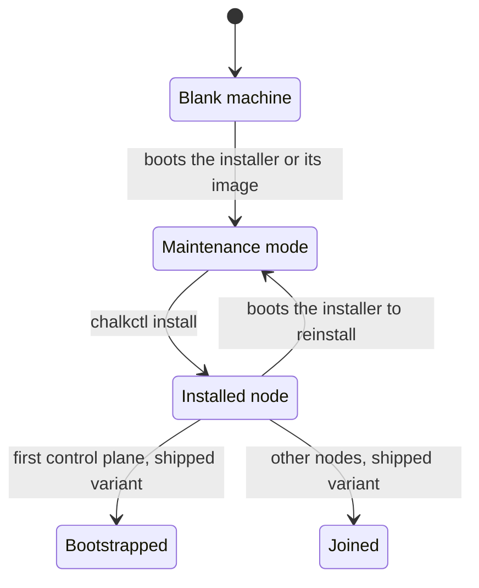

# Install a node

This page is for an operator who turns a machine into a node of the inventory. The machine may be
a physical server or a VM under QEMU, libvirt or Proxmox. At the end the node runs its image from
its system disk with its config, and chalkctl reaches it at the address the inventory names. The
page installs the homelab's `cp1`, as [Write a node's config](node-config.md) describes it.

## Before you begin

You need a workstation set up as [Set up your workstation](workstation.md) describes: chalkctl,
the repository with the inventory, the nodes' config files, the image directory and the secrets
file `secrets.age`. `chalkctl validate` accepts every node's config.

The image and the installer must carry the cluster's OS CA. The image author sets the
[`osCA`](../reference/options.md#osca) argument of `mkImages` to `./secrets.pub.json`, which git
tracks. A machine in maintenance mode then accepts only a chalkctl that holds the secrets file or
a client file of this cluster.

Each machine needs UEFI firmware, Secure Boot and a TPM 2.0. The
[requirements](../get-started/requirements.md) list the rest. For a machine that enforces Secure
Boot, you also need:

- a Secure Boot db key and certificate, `db.key` and `db.crt`, with the certificate enrolled in
  the machine's firmware. [Sign images for Secure Boot](../build/sign-images.md) creates them and
  explains the enrolment, which chalkos does not do for you;
- chalkbuild on the machine that holds `db.key`, from
  `nix shell github:trevex/chalkos#chalkbuild` or the cluster flake's development shell.

A physical machine boots the installer from a USB stick larger than the installer ISO, about
450 MiB, or from a BMC that mounts an ISO as virtual media.

A VM needs a KVM host with QEMU, OVMF built with Secure Boot and SMM support, and swtpm. libvirt
and Proxmox bring all three. You need `qemu-img` where you prepare the VM's disk. Give each
control plane 2 vCPUs and about 3 GiB of memory, each worker 2 GiB, and every node at least
16 GiB of disk. chalklab gives its VMs these sizes.

!!! note "Installing without Secure Boot"

    The steps work on machines with Secure Boot off: leave out the signing, and keep the
    inventory on the unsigned image directory. The node then checks no signatures and seals its
    disk keys to the Secure-Boot-off state of PCR 7. Anyone who holds an operator certificate can
    then run an image of their own on it.
    [Security model](../how-it-works/node/security.md) explains why.

## A node passes through maintenance mode once

A machine becomes a node in two steps. First it boots into maintenance mode, where chalkd waits
for an install and has no config. Then `chalkctl install` gives it its config and secrets, and
the machine reboots as an installed node in normal mode. An installed node never returns to
maintenance mode by itself. To reinstall it, you boot it into the installer again.



The diagram shows a machine's states. A machine reaches maintenance mode in one of two ways:

- It boots the installer, a NixOS image that runs chalkd in maintenance mode. The installer
  writes the node's image to the system disk and never touches the medium it boots from. One
  installer serves every variant and platform of the cluster.
- A VM boots the node's image from its disk. On the first boot, the image finds no installed node
  and starts chalkd in maintenance mode. The install then happens in place: chalkctl sends no
  image, and the node keeps the image it runs.

On the shipped variant, which runs Kubernetes, the first control plane is bootstrapped once. The
other nodes join the cluster on their own.

## Sign the image for machines that enforce Secure Boot

The image author's build writes the unsigned image directory, such as `images/node-metal`. The
firmware of a machine that enforces Secure Boot boots only a boot loader and a UKI signed by a
certificate in its db. Sign a copy of the build into `images/node-metal-signed` with
[`chalkbuild sign`](../reference/cli/chalkbuild_sign.md):

```console
$ rm -rf images/node-metal-signed
$ chalkbuild sign --key db.key --cert db.crt images/node-metal images/node-metal-signed
signed images/node-metal-signed/chalkos.raw
```

chalkbuild signs the copy's boot loader and UKI and checks them against `db.crt`. The output
directory must not exist, so `rm -rf` removes the signed copy of an earlier build first.

Point the inventory's image at the signed copy. The homelab's inventory names the unsigned build.
For machines that enforce Secure Boot it names the signed one:

```yaml title="chalkos.yaml"
apiVersion: chalkctl.chalkos.dev/v1alpha1
kind: Inventory
metadata: {name: homelab}
spec:
  images:
    # chalkbuild sign writes the signed copy of images/node-metal here.
    node-metal: {source: {directory: images/node-metal-signed}}
  all: {imageName: node-metal, files: [cluster/*.yaml]}
  nodes:
    cp1: {address: 10.0.0.11, files: [nodes/cp1.yaml]}
    w1: {address: 10.0.0.21, files: [nodes/w1.yaml]}
```

Signing leaves the store as it is, so the root hash stays the same. `chalkctl validate` checks the
config against the signed copy:

```console
$ chalkctl validate
cp1: valid for the image node-metal (node on metal, root hash d871203debfe), config 675850c48eaffe4a755dca41652dbf65a5b7959f1e70a3cdd2a94799136fd200
w1: valid for the image node-metal (node on metal, root hash d871203debfe), config 82ec5bbabd10ec79bf76ad892a0bcd7627c9db2ed4c9e252ad0657313359254c
```

Sign every new build again before you install or upgrade with it. A node that does not enforce
Secure Boot takes the unsigned `images/node-metal` as it is.

## A VM runs the kvm image

A node runs the image the inventory names for it, and its platform is that image's. A VM runs the
`kvm` platform's image. Every image carries the virtio drivers. The `kvm` image also writes its
console to the first serial port alone and runs the QEMU guest agent, which the `metal` image
lacks. The image author adds `kvm` to the flake's platforms and exposes its image as a package,
such as `node-kvm`, as the lab template's flake does.
[Variants and platforms](../build/variants-and-platforms.md#a-platform-builds-an-image-per-kind-of-machine)
covers the build.

Name the signed copy of the `kvm` image in the inventory's `spec.images`. `spec.all.imageName`
gives it to every node that names no image of its own or through a group:

```yaml title="chalkos.yaml"
apiVersion: chalkctl.chalkos.dev/v1alpha1
kind: Inventory
metadata: {name: homelab}
spec:
  images:
    # chalkbuild sign signs a copy of the build into this directory.
    node-kvm: {source: {directory: images/node-kvm-signed}}
  all: {imageName: node-kvm, files: [cluster/*.yaml]}
  nodes:
    cp1: {address: 10.0.0.11, files: [nodes/cp1.yaml]}
```

A VM's system disk is a virtio block disk, `/dev/vda` in the guest. Match the network by MAC
address, so that it does not depend on the interface's name, and give the VM that MAC address.
`cp1`'s `SystemDisk` and `Network` then read:

```yaml title="nodes/cp1.yaml"
apiVersion: storage.chalkos.dev/v1alpha1
kind: SystemDisk
metadata: {name: system}
spec:
  disk: {path: /dev/vda}
---
apiVersion: networkd.chalkos.dev/v1alpha1
kind: Network
metadata: {name: 10-uplink}
spec:
  match: {macAddress: "52:54:00:12:00:11"}
  network: {address: [10.0.0.11/24], gateway: 10.0.0.1}
```

On Proxmox with a SCSI disk in place of a virtio block disk, the disk is `/dev/sda`. A node's
platform is fixed at install. Moving a node to another platform takes a reinstall.

Sign the `kvm` image before the VM's first boot. An install in place sends no image, so the VM
keeps the image it boots until its first upgrade. A VM writes to its disk, so take a writable copy
of the signed raw image for the disks:

```sh
nix build .#node-kvm -o images/node-kvm
rm -rf images/node-kvm-signed
chalkbuild sign --key db.key --cert db.crt images/node-kvm images/node-kvm-signed
chalkctl validate
cp --sparse=always images/node-kvm-signed/chalkos.raw node.raw
```

The image holds the ESP, with its UKI as the first boot entry `chalkos_1.efi`, and slot A. Every
node whose image is `node-kvm` boots the same signed image; what differs between nodes reaches
them at install. On its first boot the image adds slot B and STATE behind slot A, and the install
creates VAR in the rest of the disk. The disk must therefore be larger than the image.

Every hypervisor below gives the VM the same settings:

| Setting | Value | Why |
| --- | --- | --- |
| Machine type | q35 with SMM | OVMF's Secure Boot build needs SMM to protect its variables. |
| Firmware | OVMF with Secure Boot on and `db.crt` in db | The firmware boots only images signed with a key it trusts. |
| TPM | TPM 2.0, emulated by swtpm | chalkos seals the disk keys to it, so its state must persist with the VM. |
| Disk | virtio block, made from `node.raw` | The node's system disk, `/dev/vda` in the guest. |
| Network | virtio-net, with the MAC address the node's `Network` matches | chalkctl reaches the node at the address of that network. |
| Serial port | the first one, `ttyS0` | The `kvm` image's console, where chalkd prints its fingerprint. |
| Guest agent channel | virtio-serial port `org.qemu.guest_agent.0` | Optional. The host can then shut the VM down cleanly and read its addresses. |

The guest agent answers only `guest-sync-delimited`, `guest-sync`, `guest-ping`, `guest-info`,
`guest-get-osinfo`, `guest-get-host-name`, `guest-get-time`, `guest-get-timezone`,
`guest-network-get-interfaces` and `guest-shutdown`. It never runs commands, or reads or writes
files, for the host. The hypervisor's admin therefore gets no shell on the node through it.

!!! warning "Keep the VM's UEFI variables and TPM state for the node's life"

    The node's disk keys are sealed to PCR 7, which measures the Secure Boot variables. A reset
    UEFI variables file or a new TPM state stops the node from unlocking without its recovery
    key.

A VM can boot the installer instead of its image. Attach the signed installer ISO, as the bare
metal tab below builds it, as a CD-ROM next to an empty virtio disk, and install as on a physical
machine. chalkctl then sends the signed copy of the node's `kvm` image to the installer, or the
installer pulls it from a registry. This takes one image download per node in place of one disk
copy, which suits a hypervisor that you cannot copy disk images to.

## Boot the machine into maintenance mode

A physical machine boots the installer. A VM boots its own image from a disk made from
`node.raw`. Pick the tab for your machine:

=== "Bare metal"

    Build the installer from the repository's directory:

    ```console
    $ nix build .#installer -o installer
    $ ls installer/
    chalkos-installer.iso  chalkos-installer.iso.json  chalkos-installer.raw  metadata.json  repart-output.json
    ```

    The `.iso` is a hybrid image. It boots from a CD, from virtual media and written to a USB
    stick. The `.raw` is the same system as a plain disk image, for machines that boot better from
    one. The installer takes its addresses by DHCP on every Ethernet port.
    [Customise the installer](../build/customise-installer.md) gives it static addresses, VLANs,
    bonds or extra drivers.

    chalkos also builds a generic installer without an OS CA,
    `nix build github:trevex/chalkos#installer`. Until it installs a node, it accepts any client,
    so anyone on its network who reads the fingerprint can install on the machine. Use the
    cluster's own installer where you can.

    The firmware boots the installer only when its boot loader and UKI are signed by a
    certificate in db. Sign a copy of the installer's directory, its raw image and its ISO:

    ```sh
    rm -rf installer-signed
    chalkbuild sign --key db.key --cert db.crt installer installer-signed
    ```

    Sign the installer with the same key as the images. The installer seals the node's STATE to
    PCR 7 as it measures it while the installer runs, and PCR 7 includes the certificate that
    verified the boot binaries. An image signed with another key boots, but its first boot finds
    PCR 7 changed and asks for the recovery key on the console.

    Write the signed ISO to the whole stick, not to a partition of it:

    ```sh
    sudo dd if=installer-signed/chalkos-installer.iso of=/dev/<usb-disk> \
      bs=4M conv=fsync status=progress
    ```

    `<usb-disk>` is the stick's device, for example `sdb`; `lsblk` lists the candidates. The
    command overwrites everything on the stick. With a BMC, mount
    `installer-signed/chalkos-installer.iso` as virtual media instead.

    Boot the machine from the stick through the firmware's boot menu. The installer's kernel
    writes to the screen and to the first serial port, where a BMC's serial-over-LAN shows it.

=== "QEMU"

    Give each VM its own disk, converted from the signed image and grown to the node's disk size.
    qcow2 stays thin and supports snapshots:

    ```sh
    qemu-img convert -f raw -O qcow2 node.raw cp1.qcow2
    qemu-img resize cp1.qcow2 32G
    ```

    Prepare a UEFI variables file with Secure Boot on and your db certificate enrolled, with
    `virt-fw-vars` from virt-firmware. `--enroll-generate` creates a platform key and KEK for the
    file. `--no-microsoft` leaves Microsoft's certificates out of db, and `--microsoft-kek none`
    leaves them out of KEK. The VM then boots only what you signed and accepts no db update that
    Microsoft signed. Then start the VM's TPM:

    ```sh
    mkdir -p cp1/tpm
    virt-fw-vars --input <ovmf-vars> --output cp1/OVMF_VARS.fd \
      --enroll-generate "cp1 platform key" --no-microsoft --microsoft-kek none \
      --add-db "$(uuidgen)" db.crt --secure-boot
    swtpm socket --tpm2 --tpmstate dir=cp1/tpm --ctrl type=unixio,path=cp1/tpm/swtpm.sock --daemon
    ```

    `<ovmf-vars>` is the variables template of your OVMF build, and `<ovmf-code>` below is its
    code. On Debian and Ubuntu they are `OVMF_VARS_4M.fd` and `OVMF_CODE_4M.secboot.fd`. In
    nixpkgs they are `OVMF_VARS.fd` and `OVMF_CODE.fd` of `OVMFFull.fd`. The two must come from
    the same build. Then start the VM:

    ```sh
    qemu-system-x86_64 -name cp1 -machine q35,smm=on,accel=kvm -cpu host -m 3072 -smp 2 \
      -global driver=cfi.pflash01,property=secure,value=on \
      -drive if=pflash,format=raw,unit=0,readonly=on,file=<ovmf-code> \
      -drive if=pflash,format=raw,unit=1,file=cp1/OVMF_VARS.fd \
      -drive if=none,id=disk0,format=qcow2,file=cp1.qcow2 \
      -device virtio-blk-pci,drive=disk0,bootindex=1 \
      -nic bridge,br=br0,model=virtio-net-pci,mac=52:54:00:12:00:11 \
      -chardev socket,id=chrtpm,path=cp1/tpm/swtpm.sock \
      -tpmdev emulator,id=tpm0,chardev=chrtpm -device tpm-tis,tpmdev=tpm0 \
      -device virtio-serial-pci,id=agent \
      -chardev socket,id=qga,path=cp1/qga.sock,server=on,wait=off \
      -device virtserialport,bus=agent.0,chardev=qga,name=org.qemu.guest_agent.0 \
      -nographic
    ```

    `-nographic` puts the serial console on your terminal. `-nic bridge` needs QEMU's bridge
    helper to allow `br0`. A tap device or another network backend works as well. chalklab starts
    its VMs with the same devices, so `pkg/lab/vm.go` in the chalkos repository is a working
    reference.

=== "libvirt"

    Give each VM its own disk, converted from the signed image and grown to the node's disk size:

    ```sh
    qemu-img convert -f raw -O qcow2 node.raw /var/lib/libvirt/images/cp1.qcow2
    qemu-img resize /var/lib/libvirt/images/cp1.qcow2 32G
    ```

    Write the domain. libvirt chooses the firmware by its features, and starts swtpm for the TPM
    itself:

    ```xml title="cp1.xml"
    <domain type="kvm">
      <name>cp1</name>
      <memory unit="MiB">3072</memory>
      <vcpu>2</vcpu>
      <os firmware="efi">
        <type machine="q35">hvm</type>
        <firmware>
          <feature enabled="yes" name="secure-boot"/>
          <feature enabled="yes" name="enrolled-keys"/>
        </firmware>
        <loader secure="yes"/>
      </os>
      <features>
        <acpi/>
        <smm state="on"/>
      </features>
      <cpu mode="host-passthrough"/>
      <devices>
        <disk type="file" device="disk">
          <driver name="qemu" type="qcow2"/>
          <source file="/var/lib/libvirt/images/cp1.qcow2"/>
          <target dev="vda" bus="virtio"/>
        </disk>
        <interface type="bridge">
          <source bridge="br0"/>
          <mac address="52:54:00:12:00:11"/>
          <model type="virtio"/>
        </interface>
        <tpm model="tpm-crb">
          <backend type="emulator" version="2.0"/>
        </tpm>
        <serial type="pty">
          <target type="isa-serial" port="0"/>
        </serial>
        <console type="pty">
          <target type="serial" port="0"/>
        </console>
        <channel type="unix">
          <target type="virtio" name="org.qemu.guest_agent.0"/>
        </channel>
      </devices>
    </domain>
    ```

    With `enrolled-keys`, libvirt copies a variables template that holds the distribution's and
    Microsoft's certificates, but not yours. libvirt creates the VM's UEFI variables file when
    the VM first starts. Start the VM paused, stop it, and add your certificate to db in that
    file:

    ```sh
    virsh define cp1.xml
    virsh start cp1 --paused
    virsh destroy cp1
    virsh dumpxml cp1 | grep nvram
    sudo virt-fw-vars --inplace <nvram-file> --add-db "$(uuidgen)" db.crt
    virsh start cp1
    virsh console cp1
    ```

    `<nvram-file>` is the path that `virsh dumpxml` prints, such as
    `/var/lib/libvirt/qemu/nvram/cp1_VARS.fd`. virt-fw-vars edits raw edk2 variables files. Where
    a distribution keeps them as qcow2, enrol the certificate in the firmware's setup screen
    instead, as the Proxmox tab describes.

=== "Proxmox"

    Copy the signed `node.raw` to the Proxmox host and create the VM from it. Proxmox imports the
    raw image into its storage, so it needs no qcow2:

    ```sh
    qm create 111 --name cp1 --ostype l26 --machine q35 --bios ovmf --cores 2 --memory 3072 \
      --efidisk0 local-lvm:1,efitype=4m,pre-enrolled-keys=1 \
      --tpmstate0 local-lvm:1,version=v2.0 \
      --virtio0 local-lvm:0,import-from=/root/node.raw \
      --net0 virtio=52:54:00:12:00:11,bridge=vmbr0 \
      --serial0 socket --vga serial0 --agent enabled=1 --boot order=virtio0
    qm disk resize 111 virtio0 32G
    ```

    `111` is the VM ID and `local-lvm` the storage; use yours. `pre-enrolled-keys=1` turns Secure
    Boot on with the distribution's and Microsoft's certificates enrolled. Add your db
    certificate in the firmware's setup screen, from a file on a FAT disk that the VM can read:

    ```sh
    openssl x509 -in db.crt -outform DER -out db.cer
    mkfs.vfat -C db-cert.img 1440
    mcopy -i db-cert.img db.cer ::db.cer
    qm set 111 --virtio1 local-lvm:0,import-from=/root/db-cert.img
    qm start 111
    qm terminal 111
    ```

    Press Esc while the firmware starts. Go to Device Manager, Secure Boot Configuration, and set
    Secure Boot Mode to Custom Mode. Open Custom Secure Boot Options, DB Options, Enroll
    Signature, Enroll Signature Using File, and pick `db.cer` on the small disk. Commit the
    change, leave the setup and reset the VM. Detach and delete the small disk once the node
    runs.

    Alternatively, prepare a UEFI variables file with `virt-fw-vars` from a 4m OVMF template,
    and import it with the `import-from` option of `efidisk0`.

## Note the address and the fingerprint

Once chalkd starts in maintenance mode, it prints its mode and the SHA-256 fingerprint of its
self-signed certificate on the console. It then prints its addresses with the fingerprint
whenever they change:

```text
chalkd: maintenance mode, accepting clients of the OS CA; certificate fingerprint <fingerprint>
chalkd: addresses 192.168.1.50; certificate fingerprint <fingerprint>
```

`<fingerprint>` is 64 hex characters. Note it and the address. The fingerprint tells chalkctl that
it talks to this machine and not to something in the network path. chalkd keeps the certificate
in memory, so a reboot into maintenance mode prints a new one.

When the first line says `accepting any client`, the installer or image has no OS CA. It is the
generic installer, or the flake's `mkImages` has no `osCA`.

In maintenance mode the machine takes an address by DHCP. That address is not yet the one the
inventory names, so the commands below reach it with `--address`.

## Choose the system disk

The installer writes only to the node's system disk: `spec.disk` of the `SystemDisk` document in
the node's file. List the machine's disks with
[`chalkctl disks`](../reference/cli/chalkctl_disks.md), at the address and fingerprint from the
console:

```sh
chalkctl disks --address=<address> --fingerprint=<fingerprint> --secrets=secrets.age
```

`--secrets` gives chalkctl the certificate that the machine in maintenance mode asks for. The
output has one line per disk with its device, size, type (`nvme`, `ssd` or `hdd`), model, serial
number, WWN and use, and one indented line per partition. The installer's own medium shows the use
`boot`.

Name the disk by something that survives a reboot and a moved cable: a `/dev/disk/by-id/` path,
or a selector on the serial number, model, WWN, size or type. Device names such as `/dev/sda` can
change between boots. A VM's virtio disk is the exception: it is always `/dev/vda`. The homelab's
`cp1` names its NVMe disk by its `by-id` path:

```yaml title="nodes/cp1.yaml"
apiVersion: storage.chalkos.dev/v1alpha1
kind: SystemDisk
metadata: {name: system}
spec:
  disk: {path: /dev/disk/by-id/nvme-Samsung_SSD_990_PRO_2TB_S7KHNJ0W100001}
```

chalkctl reads the file as it is when a command runs. After a change, check it again with
`chalkctl validate cp1`.

## Install the node

Run [`chalkctl install`](../reference/cli/chalkctl_install.md) with the node's name, the address
and the fingerprint:

```sh
chalkctl install cp1 --secrets=secrets.age --address=<address> --fingerprint=<fingerprint>
```

`--fingerprint` pins the node's certificate from the first connection. When reading the console
is impractical, `--insecure` accepts any certificate and prints the fingerprint it saw, as
`chalkctl: the node's certificate fingerprint is <fingerprint>`, which you compare with the
console afterwards. chalkctl then sends the secrets over a second connection pinned to that
fingerprint.

chalkctl sends the node its config, the documents of the files the inventory gives it, checked
against the image's schemas. It also sends a node certificate, the OS CA and the secret of the
second keyslot. chalkctl refuses a node that is installed already, with
`cp1 at <address> is installed already`.

!!! note "On the shipped variant, the install carries the node's Kubernetes share"

    chalkctl also sends a node with Kubernetes its Kubernetes share: its part of the cluster's
    Kubernetes secrets. A control plane gets the Kubernetes, front-proxy and etcd CAs with their
    keys, the service-account key, the encryption key and the node CA. A worker gets the
    Kubernetes CA's certificate and a kubelet client certificate.

### The installer writes the image to the system disk

A machine that runs the installer gets the image as well. chalkctl takes it from the directory the
inventory names for the node's image, and refuses it unless it is the build whose root hash that
directory's `metadata.json` names. `--image` names another image directory instead. chalkctl
sends the image's store, hash tree, UKI and boot loader, and not the whole raw image:

```text
installing cp1 onto /dev/disk/by-id/nvme-Samsung_SSD_990_PRO_2TB_S7KHNJ0W100001 from /home/alice/homelab/images/node-metal-signed: chalkos d871203debfe, sending 311717904 bytes of store, hash tree, UKI and boot loader
cp1 is installed and reboots
chalkctl recovery-key cp1 prints the key that unlocks it when its TPM fails
```

The first line names the disk, the image directory, the image's ID `chalkos` and the first 12 hex
characters of its root hash. A build from a flake with a git revision adds the revision in
parentheses, such as `d871203debfe (0f1e2d3c4b5a)`: the `revision` that the flake passes to
`mkImages`.

chalkctl checks no signature. When Secure Boot is enforced, the installer checks the UKI and the
boot loader against the machine's db and dbx. It refuses an unsigned or wrongly signed image, so
the machine never reboots into an image its firmware refuses.

On the machine, the installer:

1. refuses the disk it runs from, and any disk that holds data, as
   [Replace what a disk holds](#replace-what-a-disk-holds) describes;
2. lays out the system region with the image's own partition definitions: the ESP, slot A, an
   empty slot B and STATE, encrypted and sealed to PCR 7 unless the `SystemDisk` turns encryption
   off;
3. writes slot A and verifies it from the disk against the root hash;
4. writes the UKI as `chalkos_1.efi`, the node's first boot entry, after checking its signature
   when Secure Boot is enforced;
5. writes the config and the certificates to STATE, creates VAR and the node's other volumes, and
   enrols the second keyslot unless the fallback is `none`;
6. writes the boot loader, adds a UEFI boot entry named `chalkos` and boots it next, and writes
   the marker that the node is installed, last.

The boot entry the install creates goes first in the boot order, so the stick may stay in. Remove
it before the next install elsewhere.

When the inventory names the node's image in a registry, by `source.oci`, chalkctl sends the
image's reference by digest in place of its parts, and the installer pulls the image itself. The
first line then ends in `which the installer pulls from <reference>`. The machine needs a route
and DNS to the registry, or to an endpoint of its `Mirror`. The config needs the registry's
credentials unless the registry serves the image anonymously.
[Install from the registry](../build/publish-images.md#install-from-the-registry) covers the
details.

### A VM's image installs in place

A VM that booted its own image installs in place. chalkctl checks that the image the VM runs is
built for the platform of the node's image. It prints `installing cp1 in place`, and once the node
accepted everything, `cp1 is installed and reboots`.

chalkctl sends no image, and the node keeps the image it runs. The node makes STATE match the
encryption policy of its `SystemDisk` and writes its config and certificates there. It creates VAR
and its volumes and enrols the second keyslot. It gives the ESP a random partition UUID, so that
no two VMs made from the same image share one.

### The node reboots into normal mode

The machine reboots into its image. The node then runs in normal mode with the network of its
config, and chalkctl reaches it at the address the inventory names. Keep that address the same as
the static address of the node's `Network`, because chalkctl never reads it from the node's
config.

## Continue an install that stopped

An install that stops halfway continues where it stopped. chalkctl may have been interrupted, the
network may have dropped, or the machine may have lost power. Run the same `chalkctl install`
command again, with the fingerprint the console prints now.

This holds for an image the installer pulls from a registry too. An install that streamed its
image can continue by a pull, or the reverse with `--image`. The installer recognises a disk laid
out by an earlier attempt with the same image's partition definitions, and skips a slot that holds
the image already. It logs `continuing the install on <disk>` on the console. Until the boot
loader is written, the disk holds nothing the firmware boots, so a machine never boots a
half-installed node.

## Replace what a disk holds

The installer takes a disk on which `blkid` finds no signature or only an empty partition table,
or one that an earlier attempt of this install left. It refuses any other disk with a message that
names what it found, for example:

```text
the target disk /dev/nvme0n1 (model "...", size ..., serial "...") carries data (dos); pass --wipe-disk to replace it
the target disk /dev/nvme0n1 (model "...", size ..., serial "...") is not one an earlier install of this image left: ...; pass --wipe-disk to replace it
the target disk /dev/nvme0n1 (model "...", size ..., serial "...") holds an installed node; pass --wipe-disk to replace it
```

`--wipe-disk` lets the installer clear the disk's partition tables and lay it out anew.

!!! danger "--wipe-disk destroys the disk's data"

    With `--wipe-disk`, the installer replaces whatever the disk holds, an installed node
    included, and nothing on it can be recovered. Check the disk in `chalkctl disks` first. A
    disk on which `blkid` finds no signature counts as empty without the flag, even when it
    holds data.

[Add and remove nodes](add-remove-nodes.md) covers reinstalling a node that is part of the
cluster.

## Keep the recovery keys at hand

Each node's encrypted volumes have a second keyslot, by default its recovery key. It unlocks them
on the day the TPM does not: after a firmware update that changes dbx, a change of the Secure Boot
keys, or a replaced mainboard. [`chalkctl recovery-key`](../reference/cli/chalkctl_recovery-key.md)
derives the key from the secrets file:

```sh
chalkctl recovery-key cp1 --secrets=secrets.age
```

No file stores the keys, and installing never changes the secrets file, so a backup of the
secrets file backs up every recovery key. When a node asks for its key, you are at its console,
perhaps without your workstation. Keep the nodes' keys where you can read them there, such as in
a password manager.

## Install the other nodes

Install the remaining nodes the same way. Boot each into maintenance mode, note the address and
the fingerprint, choose the disk and run `chalkctl install`.

!!! note "On the shipped variant, only the first control plane needs a bootstrap"

    Once `cp1` is back up in normal mode, [Bootstrap a cluster](../kubernetes/bootstrap.md)
    starts the cluster on it. The other nodes need no bootstrap. Workers join at the cluster
    endpoint with the kubelet certificate chalkctl gave them. Further control planes join etcd
    and the control plane on their own, as
    [Run a highly available control plane](../kubernetes/ha-control-plane.md) describes.

## Check that it worked

[`chalkctl status`](../reference/cli/chalkctl_status.md) shows what a node runs. It shows the
node's config and whether it is the one the inventory gives, and the image the node booted, by
its root hash, with whether the boot was found healthy. It also shows the node's platform and
whether it matches its image in the inventory, the node's volumes, its certificates and any failed
units:

```sh
chalkctl status cp1 --secrets=secrets.age
```

The node shows its volumes as ready and no failed units. On a VM, the hypervisor also sees the
guest agent. Under libvirt, `virsh domifaddr` lists the addresses the agent reports:

```sh
virsh domifaddr cp1 --source agent
```

On Proxmox, the VM's summary shows those addresses.

## If something goes wrong

chalkctl reports the installer's refusal as its error. The common errors and symptoms:

| Message or symptom | Cause and fix |
| --- | --- |
| `the maintenance image trusts another OS CA than the secrets file, so it refuses chalkctl's certificate` | The installer or the image was built before the OS CA was rotated, or from another cluster's `secrets.pub.json`. Build and sign both again from the current one. |
| `Secure Boot would refuse the UKI: ...` or `Secure Boot would refuse the boot loader: ...` | The image is unsigned, or signed with a key whose certificate is not in this machine's db. Sign the build again with `chalkbuild sign` and the enrolled key, or enrol the key's certificate. |
| The VM's firmware reports `Access Denied` and boots nothing | The image is unsigned or signed with a key whose certificate is not in the VM's db. Sign the image, or enrol `db.crt`. |
| Nothing appears on a VM's console after the firmware | The VM has no serial port, or the console shows the screen. The `kvm` image writes to `ttyS0` only. |
| `STATE on the target disk ... does not open on this machine, so it belongs to another node` | The disk was installed in another machine. Use `--wipe-disk` if its data may go. |
| `the config places the system on /dev/sda (model "...", size ...), but the node runs from /dev/vda (model "...", size ...); install it with the installer instead` | The node's `SystemDisk` names another disk than the one the VM booted from. Fix `spec.disk` in the node's file. |
| `cp1 runs an image built for metal, but its image node-kvm is built for kvm; changing a node's platform is a reinstall` | The VM booted the `metal` image. Make its disk from the signed `images/node-kvm-signed`. |
| The first boot asks for a recovery key | The installer and the image were signed with different keys, or Secure Boot changed between install and boot. Type the key that `chalkctl recovery-key cp1` prints. |
| A VM asks for its recovery key after a hypervisor change | Its UEFI variables file or TPM state was reset or replaced. Type the key that `chalkctl recovery-key cp1` prints. |

The recovery-key prompt returns at every boot until the change is undone or the node is
reinstalled. Booting an image signed with the original key undoes a change of key.
[The console asks for a passphrase at boot](recover-node.md#the-console-asks-for-a-passphrase-at-boot)
describes both ways. [Troubleshooting](troubleshooting.md) covers a node that does not come up
after the reboot.

## What next

- [Add and remove nodes](add-remove-nodes.md) grows or shrinks the cluster later.
- [Architecture](../how-it-works/node/architecture.md#how-does-a-machine-become-a-node) follows
  an install step by step through chalkctl, chalkd and the disk.
- [Sign images for Secure Boot](../build/sign-images.md) covers the key's life and why it must
  not change for an installed node.

On the shipped variant, continue at [Bootstrap](../kubernetes/bootstrap.md).
