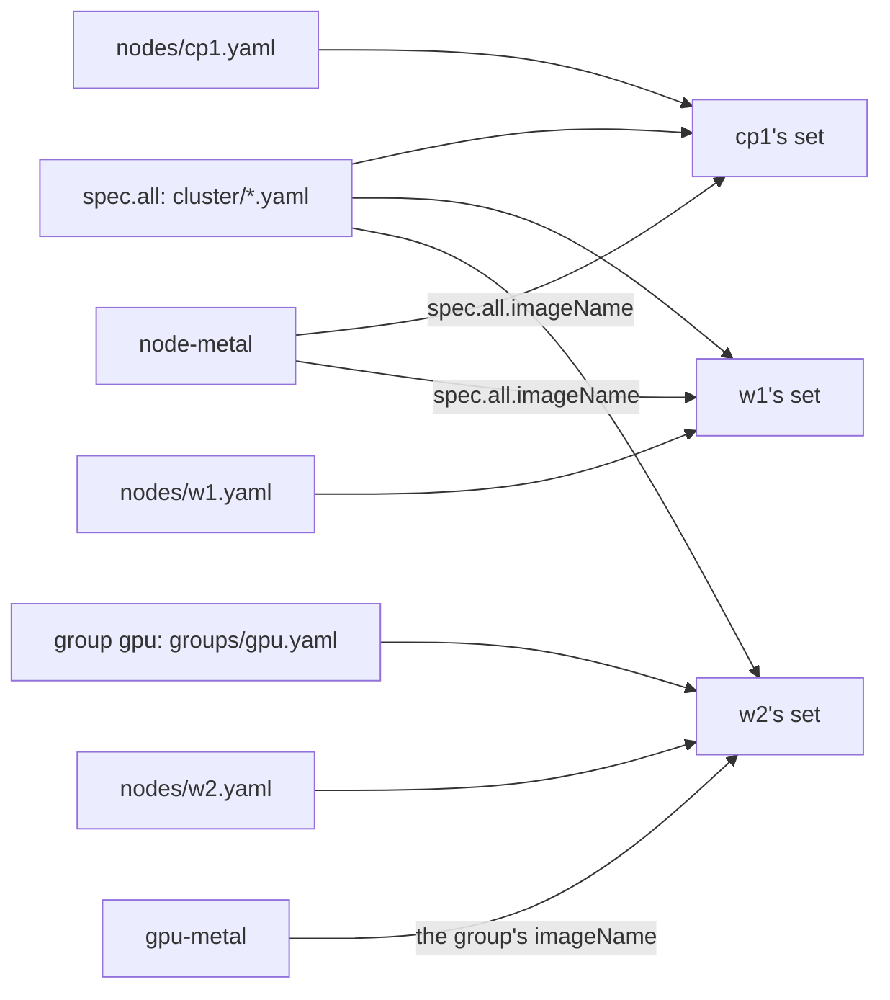

# Write a node's config

This page is for an operator who describes the cluster's nodes before installing them. At the
end each node of the inventory has its config files, with its system disk, network, time servers
and volumes, and `chalkctl validate` accepts them. The page follows the
[homelab example](https://github.com/trevex/chalkos/tree/main/examples/homelab): a control plane
`cp1` and a worker `w1` on one image.

## Before you begin

You need a workstation set up as [Set up your workstation](workstation.md) describes: chalkctl,
the repository and the image directory the inventory names. `chalkctl validate` checks the config
against that image, so the image author builds it first.

You need to know each machine's disks and network interfaces. On a machine that runs the
installer, `chalkctl disks` lists the disks, as
[Choose the system disk](install.md#choose-the-system-disk) shows.

## The inventory gives each node its files

A node's config is the set of YAML documents that makes it this node. The inventory names the
files each node's documents come from. The homelab's gives every node the files of `cluster/`,
and each node its own file in `nodes/`:

```yaml title="chalkos.yaml"
--8<-- "examples/homelab/chalkos.yaml"
```

The inventory has four parts:

- `spec.images` names each image and the directory of its build, relative to the inventory's
  directory.
- `spec.all` is what every node gets: the image `imageName` names, and the config files `files`
  names.
- `spec.groups` holds named groups of nodes, each with its files and its image. The homelab has
  none.
- `spec.nodes` holds each node by its name, with the `address` chalkctl reaches its chalkd at, as
  a host or `host:port`, and its own files.

The key of `spec.nodes`, such as `cp1`, is the node's name. Install writes it into the node's
certificate. The hostname defaults to it, and the recovery key and the seeds of the partition
UUIDs derive from it. Renaming a node therefore takes a reinstall.

`address` is where chalkctl reaches the node, also in maintenance mode before the node has any
config. chalkctl never reads it from the node's `Network` documents. A node that installs with a
DHCP address and then gets a static one names the static one here. `--address` overrides it for
one command.

Here is `cp1`'s own file, `nodes/cp1.yaml`:

```yaml title="nodes/cp1.yaml"
--8<-- "examples/homelab/nodes/cp1.yaml"
```

Each document has an `apiVersion` with its group and version, a `kind`, a `metadata.name` and a
`spec`. The `Rack` and `Hardware` kinds come from the homelab's extensions, which the image
declares. A kind of which a node holds one takes any `metadata.name`; the examples use
`default` or the kind's own name.

## Documents never merge

A node's set is the documents of the files of `spec.all`, then those of its groups in the order
the node names them, then those of its own files. A glob such as `cluster/*.yaml` takes its files
in name order. Every path or glob must name at least one file, so a typo fails instead of leaving
documents out. A file named twice counts once.

The order decides nothing about values, because documents never merge. Two documents of the same
kind and name in one node's set are an error that names both files:

```text
chalkctl: the config of 2 nodes is invalid:
node cp1: cluster/net.yaml and nodes/cp1.yaml both hold Network "10-uplink"
node w1: cluster/net.yaml and nodes/w1.yaml both hold Network "10-uplink"
```

Put a value that every node shares into a shared file once. When one node needs a different value,
that node's own file holds its own document of that kind, and the shared file leaves the kind
out.

## Groups share files and an image among some nodes

A group holds what some of the nodes share. This inventory adds a group `gpu`, whose nodes run the
image `gpu-metal` and get `groups/gpu.yaml`, and a GPU worker `w2` in it:

```yaml title="chalkos.yaml"
apiVersion: chalkctl.chalkos.dev/v1alpha1
kind: Inventory
metadata: {name: homelab}
spec:
  images:
    node-metal: {source: {directory: images/node-metal}}
    gpu-metal: {source: {directory: images/gpu-metal}}
  all: {imageName: node-metal, files: [cluster/*.yaml]}
  groups:
    gpu: {imageName: gpu-metal, files: [groups/gpu.yaml]}
  nodes:
    cp1: {address: 10.0.0.11, files: [nodes/cp1.yaml]}
    w1: {address: 10.0.0.21, files: [nodes/w1.yaml]}
    w2: {address: 10.0.0.22, groups: [gpu], files: [nodes/w2.yaml]}
```

A node runs the image named in the first of three places:

1. the node's own `imageName`;
2. the `imageName` of its groups;
3. `spec.all.imageName`.

The diagram shows how this inventory gives each node its files and its image:



`cp1` and `w1` get the files of `spec.all` and their own, and run `node-metal`. `w2` gets the
files of `spec.all`, then the group's, then its own, and runs the group's `gpu-metal`.

chalkctl refuses the inventory when a node is in two groups that name different images, also when
the node names its own. It also refuses a node that gets no image, and an `imageName` that names
no image of `spec.images`:

```text
chalkctl: chalkos.yaml: node cp1 names the image gpu-metal, which the inventory does not define
```

The image stays out of the node's config. A new build of an image, or a node's move to another
image, changes no node's config.

## Every node holds one SystemDisk

A `SystemDisk` names the disk that holds the system region and VAR, the partition for the node's
data. Every node holds exactly one. `w1`'s gives VAR 200 GiB and leaves the rest of the disk to
volumes:

```yaml
apiVersion: storage.chalkos.dev/v1alpha1
kind: SystemDisk
metadata: {name: system}
spec:
  disk: {path: /dev/disk/by-id/nvme-Samsung_SSD_990_PRO_2TB_S7KHNJ0W100002}
  var: {size: 200G}
```

Name the disk by a path below `/dev/disk/by-id`, which stays the same across boots, or by
selectors such as `model`, `serial` or `size`. Without `var.size`, VAR fills the rest of the
disk. By default STATE, VAR and every volume are encrypted with a key sealed to the TPM, with the
node's recovery key as the second keyslot. [Add storage volumes](storage-volumes.md) covers the disk selectors,
the encryption and the sizes.

## Network documents configure the interfaces

A node's network is a set of `Network`, `NetDev` and `Link` documents. Each is one
systemd-networkd unit file: a `.network`, a `.netdev` or a `.link` file. The document's
`metadata.name` is the file's name without its suffix, so networkd orders the files by it. Its
`spec` holds networkd's sections and keys in camelCase: `[Match]` with `MACAddress=` is
`match: {macAddress: …}`.

`cp1` has one static address on its uplink:

```yaml
apiVersion: networkd.chalkos.dev/v1alpha1
kind: Network
metadata: {name: 10-uplink}
spec:
  match: {name: enp1s0}
  network: {address: [10.0.0.11/24], gateway: 10.0.0.1}
```

A node whose config holds no `Network` document runs DHCP on every physical Ethernet interface,
through the image's own default unit. The documents' units take precedence over the image's
units.

A bond and a VLAN are `NetDev` documents, each with the `Network` documents that attach it. Here
`w1`'s two ports form an LACP bond, and its address is on VLAN 20 of the bond:

```yaml title="nodes/w1.yaml"
apiVersion: networkd.chalkos.dev/v1alpha1
kind: NetDev
metadata: {name: 10-bond0}
spec:
  netDev: {name: bond0, kind: bond}
  bond: {mode: 802.3ad, transmitHashPolicy: layer3+4, miiMonitorSec: 100ms, lacpTransmitRate: fast}
---
apiVersion: networkd.chalkos.dev/v1alpha1
kind: NetDev
metadata: {name: 20-vlan20}
spec:
  netDev: {name: vlan20, kind: vlan}
  vlan: {id: 20}
---
# The two ports join the bond and get no address of their own.
apiVersion: networkd.chalkos.dev/v1alpha1
kind: Network
metadata: {name: 10-bond0-ports}
spec:
  match: {name: enp1s0 enp2s0}
  network: {bond: bond0}
---
# The bond carries the VLAN and no address of its own.
apiVersion: networkd.chalkos.dev/v1alpha1
kind: Network
metadata: {name: 20-bond0}
spec:
  match: {name: bond0}
  network: {vlan: vlan20, linkLocalAddressing: "no"}
---
apiVersion: networkd.chalkos.dev/v1alpha1
kind: Network
metadata: {name: 30-vlan20}
spec:
  match: {name: vlan20}
  network: {address: [10.0.20.21/24], gateway: 10.0.20.1, dns: [10.0.20.1]}
```

The `NetDev` documents create the devices `bond0` and `vlan20`. The `Network` documents attach
the ports to the bond and the VLAN to the bond, and give the VLAN device the node's address. The
switch ports must form an LACP group too.

A `Link` document is a `.link` file, which sets the properties of a physical device, such as its
name or its MTU. The schemas of the three kinds come from the networkd of the image's own systemd,
so they accept exactly the sections and keys that networkd accepts.
[Config kinds](../reference/kinds.md#network) lists them, and
[Networking](../how-it-works/node/networking.md) describes how a node applies them.

## Host sets the hostname

The hostname is the node's name unless a `Host` document gives another:

```yaml
apiVersion: chalkos.dev/v1alpha1
kind: Host
metadata: {name: default}
spec: {hostname: w1-rack-a}
```

The `Host` document changes the hostname alone. The node's name, its certificate and, on the
shipped variant, its Kubernetes node name stay as the inventory gives them.

## TimeSync names the time servers

Nodes check certificates against their clocks. Without a `TimeSync` document, a node synchronises
its clock with three servers of the German national metrology institute, PTB, authenticated with
NTS. NTS needs the nodes to reach the servers on TCP port 4460 as well as UDP port 123. A network
without outbound NTP names its own servers, in a file every node gets:

```yaml title="cluster/time.yaml"
apiVersion: time.chalkos.dev/v1alpha1
kind: TimeSync
metadata: {name: default}
spec:
  servers:
    - host: ntp1.example.internal
    - host: ntp2.example.internal
      nts: false
```

A server authenticates with NTS unless `nts: false`. `dhcp: true` also takes the servers that
DHCP announces, which nothing authenticates.

## Volume adds storage beside VAR

A `Volume` is a further partition, on the system disk or on a disk of its own. `w1` has one for
Longhorn's replicas, on a SATA SSD that a selector finds by its model and type:

```yaml
apiVersion: storage.chalkos.dev/v1alpha1
kind: Volume
metadata: {name: longhorn}
spec:
  disk: {model: "Samsung SSD 870*", type: ssd}
  format: xfs
  mountPoint: /var/lib/longhorn
```

A node may hold several volumes, each with a name of its own. Some later changes to a volume take a
reset or a reinstall. [Add storage volumes](storage-volumes.md) covers the formats, the
encryption and which changes a node accepts.

## Secret holds values that other documents reference

A `Secret` document holds secret values by key in `spec.data`. A field of an extension's kind
references one of its keys instead of holding the value. The homelab's `Peer` for `router-a` does
so with `password: {secretRef: {name: bgp, key: password}}`, and `cluster/bgp.yaml` holds the
`Secret` named `bgp`. chalkctl refuses a set in which a reference names a `Secret` or a key that
the set lacks.

`Secret` documents are config, separate from the cluster's secrets file.
[Secret documents hold the services' secrets](workstation.md#secret-documents-hold-the-services-secrets)
says where to keep the files that hold them.

!!! note "On the shipped variant, every node also holds a Cluster and a Node document"

    The shipped variant runs Kubernetes. Each node's set then holds exactly one `Cluster`
    document, the same on every node, and one `Node` document with the node's type,
    `controlplane` or `worker`. The homelab puts the `Cluster` in `cluster/cluster.yaml` and each
    `Node` in the node's own file.
    [Plan a production cluster](../kubernetes/production-cluster.md) covers both.

## Check that it worked

`chalkctl validate` builds each node's set and checks it against the schemas of the node's image,
as chalkd will. It reaches no node and needs no credentials, so it also runs in CI:

```console
$ chalkctl validate
cp1: valid for the image node-metal (node on metal, root hash d871203debfe), config 675850c48eaffe4a755dca41652dbf65a5b7959f1e70a3cdd2a94799136fd200
w1: valid for the image node-metal (node on metal, root hash d871203debfe), config 82ec5bbabd10ec79bf76ad892a0bcd7627c9db2ed4c9e252ad0657313359254c
```

Each line names the node's image, its variant and platform, the first 12 hex characters of its
root hash, and the hash of the node's config. `chalkctl status` later compares that hash with the
config the node runs. `chalkctl validate w1` checks `w1` alone.

`validate` checks that each set:

- holds exactly one `SystemDisk`, and every other kind at most once, unless the kind allows
  several;
- holds only kinds that the node's image declares;
- holds no two documents of a kind with the same name;
- names only `Secret` documents and keys that it holds;
- passes each kind's schema, and the checks that chalkd runs when it translates the set, such as
  a volume that does not fit its disk.

It also runs the change rules of the image that read no facts about the node. It warns of a node
whose `SystemDisk` leaves STATE unencrypted.

## When validate refuses the config

`validate` names each node whose config is invalid and exits with status 1. A misspelled field
names the document and the field:

```text
cp1: valid for the image node-metal (node on metal, root hash d871203debfe), config 675850c48eaffe4a755dca41652dbf65a5b7959f1e70a3cdd2a94799136fd200
chalkctl: the config of 1 node is invalid:
node w1: Volume "longhorn": - at '/spec': additional properties 'mountpoint' not allowed
```

Here `mountpoint` should be `mountPoint`. The common refusals and their fixes:

- An unknown kind means that the node's image does not declare it. Check the `apiVersion`, or ask
  the image author for the extension that brings the kind.
- `names no file` means that a path or glob of the inventory matches no file. Check the path,
  which is relative to the inventory's directory.
- `both hold` names two files with a document of the same kind and name. Remove one, or move the
  shared document to the shared file alone.
- An inventory error names the node and the image. Check `spec.images` and the `imageName` of the
  node, its groups and `spec.all`.

## What next

- [Install a node](install.md) installs a node with its config.
- [Add storage volumes](storage-volumes.md) plans the disks and volumes in depth.
- [Config and the inventory](../how-it-works/node/config.md) explains how a node checks, keeps
  and applies its config.
