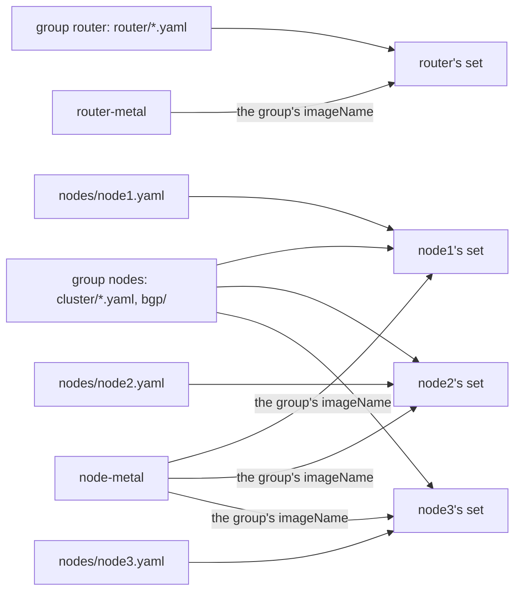

# Write a node's config

This page is for an operator who describes the cluster's nodes before installing them. At the
end each node of the inventory has its config files, with its system disk, network, time servers
and volumes, and `chalkctl validate` accepts them. The page follows the
[homelab example](https://github.com/trevex/chalkos/tree/main/examples/homelab): a router and the
three Kubernetes nodes `node1`, `node2` and `node3`, on two images.

## Before you begin

You need a workstation set up as [Set up your workstation](workstation.md) describes: chalkctl,
the repository and the image directory the inventory names. `chalkctl validate` checks the config
against that image, so the image author builds it first.

You need to know each machine's disks and network interfaces. On a machine that runs the
installer, `chalkctl disks` lists the disks, as
[Choose the system disk](install.md#choose-the-system-disk) shows.

## The inventory gives each node its files

A node's config is the set of YAML documents that makes it this node. The inventory names the
files each node's documents come from. The homelab's gives the router the files of `router/`, each
Kubernetes node the files of `cluster/` and `bgp/`, and each of those its own file in `nodes/`:

```yaml title="chalkos.yaml"
--8<-- "examples/homelab/chalkos.yaml"
```

The inventory's `metadata.name`, `homelab` here, is a label for the cluster. It reaches no node:
chalkctl uses it in its messages and as the default name of a kubeconfig's context.

The inventory's `spec` has four parts:

- `spec.images` names each image and the directory of its build, relative to the inventory's
  directory.
- `spec.all` is what every node gets: the image `imageName` names, and the config files `files`
  names. The homelab has none, because its router and its Kubernetes nodes share no file.
- `spec.groups` holds named groups of nodes, each with its files and its image. The homelab has
  two, `router` and `nodes`.
- `spec.nodes` holds each node by its name, with the `address` chalkctl reaches its chalkd at, as
  a host or `host:port`, and its own files.

The key of `spec.nodes`, such as `node1`, is the node's name. Install writes it into the node's
certificate. The hostname defaults to it, and the recovery key and the seeds of the partition
UUIDs derive from it. Renaming a node therefore takes a reinstall.

`address` is where chalkctl reaches the node, also in maintenance mode before the node has any
config. chalkctl never reads it from the node's `Network` documents. A node that installs with a
DHCP address and then gets a static one names the static one here, as the homelab's nodes name
the addresses of their `node0`. `--address` overrides it for one command.

Here is `node1`'s own file, `nodes/node1.yaml`:

```yaml title="nodes/node1.yaml"
--8<-- "examples/homelab/nodes/node1.yaml"
```

Each document has an `apiVersion` with its group and version, a `kind`, a `metadata.name` and a
`spec`. A kind of which a node holds one takes any `metadata.name`; the examples use
`default` or a short name such as `system`.

## Documents never merge

A node's set is the documents of the files of `spec.all`, then those of its groups in the order
the node names them, then those of its own files. A glob such as `cluster/*.yaml` takes its files
in name order. Every path or glob must name at least one file, so a typo fails instead of leaving
documents out. A file named twice counts once.

The order decides nothing about values, because documents never merge. Two documents of the same
kind and name in one node's set are an error that names both files:

```text
chalkctl: the config of 3 nodes is invalid:
node node1: cluster/net.yaml and nodes/node1.yaml both hold Network "20-fabric0"
node node2: cluster/net.yaml and nodes/node2.yaml both hold Network "20-fabric0"
node node3: cluster/net.yaml and nodes/node3.yaml both hold Network "20-fabric0"
```

Put a value that every node shares into a shared file once. When one node needs a different value,
that node's own file holds its own document of that kind, and the shared file leaves the kind
out.

## Groups share files and an image among some nodes

A group holds what some of the nodes share. The homelab's group `router` gives its one node the
image `router-metal` and the files of `router/`. The group `nodes` gives the three Kubernetes nodes
the image `node-metal` and the files of `cluster/` and `bgp/`, and each of them names its own
file beside the group.

A node runs the image named in the first of three places:

1. the node's own `imageName`;
2. the `imageName` of its groups;
3. `spec.all.imageName`.

The diagram shows how the homelab's inventory gives each node its files and its image:



The router gets the files of its group and runs `router-metal`. Each Kubernetes node gets the files
of `nodes`, then its own, and runs `node-metal`.

chalkctl refuses the inventory when a node is in two groups that name different images, also when
the node names its own. It also refuses a node that gets no image, and an `imageName` that names
no image of `spec.images`:

```text
chalkctl: chalkos.yaml: node node1 names the image node-kvm, which the inventory does not define
```

The image stays out of the node's config. A new build of an image, or a node's move to another
image, changes no node's config.

## Every node holds one SystemDisk

A `SystemDisk` names the disk that holds the system region and VAR, the partition for the node's
data. Every node holds exactly one. The homelab's take the whole disk for VAR. This one gives VAR
200 GiB and leaves the rest of the disk to volumes:

```yaml
apiVersion: storage.chalkos.dev/v1alpha1
kind: SystemDisk
metadata: {name: system}
spec:
  disk: {path: /dev/disk/by-id/nvme-EXAMPLE_SSD_node1}
  var: {size: 200G}
```

Name the disk by a path below `/dev/disk/by-id`, which stays the same across boots, or by
selectors such as `model`, `serial` or `size`. Without `var.size`, VAR fills the rest of the
disk. By default STATE, VAR and every volume are encrypted with a key sealed to the TPM, with the
node's recovery key as the second keyslot. [Add storage volumes](storage-volumes.md) covers the
disk selectors, the encryption and the sizes.

## Network documents configure the interfaces

A node's network is a set of `Network`, `NetDev` and `Link` documents. Each is one
systemd-networkd unit file: a `.network`, a `.netdev` or a `.link` file. The document's
`metadata.name` is the file's name without its suffix, so networkd orders the files by it. Its
`spec` holds networkd's sections and keys in camelCase: `[Match]` with `MACAddress=` is
`match: {macAddress: …}`.

The homelab's router has a static address on its port `fabric`, and sends router advertisements
there:

```yaml
apiVersion: networkd.chalkos.dev/v1alpha1
kind: Network
metadata: {name: 20-fabric}
spec:
  match: {name: fabric}
  network: {address: ["fdc8:a1b2:c3d4:1::1/64"], ipv6AcceptRA: false, ipv6SendRA: true}
  ipv6Prefix: {prefix: "fdc8:a1b2:c3d4:1::/64"}
  ipv6SendRA: {dns: ["fdc8:a1b2:c3d4:1::1"]}
  ipv6PREF64Prefix: {prefix: "64:ff9b::/96"}
```

Each node's ports take their addresses from those advertisements, with `ipv6AcceptRA: true` in
their own `Network` documents, as `nodes/node1.yaml` shows.

The image brings one unit of its own, `99-ethernet-default-dhcp`, which runs DHCP on every
physical Ethernet interface that no `Network` document matches. A node whose config holds no
`Network` document therefore runs DHCP on all of them. The documents' units take precedence over
the image's units.

A bond, a VLAN and a dummy interface such as the homelab's `node0` are `NetDev` documents, each
with the `Network` documents that attach it or configure it. On this machine, two ports form an
LACP bond, and the machine's address is on VLAN 20 of the bond:

```yaml
apiVersion: networkd.chalkos.dev/v1alpha1
kind: NetDev
metadata: {name: 10-bond0}
spec:
  netDev: {name: bond0, kind: bond}
  bond: {mode: 802.3ad, transmitHashPolicy: layer3+4, miiMonitorSec: 100ms, lacpTransmitRate: fast}
---
apiVersion: networkd.chalkos.dev/v1alpha1
kind: NetDev
metadata: {name: 20-vlan20}
spec:
  netDev: {name: vlan20, kind: vlan}
  vlan: {id: 20}
---
# The two ports join the bond and get no address of their own.
apiVersion: networkd.chalkos.dev/v1alpha1
kind: Network
metadata: {name: 10-bond0-ports}
spec:
  match: {name: enp1s0 enp2s0}
  network: {bond: bond0}
---
# The bond carries the VLAN and no address of its own.
apiVersion: networkd.chalkos.dev/v1alpha1
kind: Network
metadata: {name: 20-bond0}
spec:
  match: {name: bond0}
  network: {vlan: vlan20, linkLocalAddressing: "no"}
---
apiVersion: networkd.chalkos.dev/v1alpha1
kind: Network
metadata: {name: 30-vlan20}
spec:
  match: {name: vlan20}
  network: {address: [192.0.2.21/24], gateway: 192.0.2.1, dns: [192.0.2.1]}
```

The `NetDev` documents create the devices `bond0` and `vlan20`. The `Network` documents attach
the ports to the bond and the VLAN to the bond, and give the VLAN device the node's address. The
switch ports must form an LACP group too.

A `Link` document is a `.link` file, which sets the properties of a physical device, such as its
name or its MTU. The homelab's machines name their ports by permanent MAC address, so that the other
documents name the same ports on every machine, whatever the kernel calls them:

```yaml
apiVersion: networkd.chalkos.dev/v1alpha1
kind: Link
metadata: {name: 10-fabric0}
spec:
  match: {permanentMACAddress: "02:00:00:00:11:01"}
  link: {name: fabric0}
```

The installer holds no config, so a machine's ports keep the kernel's names until the installed
node's first boot, which renames them.

The schemas of the three kinds come from the networkd of the image's own systemd,
so they accept exactly the sections and keys that networkd accepts.
[Config kinds](../reference/kinds.md#network) lists them, and
[Networking](../how-it-works/node/networking.md) describes how a node applies them.

A node applies its `Link` documents at every boot, before networkd brings the links up. A
delivery applies a changed `Link` document to the running ports at once, as far as their drivers
allow, and that includes a new name. Every document that names the port must change in the same
delivery: the `match` of its `Network`, and the interfaces of a VRF, a BGP peer or a firewall zone.
Deliver a rename as a trial, with
[`chalkctl config apply --try`](../reference/cli/chalkctl_config_apply.md#flag-try), so a
mistake that cuts the node off rolls back. The rollback renames the port back when the previous
config names it in a `Link` document; otherwise the port keeps the new name until the next boot.
An added alternative name or setting also takes effect at once, and a removed one at the next
boot.

A VLAN takes the MAC address of its port, and the ports of a bond take the bond's, so a `Link`
document that matches by `macAddress` can match the wrong device. Match a port by
`permanentMACAddress`, which only the physical device has.

## Host sets the hostname

The hostname is the node's name unless a `Host` document gives another:

```yaml
apiVersion: chalkos.dev/v1alpha1
kind: Host
metadata: {name: default}
spec: {hostname: node1-shelf-a}
```

The `Host` document changes the hostname alone. The node's name, its certificate and, on the
shipped variant, its Kubernetes node name stay as the inventory gives them.

## TimeSync names the time servers

Nodes check certificates against their clocks. Without a `TimeSync` document, a node synchronises
its clock with three servers of the German national metrology institute, PTB, authenticated with
NTS. NTS needs the nodes to reach the servers on TCP port 4460 as well as UDP port 123. A network
without outbound NTP names its own servers, in a file every node gets:

```yaml title="cluster/time.yaml"
apiVersion: time.chalkos.dev/v1alpha1
kind: TimeSync
metadata: {name: default}
spec:
  servers:
    - host: ntp1.example.internal
    - host: ntp2.example.internal
      nts: false
```

A server authenticates with NTS unless `nts: false`. `dhcp: true` also takes the servers that
DHCP announces, which nothing authenticates.

## Volume adds storage beside VAR

A `Volume` is a further partition, on the system disk or on a disk of its own. This one takes a
SATA SSD, which a selector finds by its model and type, for a storage system's replicas:

```yaml
apiVersion: storage.chalkos.dev/v1alpha1
kind: Volume
metadata: {name: replicas}
spec:
  disk: {model: "Samsung SSD 870*", type: ssd}
  format: xfs
  mountPoint: /var/lib/replicas
```

A node may hold several volumes, each with a name of its own. Some later changes to a volume take a
reset or a reinstall. [Add storage volumes](storage-volumes.md) covers the formats, the
encryption and which changes a node accepts.

## Secret holds values that other documents reference

A `Secret` document holds secret values by key in `spec.data`. A field of an extension's kind
references one of its keys instead of holding the value. The homelab's `Peer` for `router` in
`bgp/fabric.yaml` does so with `password: {secretRef: {name: bgp, key: password}}`, and
`bgp/secrets.yaml` holds the `Secret` named `bgp`. chalkctl refuses a set in which a reference names a `Secret` or a key that
the set lacks.

`Secret` documents are config, separate from the cluster's secrets file.
[Secret documents hold the services' secrets](workstation.md#secret-documents-hold-the-services-secrets)
says where to keep the files that hold them.

!!! note "On the shipped variant, every node also holds a Cluster and a Node document"

    The shipped variant runs Kubernetes. Each node's set then holds exactly one `Cluster`
    document, the same on every node, and one `Node` document with the node's type,
    `controlplane` or `worker`. The homelab puts the `Cluster` in `cluster/cluster.yaml` and each
    `Node` in the node's own file.
    [Configure Kubernetes](../kubernetes/configure.md) covers both.

## Check that it worked

`chalkctl validate` builds each node's set and checks it against the schemas of the node's image,
as chalkd will. It reaches no node and needs no credentials, so it also runs in CI:

```console
$ chalkctl validate
node1: valid for the image node-metal (node on metal, root hash 5f1e60980b55), config c2bef3c1242a847b16346d3e1f6de732a86832fa8294ce90e923bad30c85e6bf
node2: valid for the image node-metal (node on metal, root hash 5f1e60980b55), config afa765d5e8029dbe3aea1a589d2dafdf260de42fff21692656891ddde062d567
node3: valid for the image node-metal (node on metal, root hash 5f1e60980b55), config 719604db3fd2c0634df350fc6b7760bba57de0ec82ac3fb9a9b2dcf532cfdc43
router: valid for the image router-metal (router on metal, root hash e9be19557973), config a8d132f3d5517185654d573c02c543497ab42d0068131d25bbfe8405d5761093
```

Each line names the node's image, its variant and platform, the first 12 hex characters of its
root hash, and the hash of the node's config. `chalkctl status` later compares that hash with the
config the node runs. `chalkctl validate node1` checks `node1` alone.

`validate` checks that each set:

- holds exactly one `SystemDisk`, and every other kind at most once, unless the kind allows
  several;
- holds only kinds that the node's image declares;
- holds no two documents of a kind with the same name;
- names only `Secret` documents and keys that it holds;
- passes each kind's schema, and the checks that chalkd runs when it translates the set, such as
  a volume that does not fit its disk.

It also runs the change rules of the image that read no facts about the node. It warns of a node
whose `SystemDisk` leaves STATE unencrypted.

`validate` checks no signature, so CI needs no db key. When the inventory names a signed copy, a CI
job puts the unsigned build of the same image in that directory instead.

## When validate refuses the config

`validate` names each node whose config is invalid and exits with status 1. A misspelled field
names the document and the field:

```text
node1: valid for the image node-metal (node on metal, root hash 5f1e60980b55), config c2bef3c1242a847b16346d3e1f6de732a86832fa8294ce90e923bad30c85e6bf
chalkctl: the config of 1 node is invalid:
node node2: Network "20-fabric0": - at '/spec/network': additional properties 'ipv6AcceptRa' not allowed
```

Here `ipv6AcceptRa` should be `ipv6AcceptRA`. The common refusals and their fixes:

- An unknown kind means that the node's image does not declare it. Check the `apiVersion`, or ask
  the image author for the extension that brings the kind.
- `names no file` means that a path or glob of the inventory matches no file. Check the path,
  which is relative to the inventory's directory.
- `both hold` names two files with a document of the same kind and name. Remove one, or move the
  shared document to the shared file alone.
- An inventory error names the node and the image. Check `spec.images` and the `imageName` of the
  node, its groups and `spec.all`.

## What next

- [Install a node](install.md) installs a node with its config.
- [Add storage volumes](storage-volumes.md) plans the disks and volumes in depth.
- [Config and the inventory](../how-it-works/node/config.md) explains how a node checks, keeps
  and applies its config.
