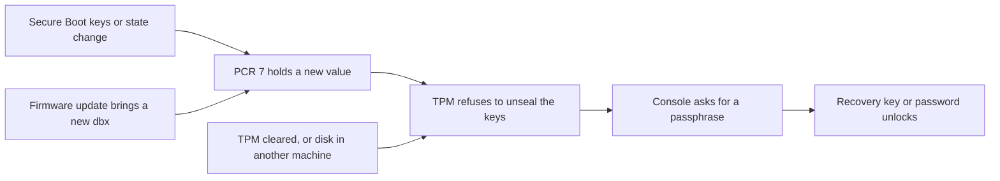

# Recover a node

This page is for an operator whose node is stuck: its disks do not unlock, its new image fell
back, its certificate expired, or it sits in maintenance mode. Each section starts from what the
console or `chalkctl status` shows, names the cause and gives the fix. Reinstalling the node is
the last resort, and the loss of the secrets file closes the page.

## Before you begin

You need the workstation that [Set up your workstation](workstation.md) describes, with the secrets
file `secrets.age`. Most fixes here need it.

You also need the node's console, through its BMC or in person, for the sections that start
there. When you do not know yet what is wrong, start at [Troubleshooting](troubleshooting.md).

## The console asks for a passphrase at boot

The node stops early in the boot. systemd-cryptsetup asks on the console for the passphrase of
`state`, then of `var` and of each encrypted volume. The TPM refused to unseal their keys, because
PCR 7 changed since the keys were sealed to it:



The diagram shows the chain from a change to the prompt. PCR 7 measures the Secure Boot state
and the PK, KEK, db and dbx. Any of these causes changes it:

- Secure Boot was turned off, or its keys changed: a new PK, KEK or db.
- A firmware update brought a new dbx.
- The image was signed with another db key than the one the node was installed with.

A cleared TPM, or a disk moved to another machine, has no sealed keys at all, with the same
result.

The node stays at the prompt. It does not fall back to maintenance mode, because that would let
anyone with physical access give it a new config. A boot that waits at the prompt never reaches
the health check either. After an upgrade, the node stays in that boot until you unlock it or
reset the machine. Only then does the boot loader try the new image again or fall back.

### Unlock the node with its recovery key

Print the node's recovery key on the workstation:

```sh
chalkctl recovery-key w1 --secrets secrets.age
```

The key is eight groups of eight letters, separated by dashes. Type it at each prompt, and the
node boots on. A node whose fallback is a password takes that password instead.

chalkctl derives the key from the secrets file and the node's name. It stays the same for the
node's whole life, also across reinstalls. Whoever reads it can unlock that node's disks with
physical access for good, so keep the console session private.

### Make the prompt go away

The prompt comes back at every boot until PCR 7 matches the sealed keys again. chalkos has no
command that seals the keys to the new PCR 7. The prompt stops after one of these:

- Undo the change: turn Secure Boot back on, restore the previous keys, or boot an image signed
  with the original db key. The keys unseal again at the next boot.
- Accept the change and reinstall the node, as
  [Reinstall the node as the last resort](#reinstall-the-node-as-the-last-resort) describes. The
  installer seals the new keys to the PCR 7 the node has now.

A node whose fallback is `none` has no second key. STATE and VAR stay locked, so the only ways
back are to undo the change or to reinstall. An extra volume that does not unlock stays unmounted
while the rest of the node runs. [Reset a volume](storage-volumes.md#reset-a-volume) creates it
again, empty.

## The node fell back after an upgrade

`chalkctl status` shows the node running its previous image, with the failed boot's log:

```text
image <old>, booted from chalkos_1.efi
upgrade to <new> failed: rolled back to <old>
  <journal lines>
```

`<old>` and `<new>` stand for the images' names, and `<journal lines>` for the last 30 lines that
chalkd and the health check logged in the failed boot. The new image did not become healthy within
its tries, and systemd-boot booted the previous one. The node runs healthy on the old image.
Find the cause in the journal lines, fix it in a new build and upgrade again, as
[A node that fails its health check rolls back](upgrade.md#a-node-that-fails-its-health-check-rolls-back)
describes.

## A change misbehaves after the node was found healthy

A boot that was found healthy is kept, so a problem that shows only later needs a rollback on
request. Each one undoes one kind of change:

- A config delivery that broke a service: `chalkctl apply-config w1 --secrets secrets.age
  --rollback` delivers the config the image ran before.
  [Roll back a config change](change-config.md#roll-back-a-config-change) describes it.
- An image that misbehaves after its boot was found healthy: `chalkctl upgrade --rollback --nodes
  w1` boots the image the node ran before, which its inactive slot still holds.
  [Go back to the previous image](upgrade.md#go-back-to-the-previous-image) describes it.

The node's OS CAs, node certificate, storage and layer payloads stay as they are with either
rollback.

## The node certificate expired

chalkctl refuses the node's certificate as expired, so every command against the node fails. The
node itself still runs. A node of a Kubernetes cluster renews its node certificate once two
thirds of its year have passed, so its certificate expires only when it could not renew for four
months: it was switched off or could not reach a control plane. Before the expiry, its status
showed why:

```text
certificates:
  node  expires <date>  renewal failing: <reason>; expires <time>
```

A node whose image runs no Kubernetes cannot renew on its own, and its certificate expires when
nobody ran `chalkctl node renew` for it. Its status said so from the renewal point on:

```text
certificates:
  node  expires <date>  the node certificate expires on <date>; this image cannot renew it on its own; run chalkctl node renew w1
```

`chalkctl node renew` issues and delivers a new certificate, also to a node whose certificate
expired:

```console
$ chalkctl node renew w1 --secrets secrets.age
w1 serves a new node certificate; it expires <time>
```

`<time>` stands for the new expiry, such as `2027-10-10T09:12:44Z`. For this command alone,
chalkctl verifies the expired certificate as of its start date, so it trusts the node's old key.
[A node renews its certificate through a control plane](../how-it-works/node/certificates.md#a-node-renews-its-certificate-through-a-control-plane)
explains the risk. Fix the reason the renewal failed too, or the certificate expires again next
year.

!!! note "On the shipped variant, two more recoveries concern Kubernetes"

    A worker whose VAR lost its data may hold an expired kubelet certificate.
    [The kubelet certificate was lost with VAR](../kubernetes/troubleshooting.md#the-kubelet-certificate-was-lost-with-var)
    delivers a new one. A control plane that cannot rejoin etcd is covered by
    [Run a highly available control plane](../kubernetes/ha-control-plane.md#a-control-plane-cannot-rejoin-etcd).

## The node is in maintenance mode

The console shows chalkd's certificate fingerprint and the node's addresses, and
`chalkctl status` fails to verify the node. The node boots an image with no installation to load:

- The installer medium is still attached and comes first in the boot order. Remove the medium or
  fix the boot order, and reboot.
- The install did not finish. Run `chalkctl install` again. It continues an unfinished install of
  the node on the same disk.

A node in maintenance mode answers `chalkctl logs` and `chalkctl reboot` with `--fingerprint` or
`--insecure`, so you can read why an install failed:

```sh
chalkctl logs w1 --address=<address> --insecure --unit=chalkd.service
```

`<address>` is the address the console shows. Without `--address`, chalkctl reaches the address
the inventory names, which a node in maintenance mode may not have, because it runs without its
config.

## Reinstall the node as the last resort

A reinstall gives the node a new disk layout, new keys sealed to its TPM and a fresh VAR, from its
config in the inventory's files. Everything on its disks is lost. The node keeps its name and its
recovery key, and gets new certificates.
[Reinstall a node on its machine](add-remove-nodes.md#reinstall-a-node-on-its-machine) gives the
steps, including the Kubernetes steps of the shipped variant.

## The secrets file is lost

Without the secrets file or a backup of it, the nodes keep running, but much of their management
is gone for good. Commands with existing client files still work within their roles: `status`,
`logs`, `disks`, `reboot` and `upgrade`. `storage reset` still works where it creates no volume
whose fallback is the recovery key. Control planes keep renewing the nodes' certificates until the
node CA expires.

These are gone:

- installing or reinstalling a node, and `apply-config`;
- `chalkctl node renew` and every `rotate`;
- new client files;
- recovery keys, so a node whose TPM stops unsealing cannot be unlocked.

The client files expire within their validity, a year by default, and nothing can issue new ones.
Plan a move to a new cluster before then. Generate new secrets, build new images, install new
nodes and move the workloads across.
[Back up what you cannot rebuild](workstation.md#back-up-what-you-cannot-rebuild) lists the
secrets file among the files to keep in a second place.

!!! note "On the shipped variant, Kubernetes access runs out too"

    `bootstrap` and the etcd commands keep working with client files, and the kubelets keep
    renewing their certificates. Existing kubeconfigs work until they expire, and no new ones can
    be issued.

## What next

- [Troubleshooting](troubleshooting.md) starts from a symptom.
- [Status, logs and the console](status-and-logs.md) reads what the node reports.
- [Storage and encryption](../how-it-works/node/storage.md) explains the sealed keys and the
  fallback.
