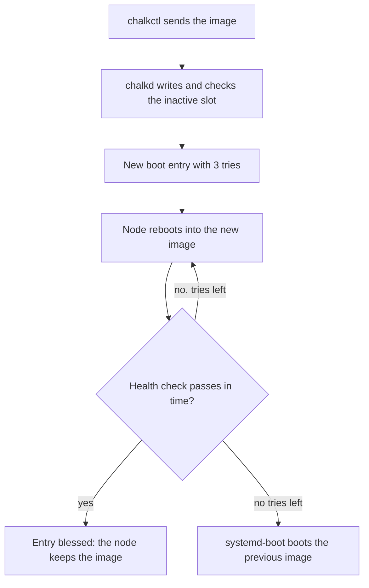

# Upgrade nodes

This page is for an operator who installs a new image on running nodes. At the end every node runs
the new image, and its boot was found healthy. A node whose new image never becomes healthy boots
its previous image again. Any change to what the image holds goes this way: a new chalkos release,
a new Kubernetes release or a change to the image's modules. The page upgrades the homelab's `cp1`
and `w1`.

A new chalkos release arrives through the image author, who updates the `chalkos` input in the
flake's `flake.lock` and builds the images again. Take chalkctl from the same revision, as
[Set up your workstation](workstation.md#chalkctl-comes-from-the-chalkos-flake) describes.

## Before you begin

You need the workstation that [Set up your workstation](workstation.md) describes. The upgrade
needs one of these credentials:

- the secrets file `secrets.age`, or an admin client file, to deliver each node's config with the
  image;
- an operator client file, which upgrades too but delivers no config. Each node then carries its
  own config over.

You also need the new image. The image author builds it into an image directory, such as
`images/node-metal`. For nodes that enforce Secure Boot, you need the db key and certificate,
`db.key` and `db.crt`, and chalkbuild, as [Install a node](install.md#before-you-begin) describes.

## Each node takes the new image in one reboot

An upgrade writes the new image into the node's inactive slot and reboots the node into it. The
node keeps its current image in the other slot, so it can fall back:



The diagram shows one node's upgrade:

1. chalkctl sends the image. chalkd writes it into the inactive slot and verifies it against its
   root hash. On a node that enforces Secure Boot, chalkd refuses a UKI that the firmware's db
   does not accept, before it writes anything.
2. chalkd adds a boot entry for the new image, one generation above the entry the node booted,
   with three tries. systemd-boot boots the newest generation first.
3. chalkctl reboots the node.
4. The new image's health check decides whether the boot is healthy. A healthy boot is blessed: the
   entry loses its counter, and the node keeps the image.
5. A boot that is not healthy within the image's health timeout, 300 seconds by default, reboots.
   Each boot uses a try. After the last try, systemd-boot boots the previous image.

An upgrade leaves the node's boot loader as it is. Only an install writes systemd-boot, and chalkd
refuses an upgrade that carries a boot loader.

[Upgrades](../how-it-works/node/upgrades.md) and
[Boot, health and rollback](../how-it-works/node/boot-and-rollback.md) explain the mechanism.

## Point the inventory at the new image

Without `--image`, `chalkctl upgrade` gives each node its image in the inventory. The homelab's
inventory names the image directory `images/node-metal` for every node. For machines that enforce
Secure Boot it names the signed copy `images/node-metal-signed`. Sign each new build again into
that copy. The output directory must not exist, so remove the copy of the previous build first:

```console
$ rm -rf images/node-metal-signed
$ chalkbuild sign --key db.key --cert db.crt images/node-metal images/node-metal-signed
signed images/node-metal-signed/chalkos.raw
```

Then check each node's config against the new image, offline:

```sh
chalkctl validate
```

`chalkctl upgrade` runs the same check before it changes any node, and stops on a config the new
image does not accept. [Config travels with the image](#config-travels-with-the-image) covers
config that only the new image accepts.

The run also stops before it sends anything when a node runs another platform than its image in
the inventory. Changing a node's platform is a reinstall. chalkctl compares no variant: a node
whose image in the inventory is another variant's build gets that image, and chalkctl prints the
change.

## Install a prebuilt image

`--image` names an image directory, or a raw image with `repart-output.json` next to it. chalkctl
installs it on the nodes that run that image's variant, or on the nodes `--nodes` names. Nodes on
another platform are skipped and named.

```sh
chalkctl upgrade --image=images/node-metal-signed --secrets secrets.age
```

chalkctl sends the image as the directory holds it and checks no signature. Sign it before the
upgrade.

When the inventory names the image in a registry, by `source.oci`, chalkctl sends each node the
image's reference by digest. The node pulls the image itself.
[Publish images to a registry](../build/publish-images.md) covers the upgrade from a registry, and
[Registries and mirrors](registries.md) the credentials and mirrors.

## Run the upgrade

Run the command in the inventory's directory, or name the inventory with `--inventory`:

```console
$ chalkctl upgrade --secrets secrets.age --allow-downtime
upgrading node on metal to <new>: cp1, w1
cp1: installing <new>
cp1: config unchanged
cp1: installed <new>, which boots next as chalkos_2+3.efi
cp1: <new> renders and checks any outputs it declares when it first boots; if one fails, the node falls back to the image it runs
cp1: cordoned, evicted <n> pods, kept <n>
cp1: rebooting into <new>
cp1: runs <new>, found healthy
cp1: uncordoned
w1: cordoned, evicted <n> pods, kept <n>
w1: installing <new>
w1: config unchanged
w1: installed <new>, which boots next as chalkos_2+3.efi
w1: <new> renders and checks any outputs it declares when it first boots; if one fails, the node falls back to the image it runs
w1: rebooting into <new>
w1: runs <new>, found healthy
w1: uncordoned
upgraded 2 nodes to <new>
```

`<new>` stands for the new image's name. chalkctl names an image by the first 12 hex characters of
its root hash. When the build names a tag or a git revision, they follow in parentheses, the
revision cut to 12 characters, as in `<root hash> (<tag>, <revision>)`. `<n>` stands for numbers of
pods. `chalkos_2+3.efi` is the new boot entry on a node that was installed with `chalkos_1.efi`:
generation 2, with three tries.

The first line names the image's variant and platform and the nodes that get it. Then each node
shows its steps:

1. `installing` starts sending the image.
2. The config line says what the node's config changes with the image. `config unchanged` means
   the inventory gives the node the config it runs.
3. `installed ..., which boots next as ...` names the new boot entry. The image renders its outputs
   when it first boots, so a failing render makes the node fall back.
4. `rebooting into` reboots the node.
5. `runs ..., found healthy` means the boot was blessed.

The last line counts the nodes upgraded.

!!! note "On the shipped variant, chalkctl also drains each node and guards etcd's quorum"

    The `cordoned` and `uncordoned` lines belong to Kubernetes. A worker is drained before it gets
    the image, a control plane right before it reboots. chalkctl also waits until the node's Node
    is Ready. Before a control plane reboots, chalkctl checks that etcd keeps its quorum without
    it. The homelab has one control plane, so etcd and the API server are down while `cp1`
    reboots, and the run needs `--allow-downtime`.
    [Upgrade Kubernetes](../kubernetes/upgrade-kubernetes.md) covers the drain, the quorum and
    Kubernetes releases.

## Control planes go first, then the other nodes in batches

chalkctl upgrades the control planes first, one at a time, and the other nodes after them in
batches. Within each group the nodes go in the order of their names. A node without Kubernetes
counts with the workers. These flags change which nodes go and how:

| Flag | Effect |
| --- | --- |
| `--max-unavailable=<n>` | Upgrades `<n>` workers or nodes without Kubernetes at once; 1 by default. Control planes always go one at a time. |
| `--nodes=<nodes>` | Upgrades only the comma-separated nodes named. |
| `--no-reboot` | Installs the images without draining or rebooting. Each node boots its new image at its next reboot. |
| `--timeout=<duration>` | How long to wait for each drain and for each node to come back healthy; 30 minutes by default. |
| `--retry-failed` | Installs an image once more on nodes that fell back from it. |
| `--diff` | Prints what each node's config changes and changes nothing. |
| `--password-file=<file>` | Holds the password of nodes whose fallback is a password, for a new encrypted volume the config adds. |

Raise `--max-unavailable` when the workloads have spare capacity, because each batch takes its
nodes away for one reboot. A batch that fails stops the run after the batch's other nodes finish.

The shipped variant adds `--allow-downtime` and `--delete-emptydir-data`, which
[Upgrade Kubernetes](../kubernetes/upgrade-kubernetes.md#choose-the-flags-for-kubernetes) lists.

## Config travels with the image

Each image on a node keeps its own config, and an upgrade delivers each node's config with its
image. Before it changes any node, chalkctl checks each node's files against the image the node
gets. A config the image does not accept stops the run with `the config of <node>: ...`, such as a
document of a kind the new image no longer declares. The node checks the config against the new
image's schemas too, and keeps it for that image.

Config that only the new image accepts, such as a document of a kind an extension of the new image
declares, goes into the node's files before the upgrade. Preview what it changes:

```sh
chalkctl validate w1
chalkctl upgrade --nodes=w1 --diff --secrets secrets.age
```

`--diff` prints for each node what its config changes against the config of the image it runs,
in the format of [`apply-config --diff`](change-config.md#preview-the-change), and
changes nothing.

The config counts against the node's storage as `apply-config` does. A destructive storage change
stops the node's upgrade, and a new volume is created before the image boots. A new encrypted
volume needs the fallback secret: the recovery key, which chalkctl derives from the secrets file,
or the password in the file `--password-file` names. Without `--password-file`, chalkctl asks for
each node's password on the terminal before it drains the first node.

Delivering config needs the admin role: the secrets file, or an admin client file. `--diff` needs
it too. With an operator client file the upgrade runs and prints
`config not delivered: the operator role cannot deliver config; each node carries its own over`.
Each node then checks the config it runs against the new image and keeps it for that image. A
reader client file cannot upgrade.

Before it asks for any password or drains a node, chalkctl asks the first node it upgrades for its
config. A node that refuses to show its config to the credentials would refuse config with the
upgrade too. The run then delivers no config to any node and prints
`<node> refuses to show its config to these credentials; config not delivered, each node carries
its own over`.

Without an inventory, chalkctl has no config to send. An upgrade with `--image` and
`--address <node>=<address>`, run outside the inventory's directory, prints
`<node>: no inventory to compare the config with; the node carries its own over` for each node.

An image the run leaves staged, with `--no-reboot`, keeps its own config until the node boots it.
[Deliver config to a staged image](change-config.md#deliver-config-to-a-staged-image) changes that
config.

## Check that it worked

`chalkctl status` names the image a node booted, the entry it booted from, and whether that boot
was found healthy:

```console
$ chalkctl status w1 --secrets secrets.age
...
image <new>, booted from chalkos_2.efi
...
```

A blessed entry has lost its counter, so its name has no `+`. A boot that is still being checked
ends in `not found healthy yet`. A node that got its image with `--no-reboot` shows
`upgrade to <new> installed; it boots next`.

## A node that fails its health check rolls back

A node whose new image is not found healthy within its tries boots its previous image. The run stops
at that node:

```text
chalkctl: w1: upgrade to <new> failed: rolled back to <old>; it stays cordoned; its boots logged:
  <journal lines>
```

`<old>` is the image the node runs again. `<journal lines>` are the last 30 lines that chalkd and the
health check logged during the failed boot, such as
`the node did not become healthy within 5m0s: ...`. `; it stays cordoned` appears on a node of a
Kubernetes cluster alone. `chalkctl status w1` shows the same lines for as long as the failed image
stays on the disk.

The node runs its previous image, and that boot is healthy. To go on:

1. Find the cause in the journal lines. They name what the health check found missing, such as a
   failed unit. [Troubleshooting](troubleshooting.md) helps from there.
2. When the image caused it, the image author fixes the modules and builds the image again. The
   fix changes the store, so the new build has a new root hash. Run `chalkctl upgrade` again with
   it.
3. When the cause lay outside the image, such as a switch port that was down, install the same
   image once more with `--retry-failed`.

Without `--retry-failed`, chalkctl refuses to install an image again on a node that fell back from
it, with the same error, so that an image known to fail does not boot a second time by accident.
[Uncordon a node that rolled back](../kubernetes/upgrade-kubernetes.md#uncordon-a-node-that-rolled-back)
gives a cordoned node back to the scheduler.

A volume that the failed image's config added stays on the node. The upgrade created it before the
image booted, and the previous image mounts it too. The next `chalkctl apply-config` for the
previous image must name the volume. Without it, the node refuses the config with
`an earlier config of this image or another added it, with an upgrade or chalkctl apply-config
--staged, and it stays on the node; name it in this config too`. Only a reinstall removes the
volume.

## Run the same command again to continue

An upgrade that stopped continues when you run the same command again. chalkctl:

- skips nodes that run the new image and were found healthy;
- waits for a node that booted the image and is still being checked;
- does not send an image a node holds already, unless the image is staged with a config other than
  the one the inventory gives the node. Then it sends the image again, and the node replaces the
  config it keeps for that image;
- uncordons only nodes it cordoned itself.

An image whose transfer was interrupted leaves the inactive slot empty, and the node keeps booting
its current image. The next run writes the slot in full.

## Go back to the previous image

Going back is an upgrade to the previous image. chalkctl and chalkd do not know older from newer
and do not warn. The node installs the previous image as the next generation, with its tries, like
any upgrade.

Use the image the node ran before, built from the same commit and `flake.lock`. It has the same root
hash, so the node finds the store in its inactive slot and needs no new copy. Keep the previous
image directory until the new image has proven itself. Whether the older image can read what the
newer one wrote is for you to check, such as etcd's data after a Kubernetes upgrade.

## If something goes wrong

- `the boot of chalkos_2+2-1.efi has not been found healthy yet; upgrade once it is, ...`: the node
  runs an image whose health check still runs. Installing another would remove the image it falls
  back to. Wait for the check, at most the health timeout per try.
- `Secure Boot would refuse the UKI: ...`: the image is unsigned, or signed with a key the
  firmware's db does not hold. Sign the build with `chalkbuild sign` and the db key.
- `w1 runs an image built for kvm, but its image node-metal is built for metal; changing a node's
  platform is a reinstall`: the inventory names a build of another platform for the node. Fix the
  inventory, or reinstall the node.
- `upgrade needs the operator role; the reader role may not upgrade nodes`: the client file has the
  reader role. Use an operator or admin client file.

## What next

- [Change a node's config](change-config.md) delivers YAML changes without a new image.
- [Upgrade Kubernetes](../kubernetes/upgrade-kubernetes.md) moves a cluster to a new Kubernetes
  release.
- [`chalkctl upgrade`](../reference/cli/chalkctl_upgrade.md) lists every flag.
