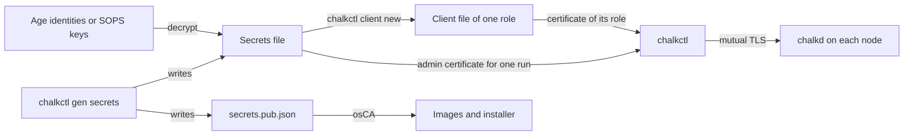

# Set up your workstation

This page is for an operator who prepares the machine they run chalkctl on. At the end you have
chalkctl, a repository laid out like the
[`cluster-metal` template](https://github.com/trevex/chalkos/tree/main/templates/cluster-metal), the
encrypted cluster secrets, and a client file for everyday commands. You also know which
credential each command needs.

## Before you begin

You need an x86-64 Linux machine with curl and cosign to download and check chalkctl, or Nix with
flakes enabled to run it from the chalkos flake.

[Manage secrets](secrets.md) covers the keys you need to encrypt and back up the cluster's secrets.

The images come from an image author, who builds them with Nix as
[Your first image flake](../build/first-image.md) shows. chalkctl needs the image directories the
builds write, and no Nix. Without an image author, take the generic images each chalkos release
publishes, as [Releases](../get-started/releases.md) describes, or build images yourself from a
template or an example with `nix build`.

!!! note "If you are both operator and image author"

    The operator pages hand these edits of the cluster's `flake.nix` to the image author. Each is a
    line or two of Nix:

    - `osCA = ./secrets.pub.json;` in the arguments of `mkImages` ties the images and the installer
      to the cluster, as [Tie the images to one cluster](../build/images-and-platforms.md#tie-the-images-to-one-cluster)
      shows. The templates set it already.
    - An image with `platform = "kvm";` runs the nodes as virtual machines, as
      [List the images](../build/images-and-platforms.md#list-the-images) shows.
    - `chalkos.debug.tools = true;` in an image's modules adds the tools `kubectl debug` uses, as
      [Add the debug tools](../build/add-software.md#add-the-debug-tools) shows.
    - The options `chalkos.router.<feature>.enable` leave router features out of an image, as
      [Leave router features out](../build/images-and-platforms.md#leave-router-features-out)
      lists.

## Get chalkctl

Take chalkctl from the chalkos release your images come from, because before 1.0 its commands and
node API change between releases. In the commands below, `<tag>` is that release, such as
`v0.6.0`: the release of the published images, or the one the image author's `flake.nix` names in
its `chalkos` input.

chalkctl compares its release with that of chalkd on each node whose information it reads, and
warns once per command when they differ, as during an upgrade of the cluster's image:
`chalkctl: warning: cp1 runs chalkd 0.5.0, this chalkctl is 0.6.0; use the chalkctl of the node's release`.
It warns and goes on. A call that the node answers with `unimplemented` adds the same hint.

### Download it from the release

Each release publishes chalkctl as `chalkctl-linux-amd64`, a static program that runs no other
program. Download it, the checksums and the signature bundles, and check the program against
`SHA256SUMS`:

```sh
release=https://github.com/trevex/chalkos/releases/download/<tag>
curl -fL -O "$release/chalkctl-linux-amd64" -O "$release/chalkctl-linux-amd64.sigstore.json" \
  -O "$release/SHA256SUMS" -O "$release/SHA256SUMS.sigstore.json"
sha256sum --check --ignore-missing SHA256SUMS
```

`sha256sum` prints `chalkctl-linux-amd64: OK`. Check with cosign that the release workflow signed
the checksums and the program:

```sh
for file in SHA256SUMS chalkctl-linux-amd64; do
  cosign verify-blob "$file" --bundle "$file.sigstore.json" \
    --certificate-identity https://github.com/trevex/chalkos/.github/workflows/release.yml@refs/heads/main \
    --certificate-oidc-issuer https://token.actions.githubusercontent.com
done
```

Install the program as `chalkctl` on the `PATH`:

```sh
install -m 0755 chalkctl-linux-amd64 ~/.local/bin/chalkctl
chalkctl version
```

[Download chalkctl and the installer](../get-started/releases.md#download-chalkctl-and-the-installer)
also verifies the program's build attestation and downloads chalkbuild and the installer.

### Run it from the chalkos flake

With Nix, chalkctl is the package `chalkctl` of the chalkos flake, built for `x86_64-linux`. Run
it from a shell that has it on the `PATH`:

```sh
nix shell github:trevex/chalkos/<tag>#chalkctl
chalkctl --help
```

A cluster's flake can add chalkctl to its development shell instead, as the lab template does, so
that `nix develop` gives the chalkctl of the pinned release.

## Lay out the repository

A cluster lives in one repository. That of the `cluster-metal` template looks like this once its
image and installer are built and its secrets are generated:

```text
cluster/
├── .gitignore         keeps images/, the installer and nix build's result links out of git
├── flake.nix          the image author's flake, which builds the image and the installer
├── flake.lock         the chalkos revision the flake pins
├── chalkos.yaml       the inventory
├── cluster/           config files every node gets
│   └── cluster.yaml
├── nodes/             each node's own config file
│   ├── cp1.yaml
│   ├── cp2.yaml
│   └── cp3.yaml
├── images/            image directories, outside git
│   └── node-metal     the build, which nix build links here
├── installer          the installer's build, outside git
├── secrets.age        the secrets file, encrypted with age
└── secrets.pub.json   the public half of the secrets file
```

A larger cluster adds directories of its own. The home lab of
[Build a home lab](../guides/home-lab.md) gives its router and its Kubernetes nodes separate
directories and images.

The inventory, `chalkos.yaml`, names the cluster's nodes, the address chalkctl reaches each at,
the image each runs and the config files each gets:

```yaml title="chalkos.yaml"
--8<-- "templates/cluster-metal/chalkos.yaml"
```

chalkctl reads `chalkos.yaml` in the current directory, so you run chalkctl from the repository's
root. `--inventory` or `$CHALKOSINVENTORY` names an inventory elsewhere, and either takes
precedence over `./chalkos.yaml`. Paths in the inventory are relative to its directory.
[Write a node's config](node-config.md) covers the inventory and the files it names.

`images/` holds the image directories. `nix build` links a build there, and
`chalkbuild sign` writes a signed copy beside it, such as `images/node-metal-signed`, for nodes
that enforce Secure Boot. Both are outside git: the template's `.gitignore` lists `images/`.

Commit the inventory, the config files and `secrets.pub.json`. A flake that names
`secrets.pub.json` in `osCA` reads it, and a flake sees only the files git tracks. `secrets.age`
may be committed too, as the next section explains.

## Generate the cluster's secrets with age

[`chalkctl gen secrets`](../reference/cli/chalkctl_gen_secrets.md) writes the secrets file,
encrypted with age to each recipient, and its public half, `secrets.pub.json`:

```console
$ chalkctl gen secrets --recipient "$(cat ~/.ssh/id_ed25519.pub)"
encrypted secrets.age to ssh-ed25519 AAAAC3NzaC1lZDI1NTE5AAAAIKMcR1DCFPGSdWXphQ3We8UmkMp2KdufUzVxxC6Hvo9k alice@workstation
wrote secrets.age and secrets.pub.json
```

[Manage secrets](secrets.md#generate-the-clusters-secrets-with-age) adds an offline backup
recipient, covers [generation with SOPS](secrets.md#generate-the-clusters-secrets-with-sops),
and shows how to keep the services' own secrets in
[`Secret` documents](secrets.md#keep-the-services-secrets-in-secret-documents).

## Build the images with the cluster's OS CA

Give `secrets.pub.json` to the image author, who names it in the `osCA` argument of `mkImages`, as
`osCA = ./secrets.pub.json;`. The image author then builds the images and the installer again.
Their chalkd in maintenance mode accepts only clients with a certificate from this cluster's OS
CA, so nobody else can install an image on a machine that waits for its install.
[Tie the images to one cluster](../build/images-and-platforms.md#tie-the-images-to-one-cluster)
describes the argument, and [Your first image flake](../build/first-image.md) shows the flake that
takes it.

--8<-- "docs/includes/no-os-ca.md"

The templates name `osCA` already.

## Choose a role for each client file

A client file holds a certificate of one client role, its key and the OS CA. It lets one person
run the everyday commands without the secrets file. `chalkctl client new` issues one from the
secrets file:

```console
$ chalkctl client new --name alice --role operator --secrets=secrets.age
wrote /home/alice/.config/chalkos/config for alice with the operator role; its certificate expires on 2027-01-21
```

The certificate is valid for 30 days with the admin role, 90 days with the operator role and a
year with the reader role, unless `--ttl` gives another validity, such as `--ttl 720h`. Issue a
new file from the secrets file when it expires; chalkctl warns during the last third of its
lifetime.
Without `--out`, the file goes to `~/.config/chalkos/config` with mode 0600. Give each person a
file of their own, with the least role their work needs:

- reader reads node information, disks, status and logs.
- operator may also reboot and upgrade nodes.
- admin may call every method chalkd serves, but for the one nodes renew their own
  certificates with.

Nothing revokes a single client file.
[Take access away](access.md#take-access-away)
describes how to take access away.

## Pass the secrets file or a client file

Pass the secrets file with `--secrets` to the commands that issue certificates or deliver keys and
config: `install`, `config apply`, `client new`, `recovery-key`, `node renew`, `rotate` and
`kubeconfig`. Run the others with a client file of a high enough role, or with the secrets file,
which counts as admin. The examples of these pages pass `--secrets` only where a command needs the
secrets file or the admin role, and leave it off the commands your client file runs.
[Commands](../reference/access.md#commands) lists the credential each command needs. A command
that needs the secrets file says so when `--secrets` is missing.

[Manage secrets](secrets.md#read-the-cluster-secrets-bundle) lists the supported file formats
and provider URIs.

`chalkctl upgrade` with an operator client file sends no config, and each node gives the new image
its pending config, else carries its own config over, as
[Operator upgrades carry no config](../how-it-works/node/upgrades.md#operator-upgrades-carry-no-config)
explains.

chalkd on each node enforces the roles. A call that the role does not allow fails
with a message that names the role it needs, such as
`/chalkos.node.v1.NodeService/Reboot needs the operator role`.
[Roles and credentials](../reference/access.md#methods) lists the role each method needs.

## Choose which client file chalkctl uses

The commands that need the secrets file read it only from `--secrets`. chalkctl never looks for a
secrets file on its own. The commands that accept a client file take the first credential they
find, in the order
[Where chalkctl finds its credentials](../reference/access.md#where-chalkctl-finds-its-credentials)
lists. With none of them, the command stops and says so.

`$CHALKOSCONFIG` and `$CHALKOSINVENTORY` let you keep the files of several clusters apart:

```sh
export CHALKOSCONFIG=~/clusters/cluster/alice.json
export CHALKOSINVENTORY=~/clusters/cluster/chalkos.yaml
```

A client file names no cluster. Its OS CA ties it to one: a node of another cluster fails the TLS
handshake, and chalkctl says the node does not accept this client file and asks whether it is
another cluster's.

chalkctl writes client files and secrets files readable by their owner alone. A file copied or
checked out with other permissions still works, and chalkctl warns once per command, as for a
client file of mode 0644:
`chalkctl: warning: alice.json holds a private key and is readable by others (mode 0644); chmod 600 it`.
The same goes for an age identity that `--identity` names and for a plaintext secrets file. A file
of another owner, or one in the Nix store, draws no warning, as you cannot change its mode.

The secrets file, the client files and the images relate as follows:



The diagram shows the secrets file at the centre. The keys of its recipients decrypt it. It
issues client files, and chalkctl issues itself a one-hour admin certificate from it for each
command. Its public half reaches the images, whose chalkd accepts certificates of the OS CA.

## Back up what you cannot rebuild

Some files exist only where you keep them: the secrets file and its recipients' keys, the Secure
Boot keys, the repository and the previous image.
[Back up what you cannot rebuild](recurring-tasks.md#back-up-what-you-cannot-rebuild) lists them.

## Check that it worked

`chalkctl validate` reads the inventory, the config files and the image directories without
connecting to the nodes. Provider-backed service secrets require their provider's keys. Build
the image named by the inventory, then run the command in the repository's root.

```sh
chalkctl validate
```

It prints a line per node, as
[Write a node's config](node-config.md#check-that-it-worked) shows. The lines show that chalkctl
runs, finds the inventory and reads the image directory. The repository then holds your encrypted cluster secrets
file and `secrets.pub.json`. Your client file lives in `~/.config/chalkos/config`.

If `validate` cannot open `chalkos.yaml`, run it in the repository's root, or name the inventory
with `--inventory` or `$CHALKOSINVENTORY`. If a command says that `no usable age identity was
found`, pass the key the secrets file or the age source was encrypted to with `--identity`.

## What next

- [Write a node's config](node-config.md) describes the inventory and the config documents of
  each node.
- [Install a node](install.md) installs the first node.
- [Security model](../how-it-works/node/security.md) explains the CAs, the roles and how a node
  in maintenance mode is trusted.
