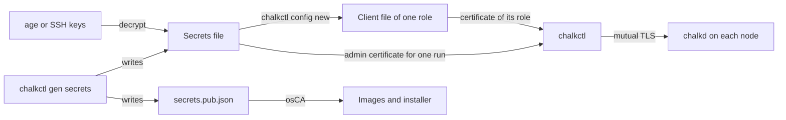

# Set up your workstation

This page is for an operator who prepares the machine they run chalkctl on. At the end you have
chalkctl, a repository laid out like the
[homelab example](https://github.com/trevex/chalkos/tree/main/examples/homelab), the cluster's
secrets file encrypted with age, and a client file for everyday commands. You also know which
credential each command needs.

## Before you begin

You need an x86-64 Linux machine. To get chalkctl from the chalkos flake, the machine needs Nix
with flakes enabled. A machine without Nix can run a copy of the program with mtools installed.

You need an age key or an SSH key of type ed25519 or RSA to encrypt the secrets file to. Each
person who will hold the secrets file needs one, and so does an offline backup.

The images come from an image author, who builds them with Nix as
[Your first image flake](../build/first-image.md) shows. chalkctl needs the image directories the
builds write, and no Nix.

## chalkctl comes from the chalkos flake

chalkctl is the package `chalkctl` of the chalkos flake, built for `x86_64-linux`. Take it from the
chalkos revision your images are built from, because chalkos is unreleased and its commands and
node API still change between revisions. Run it from a shell that has it on the `PATH`:

```sh
nix shell github:trevex/chalkos/<rev>#chalkctl
chalkctl --help
```

`<rev>` is the commit that the image author's `flake.lock` pins for the `chalkos` input, its
`locked.rev`. A cluster's flake can add chalkctl to its development shell instead, as the lab
template does, so that `nix develop` gives the chalkctl of the pinned revision.

The package's `bin/chalkctl` is a wrapper script that puts mtools on the `PATH` and runs the
program `bin/.chalkctl-wrapped`. `install` and `upgrade` run mtools' `mdir` and `mcopy` to read
the ESP of an image directory. The program is built without cgo, so it is a static binary. To run
chalkctl on a machine without Nix, an airgapped one included, copy `bin/.chalkctl-wrapped` there as
`chalkctl` and install the distribution's mtools package.

## The repository holds the inventory, the config files and the images

A cluster lives in one repository. The homelab's looks like this once its image is built and its
secrets are generated:

```text
homelab/
├── .gitignore         keeps images/ and nix build's result links out of git
├── flake.nix          the image author's flake, which builds the image
├── extensions/        the image author's NixOS modules that add kinds
├── chalkos.yaml       the inventory
├── cluster/           config files every node gets
│   ├── bgp.yaml
│   └── cluster.yaml
├── nodes/             each node's own config file
│   ├── cp1.yaml
│   └── w1.yaml
├── images/            image directories, outside git
│   └── node-metal     the build, which nix build links here
├── secrets.age        the secrets file, encrypted with age
└── secrets.pub.json   the public half of the secrets file
```

The inventory, `chalkos.yaml`, names the cluster's nodes, the address chalkctl reaches each at,
the image each runs and the config files each gets:

```yaml title="chalkos.yaml"
--8<-- "examples/homelab/chalkos.yaml"
```

chalkctl reads `chalkos.yaml` in the current directory, or the file `--inventory` names, so you
run chalkctl from the repository's root. Paths in the inventory are relative to its directory.
[Write a node's config](node-config.md) covers the inventory and the files it names.

`images/` holds the image directories. `nix build` links a build there, and
`chalkbuild sign` writes a signed copy beside it, such as `images/node-metal-signed`, for nodes
that enforce Secure Boot. Both are outside git: the homelab's `.gitignore` lists `images/`.

Commit the inventory, `cluster/`, `nodes/` and `secrets.pub.json`. A flake that names
`secrets.pub.json` in `osCA` reads it, and a flake sees only the files git tracks. `secrets.age`
may be committed too, as the next section explains.

## Generate the cluster's secrets with age

The secrets file holds every key of the cluster: the OS CA and the node CA with their keys, the
Kubernetes CAs and keys, and the secret every node's recovery key derives from. Whoever holds it
can install a node into the cluster, issue themselves any client certificate and decrypt every
node's disks with physical access to them.

Generate it once, in the repository's root, encrypted to each administrator's key and to a
backup key that you keep offline:

```console
$ chalkctl gen secrets --recipient "$(cat ~/.ssh/id_ed25519.pub)" \
    --recipient age1nmrqj76cqyf4ft8xtczufd3mtdk0xf2j7tevgwnzjp3zq9tffu3slx5eux
encrypted secrets.age to ssh-ed25519 AAAAC3NzaC1lZDI1NTE5AAAAIKMcR1DCFPGSdWXphQ3We8UmkMp2KdufUzVxxC6Hvo9k alice@workstation, age1nmrqj76cqyf4ft8xtczufd3mtdk0xf2j7tevgwnzjp3zq9tffu3slx5eux
wrote secrets.age and secrets.pub.json
```

A recipient is an age public key, an SSH public key or an age plugin recipient. A hardware key
works through a plugin such as age-plugin-yubikey, whose binary must be on the `PATH` of whoever
runs chalkctl.

The command writes two files:

- `secrets.age` is the secrets file, encrypted to the recipients.
- `secrets.pub.json` is its public half, with certificates and no keys.

`gen secrets` refuses to overwrite either file, because new secrets would lock you out of every
installed node:

```console
$ chalkctl gen secrets --recipient age1nmrqj76cqyf4ft8xtczufd3mtdk0xf2j7tevgwnzjp3zq9tffu3slx5eux
chalkctl: secrets.age exists; the secrets are generated once per cluster
```

To decrypt the file, chalkctl tries the identities `--identity` names. Without `--identity`, it
tries `~/.config/chalkos/age.key`, `~/.ssh/id_ed25519` and `~/.ssh/id_rsa`, skipping those that
do not exist or that age cannot use. It asks on the terminal for an SSH key's passphrase.

Two other ways to keep the file suit other setups:

- `--plaintext` in place of `--recipient` writes `secrets.json` unencrypted, for a file that
  something else protects. Keep it out of git.
- `--out - --public-out secrets.pub.json` writes the secrets file to standard output, for a
  secret manager. Every command then reads it from standard input with `--secrets -`.

Committing `secrets.age` puts it under the same history and review as the rest of the cluster.
Every clone then carries it, so its protection rests on the recipients' keys alone.
`chalkctl rotate` and `chalkctl node-ca rotate` later rewrite the file in place and leave
`secrets.age.prev` and, while they run, `secrets.age.lock` beside it. Keep both out of git.

!!! danger "A lost secrets file cannot be generated again"

    New secrets do not match the installed nodes. Without the file you cannot install or
    reinstall a node, deliver config, issue client files or derive a recovery key. Back it up to
    a second place, as [Back up what you cannot rebuild](#back-up-what-you-cannot-rebuild) lists.
    [Recover a node](recover-node.md#the-secrets-file-is-lost) lists what still works without it.

## Build the images with the cluster's OS CA

Give `secrets.pub.json` to the image author, who names it in the `osCA` argument of `mkImages`, as
`osCA = ./secrets.pub.json;`. The image author then builds the images and the installer again.
Their chalkd in maintenance mode accepts only clients with a certificate from this cluster's OS
CA, so nobody else can install an image on a machine that waits for its install.
[The OS CA ties images to one cluster](../build/variants-and-platforms.md#the-os-ca-ties-images-to-one-cluster)
describes the argument, and [Your first image flake](../build/first-image.md) shows the flake that
takes it.

Images built without `osCA` accept any client until they are installed. The homelab's flake leaves
it out, which suits a lab on a private network alone.

## Secret documents hold the services' secrets

A `Secret` document is a config document, unrelated to the secrets file. It holds values that
the node's services read, such as a password for a BGP peer, and it reaches the node with the
rest of the node's config. The homelab's `cluster/bgp.yaml` gives every node one, which the
`Peer` document for `router-a` names in a `secretRef`:

```yaml title="cluster/bgp.yaml"
--8<-- "examples/homelab/cluster/bgp.yaml"
```

chalkctl reads every config file as plain YAML, `Secret` documents included. A file that holds
real secret values must therefore be in plain text where chalkctl runs. Keep it out of a public
repository, or decrypt it into place with a tool such as sops before the command and remove it
after. On the node, chalkd keeps the `Secret` documents readable by root alone, and hands each
value only to the units that are granted the kind that names it.

## A client file grants one role

A client file holds a certificate of one client role, its key and the OS CA. It lets one person
run the everyday commands without the secrets file. `chalkctl config new` issues one from the
secrets file:

```console
$ chalkctl config new --name alice --role operator --secrets secrets.age
wrote /home/alice/.config/chalkos/config for alice with the operator role; its certificate expires on 2027-10-23
```

The certificate is valid for a year unless `--ttl` gives another validity, such as `--ttl 720h`.
Without `--out`, the file goes to `~/.config/chalkos/config` with mode 0600. Give each person a
file of their own, with the least role their work needs:

- reader reads node information, disks, status and logs.
- operator may also reboot and upgrade nodes.
- admin may call every method of the node API, but for the one nodes renew their own
  certificates with.

Nothing revokes a single client file.
[Access ends when a certificate expires or its CA goes](access.md#access-ends-when-a-certificate-expires-or-its-ca-goes)
describes how to take access away.

## Each command needs the secrets file or a client file

Some commands issue certificates or deliver keys and config, so they need the secrets file. The
others take a client file of a high enough role, or the secrets file, which counts as admin:

| Command | Secrets file | Admin client file | Operator client file | Reader client file |
| --- | --- | --- | --- | --- |
| `install`, `apply-config`, `config new` | yes | no | no | no |
| `recovery-key`, `node renew`, `node-ca rotate`, `rotate` | yes | no | no | no |
| `storage reset` | yes | yes | no | no |
| `upgrade` with config, `upgrade --diff` | yes | yes | no | no |
| `upgrade` without config, `reboot` | yes | yes | yes | no |
| `status`, `logs`, `disks` | yes | yes | yes | yes |

`validate` and `gen secrets` need neither. A command that needs the secrets file says so when
`--secrets` is missing, whatever client file you have:

```text
chalkctl: pass the secrets file with --secrets FILE, or --secrets - to read it from standard input
```

`chalkctl upgrade` with an operator client file sends no config. Each node carries its own config
over to the new image, and chalkctl prints
`config not delivered: the operator role cannot deliver config; each node carries its own over`.

!!! note "On the shipped variant, the Kubernetes commands need credentials too"

    `bootstrap`, `etcd remove-member` and `etcd leave` need an admin client file or the secrets
    file. `etcd members` needs a reader client file. `kubeconfig` needs the secrets file. During an
    upgrade, the operator role also lets chalkctl drain and uncordon the nodes.

chalkd on each node enforces the roles. A call that the role does not allow fails
with a message that names the role it needs, such as
`/chalkos.node.v1.NodeService/Reboot needs the operator role`.
[Roles and credentials](../reference/access.md#methods) lists the role each method needs.

## chalkctl looks for credentials in a fixed order

The commands that need the secrets file read it only from `--secrets`. chalkctl never looks for a
secrets file on its own. The commands that accept a client file take the first credential they
find, in the order
[Where chalkctl finds its credentials](../reference/access.md#where-chalkctl-finds-its-credentials)
lists. With none of them, the command stops:

```text
chalkctl: there is no client file at /home/alice/.config/chalkos/config; pass --config or --secrets
```

`$CHALKOSCONFIG` lets you keep the files of several clusters apart:

```sh
export CHALKOSCONFIG=~/clusters/homelab/alice.json
```

A client file names no cluster. Its OS CA ties it to one: a node of another cluster fails the TLS
handshake, and chalkctl says the node does not accept this client file and asks whether it is
another cluster's.

The secrets file, the client files and the images relate as follows:



The diagram shows the secrets file at the centre. The keys of its recipients decrypt it. It
issues client files, and chalkctl issues itself a one-hour admin certificate from it for each
command. Its public half reaches the images, whose chalkd accepts certificates of the OS CA.

## Back up what you cannot rebuild

A node can be reinstalled and an image built again, but some files exist only where you keep them.
Back up these files to a place apart from the workstation:

- The secrets file and the age or SSH identities of its recipients, the offline backup key
  included. Without an identity the file cannot be decrypted.
- The Secure Boot db key and certificate, `db.key` and `db.crt`, which
  [Sign images for Secure Boot](../build/sign-images.md) creates. Every machine's firmware trusts
  that certificate, so a new key means enrolling a new certificate on each machine.
- The repository: the inventory, the config files, `secrets.pub.json` and `flake.lock`, which pins
  the chalkos revision every image is built from.
- The image directory of the image the nodes ran before an upgrade, until the new image has
  proven itself. [Go back to the previous image](upgrade.md#go-back-to-the-previous-image) uses
  it.
- The password of each node whose encryption fallback is a password. Nothing else holds it.

On the shipped variant, the cluster's state lives in etcd on the control planes. chalkos has no
etcd backup or restore yet; the [roadmap](../contribute/roadmap.md#smaller-items) lists it. Three
control planes survive the loss of a machine, but they do not bring back an object that someone
deleted. Back up what the workloads keep with a tool that works at the Kubernetes level.

## Check that it worked

`chalkctl validate` reads the inventory, the config files and the image directories, and needs no
credentials. It needs the image directory the inventory names, so the image author builds the
image first. Run it in the repository's root:

```sh
chalkctl validate
```

It prints a line per node, as
[Write a node's config](node-config.md#check-that-it-worked) shows. The lines show that chalkctl
runs, finds the inventory and reads the image directory. The repository then holds `secrets.age`
and `secrets.pub.json`, and `~/.config/chalkos/config` holds your client file.

If `validate` cannot open `chalkos.yaml`, run it in the repository's root or pass `--inventory`.
If a command says that `the secrets file is encrypted and no usable age identity was found`, pass
the key the file was encrypted to with `--identity`.

## What next

- [Write a node's config](node-config.md) describes the inventory and the config documents of
  each node.
- [Install a node](install.md) installs the first node.
- [Security model](../how-it-works/node/security.md) explains the CAs, the roles and how a node
  in maintenance mode is trusted.
