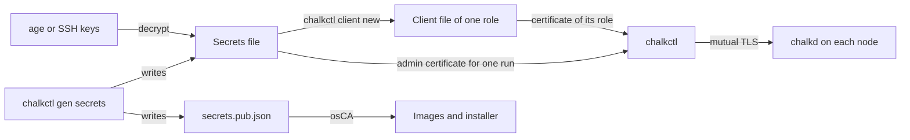

# Set up your workstation

This page is for an operator who prepares the machine they run chalkctl on. At the end you have
chalkctl, a repository laid out like the
[`cluster-metal` template](https://github.com/trevex/chalkos/tree/main/templates/cluster-metal), the
cluster's secrets file encrypted with age, and a client file for everyday commands. You also know which
credential each command needs.

## Before you begin

You need an x86-64 Linux machine. To get chalkctl from the chalkos flake, the machine needs Nix
with flakes enabled. A machine without Nix can run a copy of the program with mtools installed.

You need an age key or an SSH key of type ed25519 or RSA to encrypt the secrets file to. Each
person who will hold the secrets file needs one, and so does an offline backup.

The images come from an image author, who builds them with Nix as
[Your first image flake](../build/first-image.md) shows. chalkctl needs the image directories the
builds write, and no Nix. chalkos publishes no prebuilt images yet, so without an image author you
build them yourself from a template or an example with `nix build`.

!!! note "If you are both operator and image author"

    The operator pages hand these edits of the cluster's `flake.nix` to the image author. Each is a
    line or two of Nix:

    - `osCA = ./secrets.pub.json;` in the arguments of `mkImages` ties the images and the installer
      to the cluster, as [Tie the images to one cluster](../build/images-and-platforms.md#tie-the-images-to-one-cluster)
      shows. The templates set it already.
    - An image with `platform = "kvm";` runs the nodes as virtual machines, as
      [List the images](../build/images-and-platforms.md#list-the-images) shows.
    - `chalkos.debug.tools = true;` in an image's modules adds the tools `kubectl debug` uses, as
      [Add the debug tools](../build/add-software.md#add-the-debug-tools) shows.
    - The options `chalkos.router.<feature>.enable` leave router features out of an image, as
      [Leave router features out](../build/images-and-platforms.md#leave-router-features-out)
      lists.

## Get chalkctl from the chalkos flake

chalkctl is the package `chalkctl` of the chalkos flake, built for `x86_64-linux`. Take it from the
chalkos revision your images are built from, because chalkos is unreleased and its commands and
node API still change between revisions. Run it from a shell that has it on the `PATH`:

```sh
nix shell github:trevex/chalkos/<rev>#chalkctl
chalkctl --help
```

`<rev>` is the commit that the image author's `flake.lock` pins for the `chalkos` input, its
`locked.rev`. A cluster's flake can add chalkctl to its development shell instead, as the lab
template does, so that `nix develop` gives the chalkctl of the pinned revision.

To run chalkctl on a machine without Nix, copy its program and install mtools, as
[Requirements](../get-started/requirements.md#workstation) describes.

## Lay out the repository

A cluster lives in one repository. That of the `cluster-metal` template looks like this once its
image and installer are built and its secrets are generated:

```text
cluster/
├── .gitignore         keeps images/, the installer and nix build's result links out of git
├── flake.nix          the image author's flake, which builds the image and the installer
├── flake.lock         the chalkos revision the flake pins
├── chalkos.yaml       the inventory
├── cluster/           config files every node gets
│   └── cluster.yaml
├── nodes/             each node's own config file
│   ├── cp1.yaml
│   ├── cp2.yaml
│   └── cp3.yaml
├── images/            image directories, outside git
│   └── node-metal     the build, which nix build links here
├── installer          the installer's build, outside git
├── secrets.age        the secrets file, encrypted with age
└── secrets.pub.json   the public half of the secrets file
```

A larger cluster adds directories of its own. The
[homelab example](https://github.com/trevex/chalkos/tree/main/examples/homelab) gives its router
and its Kubernetes nodes separate directories and images, and keeps its NixOS extensions in
`extensions/`.

The inventory, `chalkos.yaml`, names the cluster's nodes, the address chalkctl reaches each at,
the image each runs and the config files each gets:

```yaml title="chalkos.yaml"
--8<-- "templates/cluster-metal/chalkos.yaml"
```

chalkctl reads `chalkos.yaml` in the current directory, so you run chalkctl from the repository's
root. `--inventory` or `$CHALKOSINVENTORY` names an inventory elsewhere, and either takes
precedence over `./chalkos.yaml`. Paths in the inventory are relative to its directory.
[Write a node's config](node-config.md) covers the inventory and the files it names.

`images/` holds the image directories. `nix build` links a build there, and
`chalkbuild sign` writes a signed copy beside it, such as `images/node-metal-signed`, for nodes
that enforce Secure Boot. Both are outside git: the template's `.gitignore` lists `images/`.

Commit the inventory, the config files and `secrets.pub.json`. A flake that names
`secrets.pub.json` in `osCA` reads it, and a flake sees only the files git tracks. `secrets.age`
may be committed too, as the next section explains.

## Generate the cluster's secrets with age

The secrets file holds every key of the cluster: the OS CA and the node CA with their keys, the
Kubernetes CAs and keys, and the secret every node's recovery key derives from. Whoever holds it
can install a node into the cluster, issue themselves any client certificate and decrypt every
node's disks with physical access to them.

Generate it once, in the repository's root, encrypted to each administrator's key and to a
backup key that you keep offline:

```console
$ chalkctl gen secrets --recipient "$(cat ~/.ssh/id_ed25519.pub)" \
    --recipient age1nmrqj76cqyf4ft8xtczufd3mtdk0xf2j7tevgwnzjp3zq9tffu3slx5eux
encrypted secrets.age to ssh-ed25519 AAAAC3NzaC1lZDI1NTE5AAAAIKMcR1DCFPGSdWXphQ3We8UmkMp2KdufUzVxxC6Hvo9k alice@workstation, age1nmrqj76cqyf4ft8xtczufd3mtdk0xf2j7tevgwnzjp3zq9tffu3slx5eux
wrote secrets.age and secrets.pub.json
```

A recipient is an age public key, an SSH public key or an age plugin recipient. A hardware key
works through a plugin such as age-plugin-yubikey, whose binary must be on the `PATH` of whoever
runs chalkctl.

The command writes two files:

- `secrets.age` is the secrets file, encrypted to the recipients.
- `secrets.pub.json` is its public half, with certificates and no keys.

`gen secrets` refuses to overwrite either file, because new secrets would lock you out of every
installed node:

```console
$ chalkctl gen secrets --recipient age1nmrqj76cqyf4ft8xtczufd3mtdk0xf2j7tevgwnzjp3zq9tffu3slx5eux
chalkctl: secrets.age exists; the secrets are generated once per cluster
```

To decrypt the file, chalkctl tries the identities `--identity` names. Without `--identity`, it
tries `~/.config/chalkos/age.key`, `~/.ssh/id_ed25519` and `~/.ssh/id_rsa`, skipping those that
do not exist or that age cannot use. It asks on the terminal for an SSH key's passphrase.

Two other ways to keep the file suit other setups:

- `--plaintext` in place of `--recipient` writes `secrets.json` unencrypted, for a file that
  something else protects. Keep it out of git.
- `--out - --public-out secrets.pub.json` writes the secrets file to standard output, for a
  secret manager. Every command then reads it from standard input with `--secrets -`.

Committing `secrets.age` puts it under the same history and review as the rest of the cluster.
Every clone then carries it, so its protection rests on the recipients' keys alone.
`chalkctl rotate` later rewrites the file in place and leaves `secrets.age.prev` and, while it
runs, `secrets.age.lock` beside it. Keep both out of git. `secrets.age.prev` holds the version
from before the last change, or after a rotation the version from before the rotation.

!!! danger "A lost secrets file cannot be generated again"

    New secrets do not match the installed nodes. Without the file you cannot install or
    reinstall a node, deliver config, issue client files or derive a recovery key. Back it up to
    a second place, as
    [Back up what you cannot rebuild](recurring-tasks.md#back-up-what-you-cannot-rebuild) lists.
    [Recover a node](recover-node.md#the-secrets-file-is-lost) lists what still works without it.

## Build the images with the cluster's OS CA

Give `secrets.pub.json` to the image author, who names it in the `osCA` argument of `mkImages`, as
`osCA = ./secrets.pub.json;`. The image author then builds the images and the installer again.
Their chalkd in maintenance mode accepts only clients with a certificate from this cluster's OS
CA, so nobody else can install an image on a machine that waits for its install.
[Tie the images to one cluster](../build/images-and-platforms.md#tie-the-images-to-one-cluster)
describes the argument, and [Your first image flake](../build/first-image.md) shows the flake that
takes it.

Images built without `osCA` accept any client until they are installed, as an admin. Anyone on
the machine's network may then install it, reboot it and run every diagnostic on it, those for
operators such as `nft-ruleset` included. The templates name `osCA` already. The homelab's flake
leaves it out, so that it builds before any cluster has secrets, and
[Build a home lab](../guides/home-lab.md#generate-the-clusters-secrets) adds it.

## Keep the services' secrets in Secret documents

A `Secret` document is a config document, unrelated to the secrets file. It holds values that
the node's services read, such as a password for a BGP peer, and it reaches the node with the
rest of the node's config. The homelab's `bgp/secrets.yaml` gives the three nodes one, which the
`Peer` document for `router` in `bgp/fabric.yaml` names in a `secretRef`:

```yaml title="bgp/secrets.yaml"
--8<-- "examples/homelab/bgp/secrets.yaml"
```

chalkctl reads every config file as plain YAML, `Secret` documents included. A file that holds
real secret values must therefore be in plain text where chalkctl runs. Keep it out of a public
repository, or decrypt it into place with a tool such as sops before the command and remove it
after. On the node, chalkd keeps the `Secret` documents readable by root alone, and hands each
value only to the units that are granted the kind that names it.

## Choose a role for each client file

A client file holds a certificate of one client role, its key and the OS CA. It lets one person
run the everyday commands without the secrets file. `chalkctl client new` issues one from the
secrets file:

```console
$ chalkctl client new --name alice --role operator --secrets secrets.age
wrote /home/alice/.config/chalkos/config for alice with the operator role; its certificate expires on 2027-10-23
```

The certificate is valid for a year unless `--ttl` gives another validity, such as `--ttl 720h`.
Without `--out`, the file goes to `~/.config/chalkos/config` with mode 0600. Give each person a
file of their own, with the least role their work needs:

- reader reads node information, disks, status and logs.
- operator may also reboot and upgrade nodes.
- admin may call every method chalkd serves, but for the one nodes renew their own
  certificates with.

Nothing revokes a single client file.
[Take access away](access.md#take-access-away)
describes how to take access away.

## Pass the secrets file or a client file

Pass the secrets file with `--secrets` to the commands that issue certificates or deliver keys and
config: `install`, `config apply`, `client new`, `recovery-key`, `node renew` and `rotate`. Run the
others with a client file of a high enough role, or with the secrets file, which counts as admin.
[Commands](../reference/access.md#commands) lists the credential each command needs. A command
that needs the secrets file says so when `--secrets` is missing:

```text
chalkctl: pass the secrets file with --secrets FILE, or --secrets - to read it from standard input
```

`chalkctl upgrade` with an operator client file sends no config, and each node gives the new image
its pending config, else carries its own config over, as
[Operator upgrades carry no config](../how-it-works/node/upgrades.md#operator-upgrades-carry-no-config)
explains.

chalkd on each node enforces the roles. A call that the role does not allow fails
with a message that names the role it needs, such as
`/chalkos.node.v1.NodeService/Reboot needs the operator role`.
[Roles and credentials](../reference/access.md#methods) lists the role each method needs.

## Choose which client file chalkctl uses

The commands that need the secrets file read it only from `--secrets`. chalkctl never looks for a
secrets file on its own. The commands that accept a client file take the first credential they
find, in the order
[Where chalkctl finds its credentials](../reference/access.md#where-chalkctl-finds-its-credentials)
lists. With none of them, the command stops and says so.

`$CHALKOSCONFIG` and `$CHALKOSINVENTORY` let you keep the files of several clusters apart:

```sh
export CHALKOSCONFIG=~/clusters/cluster/alice.json
export CHALKOSINVENTORY=~/clusters/cluster/chalkos.yaml
```

A client file names no cluster. Its OS CA ties it to one: a node of another cluster fails the TLS
handshake, and chalkctl says the node does not accept this client file and asks whether it is
another cluster's.

The secrets file, the client files and the images relate as follows:



The diagram shows the secrets file at the centre. The keys of its recipients decrypt it. It
issues client files, and chalkctl issues itself a one-hour admin certificate from it for each
command. Its public half reaches the images, whose chalkd accepts certificates of the OS CA.

## Back up what you cannot rebuild

Some files exist only where you keep them: the secrets file and its recipients' keys, the Secure
Boot keys, the repository and the previous image.
[Back up what you cannot rebuild](recurring-tasks.md#back-up-what-you-cannot-rebuild) lists them.

## Check that it worked

`chalkctl validate` reads the inventory, the config files and the image directories, and needs no
credentials. It needs the image directory the inventory names, so the image author builds the
image first. Run it in the repository's root:

```sh
chalkctl validate
```

It prints a line per node, as
[Write a node's config](node-config.md#check-that-it-worked) shows. The lines show that chalkctl
runs, finds the inventory and reads the image directory. The repository then holds `secrets.age`
and `secrets.pub.json`, and `~/.config/chalkos/config` holds your client file.

If `validate` cannot open `chalkos.yaml`, run it in the repository's root, or name the inventory
with `--inventory` or `$CHALKOSINVENTORY`.
If a command says that `the secrets file is encrypted and no usable age identity was found`, pass
the key the file was encrypted to with `--identity`.

## What next

- [Write a node's config](node-config.md) describes the inventory and the config documents of
  each node.
- [Install a node](install.md) installs the first node.
- [Security model](../how-it-works/node/security.md) explains the CAs, the roles and how a node
  in maintenance mode is trusted.
