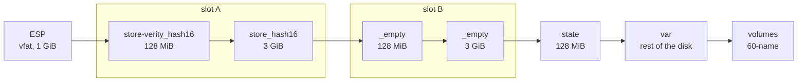

# Image and partition layout

This page is for operators and image authors who read a node's disks, its ESP or STATE, or the
outputs of an image build. It lists the partitions of a node's disks, the files on the ESP and on
STATE, the outputs of an image build and the paths a running node uses.
[The image](../how-it-works/node/image.md) and
[Storage and encryption](../how-it-works/node/storage.md) explain why the layout is what it is.

## Partition map

The system disk holds the system region (the ESP, two slots and STATE)
followed by VAR and the volumes placed on it. A slot
is a pair of partitions: the dm-verity hash tree first, then the erofs
data of the store.



The table lists the partitions in disk order. The first column is the systemd-repart
definition file that describes each one. The system region's sizes are the defaults of the
image's `chalkos.disk` options, which [Image options](image-options.md#disk) describes. They are
fixed when the image is built, so every node that runs an image of one variant has the same
system region.

| Definition | Label | Size | File system | Encryption | Created by |
| --- | --- | --- | --- | --- | --- |
| `00-esp` | `esp` | `espSize`, `1G` | vfat | none | image build |
| `10-store-verity-a` | `store-verity_<hash16>` | `storeVeritySize`, `128M` | dm-verity hash tree | none | image build |
| `20-store-a` | `store_<hash16>` | `storeSize`, `3G` | erofs, zstd | none | image build |
| `30-store-verity-b` | `_empty` | `storeVeritySize`, `128M` | none until an upgrade | none | first boot, or install from the installer |
| `40-store-b` | `_empty` | `storeSize`, `3G` | none until an upgrade | none | first boot, or install from the installer |
| `50-state` | `state` | `stateSize`, `128M` | ext4 | node's policy, LUKS2 sealed to the TPM by default | first boot, install |
| `50-var` | `var` | the `SystemDisk`'s `spec.var.size`, rest of the disk | ext4 | node's policy | install |
| `60-<name>` | `<name>` | the volume's `size` | the volume's `format` | node's policy | install, later config |

A volume with a disk of its own is the only partition on that disk, from the definition
`10-<name>`. The system region's definitions are the same files the image ships in
`/etc/chalkos/repart.d`; VAR's and the volumes' come from the node's
config and are kept on STATE.

The "Created by" column names the first writer of each partition:

- Image build: the Nix build of the image runs systemd-repart and writes the ESP and slot A into
  the raw image.
- First boot: systemd-repart in the initrd runs the system region's definitions against the
  disk systemd-boot was loaded from, so it adds slot B and STATE behind the partitions the image
  shipped with. It runs at every boot and changes nothing once they exist.
- Install: from the installer, chalkd lays out the
  whole system region on the target disk with one systemd-repart run of the image's definitions and
  writes slot A itself. In place, chalkd recreates STATE when its contents do not match the node's
  encryption policy (an unencrypted STATE for a `SystemDisk` with `encryption: {mode: none}`). In
  both flows it then creates VAR and the volumes.
- Config: [`chalkctl apply-config`](cli/chalkctl_apply-config.md) creates volumes added
  to a node's storage and grows those whose size grew. At every boot, `chalkos-storage` in the
  initrd applies the storage section recorded on STATE again.

The sizes have lower bounds, checked when the image is evaluated: the ESP needs at least 260
MiB, the smallest ESP systemd-repart formats as vfat, and STATE at least 64 MiB, the smallest
encrypted ext4 partition it makes. The image build fails when the store's data takes more than
80% of a slot, its hash tree more than 80% of the verity partition, or three UKIs more than 80%
of the ESP. The installer sets `storeSize` and `storeVeritySize` to
null, which sizes its single slot to its contents, and its ESP to 260 MiB.

## GPT partition types

systemd-repart matches existing partitions to definitions by GPT type, so STATE, VAR and each
volume have a type of their own, a hash of the label, and no definition takes over another
one's partition.

| Partition | GPT type |
| --- | --- |
| ESP | `c12a7328-f81f-11d2-ba4b-00a0c93ec93b` |
| Store hash tree, x86-64 | `77ff5f63-e7b6-4633-acf4-1565b864c0e6` |
| Store data, x86-64 | `8484680c-9521-48c6-9c11-b0720656f69e` |
| Store hash tree, arm64 | `6e11a4e7-fbca-4ded-b9e9-e1a512bb664e` |
| Store data, arm64 | `b0e01050-ee5f-4390-949a-9101b17104e9` |
| STATE | `480b7842-1236-1abb-0339-e5503b43122a` |
| VAR | `65f335d7-a1f7-f6df-b954-a97d9a5db9e6` |
| Volume `<name>` | the first 128 bits of SHA-256 of `chalkos-partition-type:<name>`, as a UUID |

The store's types are the Discoverable Partitions Specification's `usr` types. STATE, VAR and
volumes have chalkos's own types.

## Partition UUIDs

The UKI's kernel command line carries the store's
root hash as `usrhash=`, and systemd finds the store's partitions by
UUIDs derived from it: the data partition's UUID is the root hash's first 128 bits, the hash
tree's its last 128 bits. A store
built with the root hash `2ece03b0fa094b775ee5bf2e1f6f9eb66d6f0dc06f30f49f2f978f00e1173942`
therefore lives in these partitions:

| Partition | Label | Partition UUID |
| --- | --- | --- |
| Store data | `store_2ece03b0fa094b77` | `2ece03b0-fa09-4b77-5ee5-bf2e1f6f9eb6` |
| Store hash tree | `store-verity_2ece03b0fa094b77` | `6d6f0dc0-6f30-f49f-2f97-8f00e1173942` |

The other UUIDs are set as follows:

| Partition | Partition UUID |
| --- | --- |
| A slot being written | random, with both labels `_empty`, so nothing boots it |
| A written slot | derived from the root hash, with the labels naming its first 16 hex characters |
| ESP | random, set at install, because systemd-boot reports it as the boot partition and no other disk with the same image may match it |
| STATE | random, from systemd-repart's `--seed=random`, when an install from the installer lays out the disk or an install recreates STATE for another encryption; otherwise the one systemd-repart gave it at first boot |
| VAR and volumes | derived by systemd-repart from a seed per node and disk name |

The labels name a slot's store by the first 16 hex characters of its root hash, `<hash16>`, so
`store-verity_<hash16>` fits a GPT label of 36 characters, but nothing boots by label; the boot
finds the store by partition UUID alone. systemd-repart labels slot A `store-verity` and `store`
when it builds the raw image, before the root hash is known; the image build then relabels the
copy in the image directory, so `chalkos.raw` and its `repart-output.json` carry the hash's
labels. The installer's own medium keeps `store-verity` and `store`.

## Files on the ESP

The ESP is mounted at `/efi` when it is used, with mode `0700`, and unmounted after a minute
idle, so a power cut rarely finds its FAT file system in use.

| Path | What it is |
| --- | --- |
| `/EFI/BOOT/BOOTX64.EFI` | systemd-boot, at the removable-media path, so firmware finds it without a boot entry. `BOOTAA64.EFI` on arm64. |
| `/EFI/Linux/chalkos_<generation>.efi` | A UKI without a boot counter: `chalkos_1.efi` as the image holds it and an install from the installer writes it, or one whose boot was blessed. |
| `/EFI/Linux/chalkos_<generation>+<left>.efi` | A UKI an upgrade installed, one generation above the highest on the ESP, with `chalkos.upgrade.bootTries` tries left, such as `chalkos_2+3.efi`. |
| `/EFI/Linux/chalkos_<generation>+<left>-<done>.efi` | The same UKI after systemd-boot counted a boot that was not blessed, such as `chalkos_2+2-1.efi`. `+0-3` means no tries left: systemd-boot boots another entry. |
| `/EFI/Linux/.chalkos-<root-hash>.efi` | A UKI an upgrade or an install from the installer is receiving, named by the image's full root hash. systemd-boot ignores names starting with a dot. |
| `/EFI/BOOT/.boot-loader.tmp` | The boot loader an install from the installer is writing. |

`chalkos` is the image ID, `system.image.id`; the installer's UKI is
`chalkos-installer_1.efi`. The image ID consists of lower-case letters, digits, `.`, `_` and
`-`; the build fails otherwise. The generation is the number in the name without its counter; an
upgrade reads the highest any name `chalkos_<n>.efi` on the ESP gives and writes the next. The
name alone counts, as systemd-boot orders the entry by it: a file that is no UKI, or a UKI whose
os-release names another image or none, counts too. A name that gives no generation, such as
`chalkos.efi`, counts for none. An upgrade refuses to run while the entry the node booted, or
another it keeps, gives no generation, a generation of 0 or one with leading zeros, such as
`chalkos.efi`, `chalkos_5a.efi`, `chalkos_7+2147483648.efi`, whose counter systemd-boot ignores,
or `chalkos_01.efi`, or while a name gives a generation too large for one to follow it in 64
bits. chalkd never writes such names.

An upgrade first removes every UKI of the image's ID, and every file that is no UKI whose name
gives a generation, except the one the node booted and those booting the running store, then
receives the new one, so the ESP holds the UKIs of both slots and, during an upgrade, a third. An
install from the installer removes every UKI of the image's ID but the `chalkos_1.efi` it
writes. UKIs of other image IDs, or of none, such as a rescue system's, stay. systemd-boot sorts entries by
image ID, lowest first, before their file names, so such a UKI whose image ID sorts before
`chalkos`, such as one with `IMAGE_ID=alpine`, boots before every chalkos entry. chalkos itself
never puts UKIs of other image IDs on the ESP. An upgrade leaves systemd-boot alone: only an
install writes the boot loader.

systemd-boot boots the highest generation whose tries are not used up, comparing the numbers as
numbers, by the rules [Boot and the image](boot.md#systemd-boot-sort-rules) lists. chalkd sets no EFI variable to choose an entry. An install from the installer adds a UEFI
boot entry labelled `chalkos` for the target ESP's removable-media path, `\EFI\BOOT\BOOTX64.EFI`
on x86-64 and `\EFI\BOOT\BOOTAA64.EFI` on arm64.

## Files on STATE

STATE is mounted at `/state`. It holds what makes the node this node and nothing else: a config
slot for each image the node holds, below `config/<root-hash>`, and the machine state every image
shares. The `chalkd` and `kubernetes` directories, and each slot's `secrets` directories, are
readable by root alone.

| Path | Written by | What it holds |
| --- | --- | --- |
| `config/<root-hash>/` | install, Upgrade, ApplyConfig | The config slot of the image whose store has the root hash, which its boot loads: a symbolic link to a directory beside it, which a new set replaces as a whole. An Upgrade forgets the slots of the images no UKI on the ESP boots, and with them a slot an upgrade wrote before a crash kept its image from being activated. |
| `config/<root-hash>/identity.json` | install, Upgrade, ApplyConfig | The node's identity on that image, which its config translates to and the boot applies: hostname, static addresses, storage and Kubernetes settings. |
| `config/<root-hash>/delivered/<group>/<Kind>/<name>.json` | install, Upgrade, ApplyConfig | The slot's config documents as delivered, which GetConfig returns with secrets hashed; `Secret` documents in `delivered/secrets/<name>.json`. |
| `config/<root-hash>/documents/<group>/<Kind>/<name>.json` | install, Upgrade, ApplyConfig | The same documents with their schemas' defaults filled in, which the node's services read; `Secret` documents in `documents/secrets/<name>.json`. |
| `config/<root-hash>/version` | install, Upgrade, ApplyConfig | The SHA-256 of the slot's config as delivered, which Status reports. |
| `chalkd/node.pem` | install, renewal | The node certificate's chain and its key in one file, so both are replaced together. |
| `chalkd/ca.crt` | install, rotation | The certificates of the OS CAs the node trusts, a bundle. |
| `kubernetes/share.json` | install, rotation | The node's Kubernetes share. |
| `kubernetes/node-ip` | chalkd | A control plane's addresses, pinned when it became an etcd member, one per line. |
| `kubernetes/joining` | chalkd | The node started joining the cluster, so it never bootstraps a cluster of its own. |
| `kubernetes/bootstrapped` | Bootstrap | The node bootstrapped the cluster. |
| `kubernetes/etcd-initialised` | chalkd | etcd answered ready after the bootstrap, so its data exists. |
| `kubernetes/etcd-initial-cluster` | chalkd | etcd's initial cluster when the node joined an existing one. |
| `kubernetes/left` | EtcdLeave | The node left etcd; it joins again only once reinstalled. |
| `storage/storage.json` | install, Upgrade, ApplyConfig | The storage as applied, which every image's boot sets up: machine state, which the storage kinds' change rules compare the config of every slot write with. Every boot sets up each volume the file records, also one the booted image's config lacks, and nothing at boot removes a volume. |
| `storage/disks.json` | chalkos-storage, chalkd | The disks the section's names were pinned to, and the PARTUUID of each volume. |
| `storage/disks/<disk>/*.conf` | chalkos-storage, chalkd | The repart definitions of each disk, from the storage section. |
| `installed` | install | The marker that the node is installed, written last. |

A node whose STATE has no `installed` marker starts chalkd in
maintenance mode.

## Outputs of an image build

An image directory is what
[`mkImages`](mkimages.md) builds as `images.<variant>-<platform>`, such as `nix build .#node-kvm`
in the lab template, whose flake exposes `images.node-kvm`. It holds five entries, six for an
image with Kubernetes:

| Entry | What it is |
| --- | --- |
| `chalkos.raw` | The raw disk image: the ESP, with the UKI as `/EFI/Linux/chalkos_1.efi`, and slot A labelled with its root hash, with no slot B and no STATE. |
| `repart-output.json` | systemd-repart's description of the raw image's partitions: type, label, UUID, offset, size and the store's root hash, with slot A's labels as the raw image carries them. `chalkbuild sign` and `chalkctl install` find the partitions with it. |
| `repart.d` | The system region's definitions, `00-esp.conf` to `50-state.conf`, as the image carries them in `/etc/chalkos/repart.d`. |
| `metadata.json` | What the image is: `schemaVersion` of this file (0), the image ID, variant, platform and the store's root hash (`rootHash`), the `revision` and `tag` mkImages was given, null without them, `kubernetes`, the Kubernetes release and CNI provider (`{"version": "1.37.1", "cni": "flannel"}`), null on an image without Kubernetes, and `kinds`, the config kinds the image accepts, each with its `apiVersion`, `kind` and whether a node may hold several documents of it (`multiple`). chalkctl reads the root hash and the platform from it, and sends the revision and tag with the image when the file names its root hash; chalkctl warns of a file it ignores. |
| `schemas` | One JSON Schema (draft 2020-12, the schema dialect of OpenAPI 3.1) per kind, named `<group>_<version>_<kind>.json`, as the image carries them in `/etc/chalkos/schemas`. |
| `image.json` | What the image fixes about Kubernetes, as it carries it in `/etc/chalkos/kubernetes/image.json`; only on an image with Kubernetes. An install from the installer sends it with `schemas`, or the installer reads both from the contract layer of an image it pulls, so chalkd translates the node's config for the image it writes; an upgrade checks each node's config from the inventory against both before it drains a node, and chalkd checks the config it carries against those of the image it wrote. |

[Config kinds](kinds.md) lists the fields of the kinds in the default variant's `schemas`.

The definitions of an image with the default sizes read:

```ini title="repart.d/50-state.conf"
[Partition]
Encrypt=tpm2
Format=ext4
Label=state
SizeMaxBytes=128M
SizeMinBytes=128M
Type=480b7842-1236-1abb-0339-e5503b43122a
```

An install from the installer refuses definitions that lay out more than the system region,
whether chalkctl sends them or the installer reads them from a pulled image's contract. The
definitions must describe six partitions: one ESP formatted as vfat, the store's data and
hash-tree partitions of two slots for the image's architecture, and STATE labelled `state` and
formatted as ext4. Each file holds one `[Partition]` section and sets each key at most once, and
only these keys:

| Partition | Keys |
| --- | --- |
| ESP | `Type`, `Label`, `Format`, `SizeMinBytes`, `SizeMaxBytes` |
| Store data and hash tree | `Type`, `Label`, `SizeMinBytes`, `SizeMaxBytes` |
| STATE | `Type`, `Label`, `Format`, `Encrypt`, `AddValidateFS`, `SizeMinBytes`, `SizeMaxBytes` |

The `chalkos.disk` options produce such definitions, so the restriction matters only for an image
whose `repart.d` was changed by other means.

The installer's directory holds `chalkos-installer.raw` and its `repart-output.json`, the hybrid
ISO `chalkos-installer.iso`, `chalkos-installer.iso.json`, which describes the ISO's partitions
as `repart-output.json` does, and a `metadata.json` of the same fields, with the ID
`chalkos-installer`, no variant or platform, and the installer's root hash, revision and tag.

## OCI artifact { #oci-artifact }

An OCI artifact holds an image for publishing to a registry. `mkImages` builds it as
`oci.<variant>-<platform>`, and [`chalkbuild oci`](cli/chalkbuild_oci.md) writes it from an image
directory. Both write an OCI image layout: the file `oci-layout`, an `index.json` that names one
manifest, and the blobs below `blobs/sha256/`. The manifest has the artifact type
`application/vnd.chalkos.image.v1`, and no index wraps it.

| Part | Media type | Content |
| --- | --- | --- |
| config | `application/vnd.chalkos.image.header.v1+json` | The header: image ID, root hash, architecture, platform, revision and tag. |
| layer | `application/vnd.chalkos.image.store.v1` | The store's erofs data. |
| layer | `application/vnd.chalkos.image.hash-tree.v1` | The store's dm-verity hash tree. |
| layer | `application/vnd.chalkos.image.uki.v1` | The UKI. |
| layer | `application/vnd.chalkos.image.boot-loader.v1` | systemd-boot. |
| layer | `application/vnd.chalkos.image.contract.v1.tar` | The contract: `metadata.json`, `schemas/`, `repart.d/` and `image.json`. |

The header of the image `node-metal` reads:

```json
{
  "imageId": "chalkos",
  "rootHash": "2ece03b0fa094b775ee5bf2e1f6f9eb66d6f0dc06f30f49f2f978f00e1173942",
  "architecture": "x86-64",
  "platform": "metal",
  "revision": "28aac64fc0de68df53a376208012ddc5631b2aeb",
  "tag": "v1.5.0"
}
```

`architecture` is `x86-64` or `arm64`, as systemd names it. `revision` and `tag` are those of
`metadata.json`, empty when the build named none.

The layers are uncompressed, and chalkos finds each one by its media type, not its position. The
store layer holds exactly the store data the root hash covers, and the hash tree layer exactly the
hash tree's size, so each layer's digest is the hash of the image part an install or upgrade sends.

The contract layer is a tar of `metadata.json`, `schemas/*.json`, `repart.d/*.conf` and
`image.json`, which an image without Kubernetes lacks. Its entries are in name order, with the
modification time 0 and owner 0:0, so the same image directory always makes the same layer and
the same manifest. [`chalkbuild sign`](cli/chalkbuild_sign.md) replaces the UKI and boot-loader
layers and the manifest, and keeps the other layers.

## Device links

udev rules in the image name the disk systemd-boot was loaded from, so the node never mistakes
another disk carrying the same image or the same labels for its own.

| Link | Target |
| --- | --- |
| `/dev/disk/chalk-boot-disk` | The boot disk. |
| `/dev/disk/chalk-boot/<label>` | A partition of the boot disk by its GPT label, such as `/dev/disk/chalk-boot/esp`, `/dev/disk/chalk-boot/state` or `/dev/disk/chalk-boot/var`. |

## Paths on a running node

| Path | What it holds |
| --- | --- |
| `/efi` | The ESP, mounted on use. |
| `/state` | STATE. |
| `/var` | VAR; tmpfs until the node is installed. |
| `/etc/chalkos/repart.d` | The system region's definitions. |
| `/etc/chalkos/schemas` | The schemas of the config kinds the image accepts; chalkcfg reads their names to know the kinds. |
| `/etc/chalkos/os-ca.crt` | The OS CA certificate the image carries, when the image is built with the mkImages argument `osCA`. |
| `/etc/chalkos/kubernetes/image.json` | What the image fixes about Kubernetes: its release, the images of its components and its pod network, on images with Kubernetes. chalkd builds the node's cluster from it and the node's config. |
| `/etc/chalkos/layers/<layer>` | An empty marker of each layer the image carries: `kubernetes` or `router`. chalkd reads the directory when it starts and serves the methods of those layers alone. |
| `/etc/chalkos/services.json` | The units granted config kinds, from `systemd.services.<unit>.chalkos.kinds`. |
| `/etc/chalkos/outputs.json` | The image's outputs, from `chalkos.outputs`: each one's input kinds, renderer, check, directory, owner and mode. |
| `/etc/chalkos/effects.json` | What a delivery does to the node's services, from `chalkos.effects`, with the outputs, the kinds and the rules that fire each effect. |
| `/run/chalkos/node.json` | The node's identity, which the node's Kubernetes preparation reads. |
| `/run/chalkos/kubernetes/cluster.json` | The node's Kubernetes cluster, which chalkd builds from the node's `Node`, `Cluster` and `Flannel` documents and `image.json` at boot and on every apply. |
| `/run/chalkos/config/<group>/<Kind>/<name>.json` | The node's config documents, `Secret`s and `Addon`s excepted, which chalkcfg prints. |
| `/run/chalkos/credentials/<unit>/<secret>.<key>` | The values the `secretRef` fields of a unit's kinds name; the unit loads them as the credentials `secret_<secret>.<key>`. |
| `/run/chalkos/outputs/<name>` | An output's files, a link to the directory below `/run/chalkos/outputs/.rendered` that holds the last render; an output with another `dir` links from there. |
| `/run/chalkos/outputs/.staging` | The outputs a delivery renders and checks before it swaps them in. |
| `/run/chalkos/outputs/.status.json` | Each output's hash and last render or check failure, which status reports. |
| `/run/chalkd/effects-baseline.json` | The config, facts and output hashes the effects compare with while a delivery that failed part way is not applied whole. |
| `/run/chalkos/storage-status.json` | What the last storage setup found on each disk. |
| `/run/chalkos/outputs/chrony/servers.sources` | The time servers of the config, for chrony, which the built-in output `chrony` renders. |
| `/run/systemd/network` | The networkd units of the config, which the built-in output `networkd` renders, a link below `/run/chalkos/outputs/.rendered`. |
| `/run/chalkos/chrony-dhcp/dhcp.sources` | The time servers DHCP announced, for chrony, when the node's `TimeSync` takes them with `spec.dhcp`; empty otherwise. |
| `/run/containerd/certs.d/<registry>/hosts.toml` | The mirrors of a registry, which containerd reads on every pull, from the node's `Mirror` and `Registry` documents. |
| `/run/chalkos/kubernetes/manifests` | The static pods chalkd renders on a control plane. |
| `/run/chalkos/kubernetes/pki` | The control plane's certificates and kubeconfigs. |
| `/run/chalkos/kubernetes/kubelet` | The kubelet's `kubeconfig`, `config.json`, `flags` and `ca.crt`. |
| `/run/chalkos/kubernetes/credential-provider` | The kubelet's image credential provider, from the node's `Registry` documents: its `config.json`, the credentials in `credentials.json`, readable by root alone, and the `flags` that point the kubelet at the configuration and at chalkd. |
| `/run/chalkos/kubernetes/node-ip` | The addresses the node picked this boot, the primary family's first. |
| `/run/chalkos/kubernetes/vxlan` | The addresses and source ranges the firewall's VXLAN rule accepts. |
| `/var/lib/etcd` | etcd's data on a control plane, whose directory `chalkos-controlplane.service` makes when the node's `Node.spec.type` is `controlplane`. |
| `/var/lib/kubelet/pki` | The kubelet's client and serving certificates. |
| `/var/lib/chalkd/failed-boot` | The log lines of the last boot that was not found healthy. |

Sources: `modules/node/base/disk.nix` for the system region and the device links,
`modules/node/base/image-directory.nix` for the outputs of an image build,
`pkg/config/storage.go` for VAR and the volumes, `pkg/ociimage` for the OCI artifact, and
`pkg/esp`, `pkg/upgrade`, `pkg/install`, `pkg/storage` and `pkg/chalkd` for the files on the ESP and STATE
and the paths on a running node.
