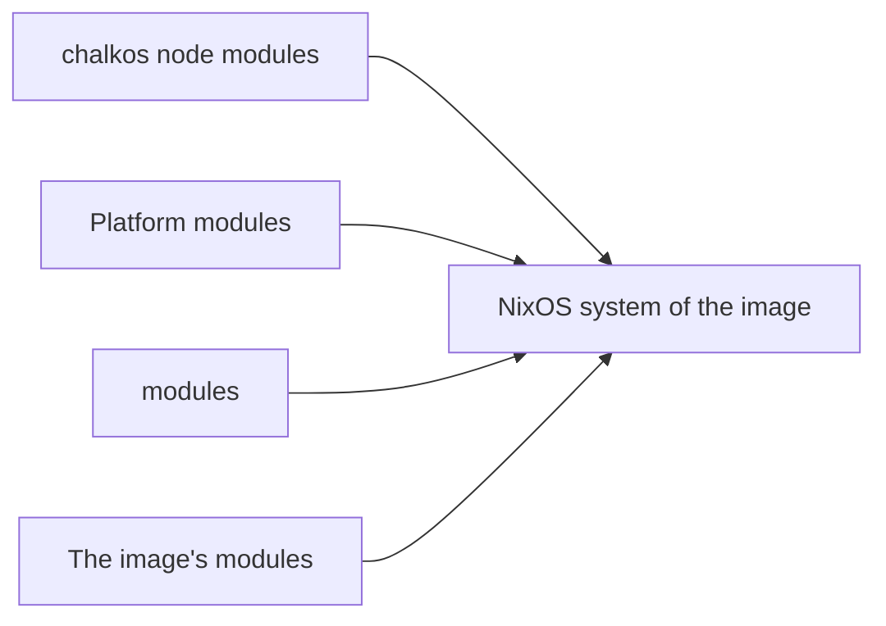

# mkImages

This page is for image authors who build images in a flake. `chalkos.lib.mkImages` builds a
cluster's images from a list of named images, and the installer. `chalkos.lib.mkImage` builds
one image and `chalkos.lib.mkInstaller` the installer. The options the images' NixOS modules set
are on [Image options](image-options.md) and [Extension API](extension-api.md).

A flake calls mkImages and exposes the images to build:

```nix title="flake.nix"
{
  inputs.chalkos.url = "github:trevex/chalkos";

  outputs =
    { chalkos, ... }:
    let
      images = chalkos.lib.mkImages {
        osCA = ./secrets.pub.json;
        # Every image carries these.
        modules = [ ./site.nix ];
        images = [
          {
            name = "node-metal";
            platform = "metal";
            modules = [ chalkos.nixosModules.kubernetes ];
          }
          {
            name = "node-kvm";
            platform = "kvm";
            modules = [ chalkos.nixosModules.kubernetes ];
          }
          {
            name = "storage-metal";
            platform = "metal";
            modules = [ ./storage.nix ];
          }
        ];
        installer.modules = [ ./installer-network.nix ];
      };
    in
    {
      packages.x86_64-linux = images;
      nixosConfigurations = chalkos.lib.nixosOf images;
      # nix flake check runs the images' tests.
      checks.x86_64-linux = chalkos.lib.testsOf images;
    };
}
```

## Layers { #layers }

A layer is a predefined set of NixOS modules that chalkos ships, which enables chalkos's
Kubernetes or router modules. An image lists it in its `modules` like any other module, and
lists one layer at most. An image without a layer runs chalkos's base alone.

- `chalkos.nixosModules.kubernetes`: the Kubernetes layer, which runs containerd and the kubelet.
  One image serves control planes and workers: each node's Kubernetes Node document makes it one
  or the other.
- `chalkos.nixosModules.router`: the router layer, which forwards packets between the node's
  interfaces and accepts the kinds of `router.chalkos.dev`.

## Module order { #module-order }

An image is one NixOS system, evaluated from four lists of modules:



1. chalkos's node modules.
2. chalkos's modules of the platform, for `metal` and `kvm`.
3. `modules`, which every image of the mkImages call carries.
4. The image's own `modules`, with its layer.

NixOS merges a value by priority, not by module order. A list such as `boot.kernelParams` holds
every module's entries, the image's own before those of `modules`. `lib.mkBefore` puts an entry
first and `lib.mkAfter` puts one last.

The installer is a system of its own, built from chalkos's node modules, its installer modules and
`installer.modules`, without [`modules`](#modules). It belongs to no platform: one installer
writes images of every platform.

## mkImage and mkInstaller { #mkimage }

mkImages builds each entry of `images` with `chalkos.lib.mkImage` and the installer with
`chalkos.lib.mkInstaller`. A flake can call them itself, with the same shared arguments:

```nix
let
  shared = {
    osCA = ./secrets.pub.json;
    revision = self.rev or self.dirtyRev or null;
  };
in
{
  packages.x86_64-linux = {
    node-metal = chalkos.lib.mkImage (
      shared
      // {
        name = "node-metal";
        platform = "metal";
        modules = [ chalkos.nixosModules.kubernetes ];
      }
    );
    installer = chalkos.lib.mkInstaller (shared // { modules = [ ./installer-network.nix ]; });
  };
}
```

mkImage takes `modules` as the image's own, after its platform's. It returns the same image as
mkImages would.

## Return values { #return-values }

mkImage returns the image directory, built only when asked for, with these attributes:

- `name` and `platform`: the image's name and platform, as given.
- `layer`: the layer the image carries, `"kubernetes"` or `"router"`, or null.
- `oci`: the image directory as an OCI image layout, as
  [`chalkbuild oci`](cli/chalkbuild_oci.md) writes it, built only when asked for;
  [Publish images to a registry](../build/publish-images.md) signs and pushes it.
- `nixos`: the evaluated NixOS system, to read the image's options, such as
  `images.node-metal.nixos.config.chalkos.kubernetes.package.version`.
- `tests`: the image's tests, its `chalkos.tests`, as a derivation that builds when every test
  passes and fails with what each failed test got otherwise. The image build itself runs them
  only with `chalkos.testsOnBuild`.

mkInstaller returns the installer, a raw image and a hybrid ISO in one directory, which installs
images of every platform, with its evaluated NixOS system as `nixos`.

mkImages returns each image of its `images` by its name, and the installer as `installer`.

## Helpers { #helpers }

Each helper takes an attribute set of images, such as mkImages's result, and leaves out what
mkImage did not build, such as the installer:

- `selectImages { platform; layer; } images`: the images that match every field given, such as
  `selectImages { layer = "kubernetes"; } images`. Either field may be left out; any other is
  refused.
- `ociOf images`, `nixosOf images` and `testsOf images`: each image's `oci`, `nixos` and
  `tests`. A flake exports `nixosOf` as `nixosConfigurations`, so that
  `nix build .#nixosConfigurations.node-metal.config.system.build.chalkosSchemas` builds one part
  of an image, its schemas here, without the rest. It exports `testsOf` as its checks, so that
  `nix flake check` runs the images' tests.

mkImage takes the arguments below except `images` and `installer`, and one image's `name`,
`platform` and `modules` in place of `modules`. mkInstaller takes them except `images` and
`installer`, with the installer's modules as `modules`.
